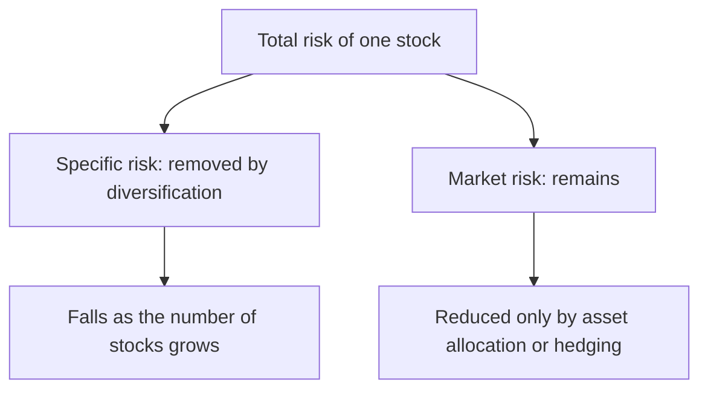
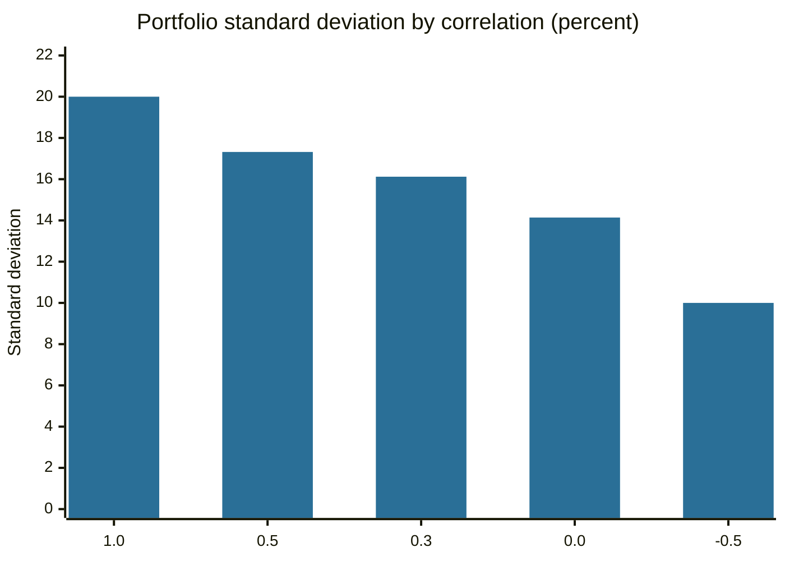

# Diversification

## Summary

Diversification means spreading money over assets whose returns do not move together, so that a bad outcome in one is offset by others. It reduces the specific risk of single companies, sectors and countries without lowering the expected return, which is why it is called the one free lunch in investing. It cannot remove market risk. The word is also used in corporate strategy, where it means a company expanding into new products or markets, and that is a different idea.

*This note is educational. It is not investment advice.*

## Prerequisites

- [Risk and return](risk-and-return.md).

## Core concepts

### Definition

*Diversification* in portfolio theory is the reduction of portfolio risk by holding assets with imperfectly correlated returns. The *correlation* between two assets ranges from +1 (move together perfectly) to -1 (move in opposite directions). Markowitz (1952) showed that the risk of a portfolio depends not only on the risk of each asset, but on how they move together.

### Analogy

A diversified portfolio is a team of rowers whose strokes are not perfectly in time: when one is slow another is fast, and the boat moves more smoothly than any rower alone. If all rowers are exactly in time (correlation +1), the boat swings as much as one rower does. The analogy fails in a storm, when correlations rise and everybody slows at once, which is what happens in crises.

### Mechanism

For two assets with weights w1 and w2, standard deviations s1 and s2 and correlation r, the portfolio's standard deviation is:

```text
sd = sqrt( (w1*s1)^2 + (w2*s2)^2 + 2*w1*w2*r*s1*s2 )
```

The expected return is the weighted average of the two, so risk falls while return does not, whenever r is below +1.



Specific risk falls quickly with the first dozens of holdings in different industries, and what remains is market risk, rewarded with the risk premium (Sharpe, 1964).

Forms of diversification: across **asset classes** (stocks, bonds, real estate, commodities), within a class across **sectors, sizes and styles**, across **countries and currencies**, and across **time** (investing regularly, see [dollar-cost averaging](dollar-cost-averaging.md)). A broad index fund provides most of it at low cost.

### Not the same as naive splitting

Benartzi and Thaler (2001) found that many savers divide their money equally among the funds a plan offers, whatever those funds hold. Five funds that all hold large US stocks are not diversified. Diversification is about how returns correlate, not about the number of line items.

### Corporate diversification

In strategy, *diversification* means a company enlarging its scope. Ansoff's classification distinguishes concentric diversification (new products close to the current technology), horizontal diversification (new products for current customers), conglomerate diversification (unrelated products for new customers) and vertical integration (activities earlier or later in the supply chain). Wrigley separated related from unrelated diversification by whether the company has the relevant skills. For a shareholder, such strategies are not needed to reduce risk, since the shareholder can diversify by holding several companies.

## Worked example

Two assets each have an expected return of 8% and a standard deviation of 20%. A portfolio holds 50% in each.

```python
# Python 3.12. Standard deviation of a 50/50 two-asset portfolio for different correlations.
import math
def port_sd(s1, s2, rho, w=0.5):
    return math.sqrt((w * s1) ** 2 + ((1 - w) * s2) ** 2 + 2 * w * (1 - w) * rho * s1 * s2)
for rho in (1.0, 0.5, 0.3, 0.0, -0.5):
    print(rho, round(port_sd(20, 20, rho), 2))
```

Output:

```text
1.0 20.0
0.5 17.32
0.3 16.12
0.0 14.14
-0.5 10.0
```

The expected return of the portfolio is 8% in every case, and the risk falls from 20% (no benefit at correlation +1) to 14.14% (uncorrelated) and 10% (correlation -0.5). Even a high correlation of 0.5 lowers risk by more than 2.6 percentage points.



## Trade offs and when to use it

Diversification reduces the chance of a large loss from a single failure and makes returns steadier. It limits the upside of a lucky concentrated bet, adds trading and monitoring costs, and fails when all assets fall together. "Diworsification", spreading into so many holdings that costs rise and nothing is understood, is a risk for active investors. For most people, a global index fund combined with bonds is a sufficient form of it.

## Common mistakes

- **Counting holdings instead of correlations.** Ten technology stocks are one bet.
- **Home bias and employer stock.** Holding your employer's shares adds risk to the income you already depend on.
- **Believing diversification protects against every loss.** It does not remove market risk.
- **Assuming correlations are stable.** They rise in crises.

## Practice

1. Which risk can diversification reduce, and which not?
2. Two assets have equal risk of 15%. What happens to the risk of a 50/50 portfolio at correlation +1?
3. Why is Ansoff's diversification not a way for shareholders to reduce risk?

### Answers

1. It reduces specific risk and does not remove market risk.
2. It stays at 15%.
3. Shareholders can diversify more cheaply by holding shares in several companies.

## Further reading

- Markowitz, H. (1952). Portfolio selection. *The Journal of Finance*, 7(1), 77-91. [DOI](https://doi.org/10.1111/j.1540-6261.1952.tb01525.x). The paper that introduced mean-variance portfolio theory and the case for diversification.
- Sharpe, W. F. (1964). Capital asset prices: a theory of market equilibrium under conditions of risk. *The Journal of Finance*, 19(3), 425-442. [DOI](https://doi.org/10.1111/j.1540-6261.1964.tb02865.x). The original statement of the capital asset pricing model and of systematic risk.
- Benartzi, S. and Thaler, R. H. (2001). Naive diversification strategies in defined contribution saving plans. *American Economic Review*, 91(1), 79-98. [DOI](https://doi.org/10.1257/aer.91.1.79). Shows that many savers split money evenly across the funds offered, whatever those funds hold.
- Bodie, Z., Kane, A. and Marcus, A. J. (2021). *Investments (12th ed.)*. McGraw Hill. The standard university textbook on securities, portfolio theory and market efficiency.
