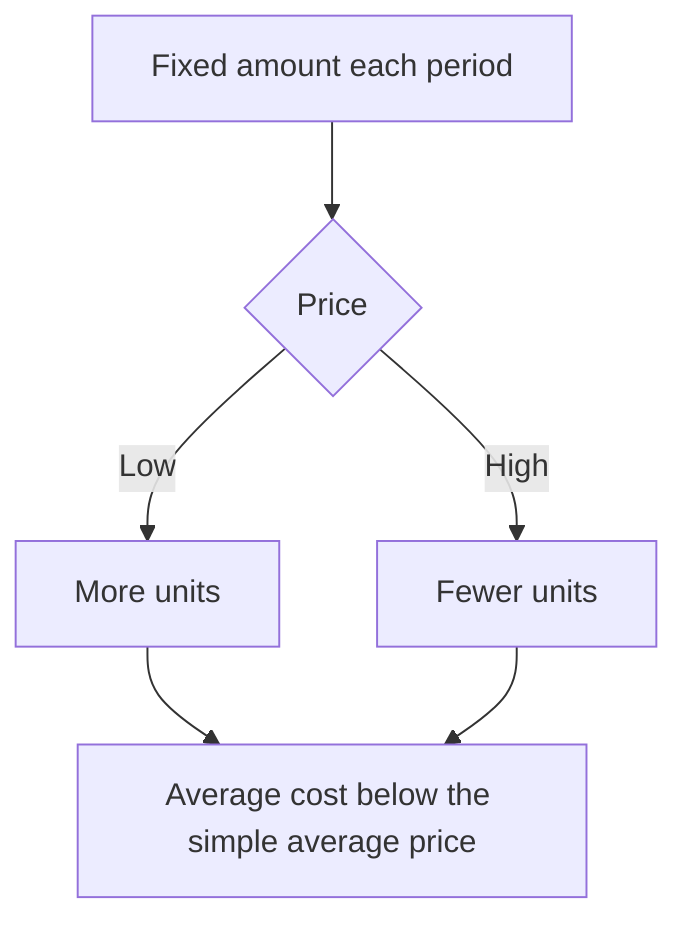
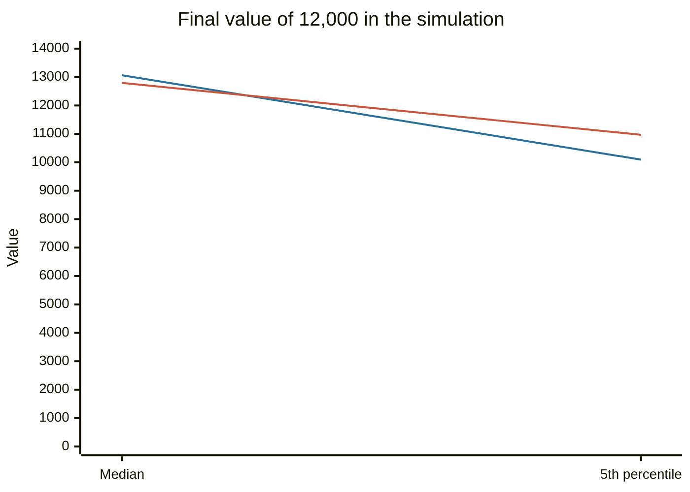

# Dollar-cost averaging

## Summary

Dollar-cost averaging (DCA) is investing a fixed amount of money at regular intervals regardless of price. A fixed amount buys more units when the price is low and fewer when it is high, so the average cost per unit is the harmonic mean of the prices, which is never above their simple average. DCA is a way to build a position from income and to reduce the regret of investing a lump sum just before a fall. For an investor who already has the money, investing it all at once tends to do better more often when markets are expected to rise.

*This note is educational. It is not investment advice.*

## Prerequisites

- [Risk and return](risk-and-return.md).

## Core concepts

### Definition

*Dollar-cost averaging* (the constant dollar plan) is a strategy of investing the same amount in a security at fixed intervals, for example 200 a month, whatever the price. The alternative is a *lump sum*: investing the whole amount at once.

### Analogy

DCA is buying groceries with a fixed weekly budget. When the price of apples is low you get more, when it is high you get fewer, and over months your average price per kilo is below the simple average of the weekly prices. The analogy has a limit: apples are bought to be eaten, while shares are bought to be sold, and the final price matters.

### Mechanism

With a constant amount A spent at prices p1, p2, ..., pn, the units bought are A/p1, A/p2, ..., A/pn. The average cost is the total spent divided by the total units, which equals the harmonic mean of the prices:

```text
average cost = n / (1/p1 + 1/p2 + ... + 1/pn)
```

The harmonic mean is never above the arithmetic mean, so the average cost is never above the simple average price. It does not make a profit by itself. If the final price is below the average cost, the investor still loses.



### DCA versus lump sum

When an investor has a sum available, DCA means part of the money waits in cash. If expected returns on stocks exceed cash, the waiting part loses the difference on average, so the lump sum tends to come out ahead more often. DCA lowers the risk of a bad entry point and the regret that comes with it. Constantinides (1979) analyzed DCA as an investment policy and showed it is generally suboptimal for an investor who maximizes expected utility, so the practical case for it rests on behavior and cash flow, not on higher expected returns. For savers who invest from monthly pay, DCA is not a choice but the only way to invest, and it also builds the habit.

## Worked example

200 is invested each month for six months at the prices below.

| Month | Amount | Price | Units |
| --- | --- | --- | --- |
| Jan | 200 | 100 | 2.000 |
| Feb | 200 | 80 | 2.500 |
| Mar | 200 | 120 | 1.667 |
| Apr | 200 | 110 | 1.818 |
| May | 200 | 90 | 2.222 |
| Jun | 200 | 95 | 2.105 |

Total invested 1,200, total units 12.312, average cost 1,200 / 12.312 = 97.46. The simple average of the six prices is 99.17, and the harmonic mean is 97.46, equal to the average cost, as the theory says. If the price at the end is 100, the position is worth 1,231 and the gain is 31.

A simulation compares a lump sum of 12,000 invested at once with 1,000 a month for 12 months, with the rest in cash. The assumptions are monthly stock returns that are normal with a mean of 0.8% and a standard deviation of 4.5%, and cash earns 0.3% a month. They are illustrative.

```python
# Python 3.12. Lump sum versus 12-month dollar-cost averaging, simulated.
import random, statistics as st
random.seed(42)
mu, sigma, cash_m = 0.008, 0.045, 0.003      # assumed monthly stock mean and sd, and monthly cash return
def run():
    stock = [random.gauss(mu, sigma) for _ in range(12)]
    lump = 12_000.0
    for r in stock: lump *= 1 + r
    dca, cash = 0.0, 12_000.0
    for r in stock:
        buy = 1_000.0
        cash -= buy
        dca += buy
        dca *= 1 + r
        cash *= 1 + cash_m
    return lump, dca + cash
res = [run() for _ in range(20_000)]
wins = sum(l > d for l, d in res) / len(res)
print(f"lump sum ahead in {wins:.1%} of runs")
print(f"median final: lump {st.median(l for l, _ in res):,.0f}, DCA {st.median(d for _, d in res):,.0f}")
print(f"5th percentile: lump {sorted(l for l, _ in res)[1000]:,.0f}, DCA {sorted(d for _, d in res)[1000]:,.0f}")
```

Output:

```text
lump sum ahead in 60.4% of runs
median final: lump 13,063, DCA 12,793
5th percentile: lump 10,094, DCA 10,968
```

The lump sum wins in about 60% of the runs and has a higher median, and the worst 5% of DCA outcomes are better than the worst 5% of lump sum outcomes. DCA trades a lower expected result for a smaller downside.



The first line is the lump sum and the second line is DCA.

## Trade offs and when to use it

Use DCA when investing from income, or when the fear of a bad entry would otherwise keep you out of the market for years. It automates the process and removes the need to time purchases. For a windfall, a lump sum is the better choice on average, and DCA over a short period (three to twelve months) is a way to lower regret. DCA does not protect against a long decline, and trading costs on many small purchases can matter if fees are fixed per trade.

## Common mistakes

- **Believing DCA guarantees a profit or a low price.** It only averages the entry.
- **Stopping during a fall.** The units bought at low prices are the benefit of the method.
- **Keeping the waiting cash in a zero-interest account.**
- **Using DCA for a speculative single asset** and calling it a strategy.

## Practice

1. Prices of 50, 25 and 50 with 100 invested each time. What is the average cost?
2. Why is the average cost of DCA never above the simple average price?
3. Why does a lump sum tend to beat DCA when stocks are expected to rise?

### Answers

1. Units are 2, 4 and 2, so 8 units for 300, which is 37.5. The simple average is 41.67.
2. It is the harmonic mean of the prices, which is never above the arithmetic mean.
3. Part of the money waits in cash under DCA and misses the expected stock return.

## Further reading

- Constantinides, G. M. (1979). A note on the suboptimality of dollar-cost averaging as an investment policy. *Journal of Financial and Quantitative Analysis*, 14(2), 443-450. [DOI](https://doi.org/10.2307/2330513). Shows that a fixed dollar-cost averaging rule is generally not optimal for an expected-utility investor.
- Bodie, Z., Kane, A. and Marcus, A. J. (2021). *Investments (12th ed.)*. McGraw Hill. The standard university textbook on securities, portfolio theory and market efficiency.
- Barber, B. M. and Odean, T. (2000). Trading is hazardous to your wealth: the common stock investment performance of individual investors. *The Journal of Finance*, 55(2), 773-806. [DOI](https://doi.org/10.1111/0022-1082.00226). Evidence that active trading by individuals reduces returns, which is one reason for automatic investing plans
- Thaler, R. H. and Benartzi, S. (2004). Save More Tomorrow: using behavioral economics to increase employee saving. *Journal of Political Economy*, 112(S1), S164-S187. [DOI](https://doi.org/10.1086/380085). The field evidence that committing future raises to saving raises saving rates a lot.
