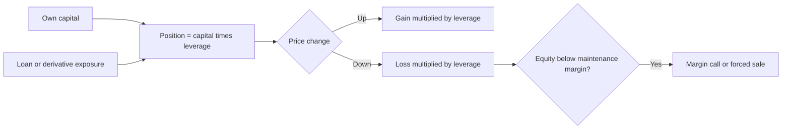
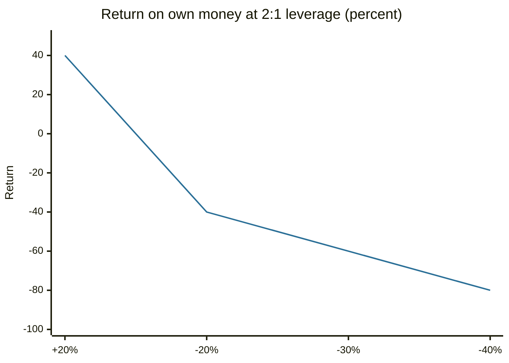

# Leverage and margin

## Summary

Leverage is using borrowed money or derivatives to control a position larger than your own capital. Margin is the deposit of your own money that a broker requires against such a position. Leverage multiplies gains and losses by the same factor, so a loss can exceed the capital, and a margin call forces the investor to add money or the broker to sell. It is the mechanism behind margin loans, short selling, futures, CFDs and retail forex.

*This note is educational. It is not investment advice. Leveraged trading can lose more than the money deposited.*

## Prerequisites

- [Debt](../credit-and-debt/debt.md).
- [Risk and return](risk-and-return.md).

## Core concepts

### Definition

- **Leverage ratio** = position size / own capital. A position of 20,000 on 10,000 of capital has leverage of 2:1.
- **Margin** is the collateral required. *Initial margin* is the share of the position that must be your own money when it is opened, and *maintenance margin* is the minimum equity that must be kept afterwards.
- **Margin call:** a demand to add funds or close positions when equity falls below the maintenance level.
- **Liquidation:** the broker's sale of the position, without asking, when the margin is not restored.

In the United States, Regulation T sets the initial margin on stock purchases at 50%, and FINRA rules set a minimum maintenance margin of 25% of the market value of the securities. Brokers can require more.

TODO: confirm the Regulation T and FINRA maintenance margin figures against the current rule text.

In the EU, rules for retail clients of CFD providers set maximum leverage by asset type and a close-out at 50% of the minimum margin (see [contracts for difference](../financial-instruments/contracts-for-difference.md)).

### Analogy

Leverage is a long lever. A small push at your end lifts a heavy weight, and the weight pushes back with the same ratio if it moves the wrong way. The analogy has a limit: a physical lever cannot snap and leave you owing more than you have, while a leveraged position can.

### Mechanism

Leverage L multiplies the return on the asset (r) into a return on equity of about L × r, minus the cost of borrowing on the borrowed part. Equity ratio = (value - loan) / value. When it falls below the maintenance level, the margin call occurs.

## Worked example

An investor buys shares worth 20,000 using 10,000 of own money and a margin loan of 10,000 (50% initial margin). Maintenance margin is 25%.

| Price change | Position value | Equity (value - 10,000 loan) | Equity ratio | Return on own money | Status |
| --- | --- | --- | --- | --- | --- |
| +20% | 24,000 | 14,000 | 58.3% | +40% | Fine |
| -20% | 16,000 | 6,000 | 37.5% | -40% | Fine |
| -30% | 14,000 | 4,000 | 28.6% | -60% | Close to the limit |
| -40% | 12,000 | 2,000 | 16.7% | -80% | Margin call |

The call occurs when equity / value falls to 25%: (V - 10,000) / V = 0.25, so V = 13,333, a fall of 33.3% in the price. At 2:1 leverage a 33.3% fall in the asset costs 66.7% of the own money and triggers the call. If the price keeps falling before the investor reacts, the broker sells, and a gap can leave a loss larger than the equity. Interest on the loan, at say 8%, adds a cost of 800 a year before any price move.

The line shows the return on own money for each price change of the asset.

## Trade offs and when to use it

Moderate leverage can raise expected return when the asset's return is above the cost of borrowing, and professional investors use it in controlled ways. For individuals, leverage adds the risk of forced selling at the worst moment, which turns a temporary fall into a permanent loss. A margin call makes the choice to wait out a decline impossible. If used at all, keep leverage low, hold spare cash for margin calls, size positions by the loss that the account can bear, and avoid leverage in volatile or illiquid assets.

## Common mistakes

- **Computing risk on the margin and not on the position.** The exposure is the full notional value.
- **Assuming the loss is capped at the deposit.** It can be larger, particularly with gaps.
- **Using all available leverage.** There is then no room for a bad week.
- **Ignoring the cost of borrowing.** Interest and financing charges run every day.

## Practice

1. A position of 50,000 is held with 10,000 of own capital. What is the leverage and what fall wipes out the capital?
2. At what price fall does a 2:1 stock position with a 25% maintenance margin get a margin call?
3. Why can a margin call turn a temporary loss into a permanent one?

### Answers

1. 5:1, and a fall of 20% (10,000 / 50,000).
2. A fall of 33.3%.
3. The position is sold at the low price, so the investor cannot wait for a recovery.

## Further reading

- U.S. Securities and Exchange Commission, Office of Investor Education and Advocacy. Margin (glossary). Investor.gov. [Link](https://www.investor.gov/introduction-investing/investing-basics/glossary/margin). Regulator definition of buying on margin and its risks.
- ESMA (2018). ESMA adopts final product intervention measures on CFDs and binary options. European Securities and Markets Authority. [Link](https://www.esma.europa.eu/press-news/esma-news/esma-adopts-final-product-intervention-measures-cfds-and-binary-options). States the leverage limits, margin close-out and negative balance protection for retail CFDs in the EU.
- Hull, J. C. (2021). *Options, Futures, and Other Derivatives (11th ed.)*. Pearson. The standard reference on how forwards, futures, options and swaps work and are priced.
