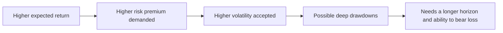
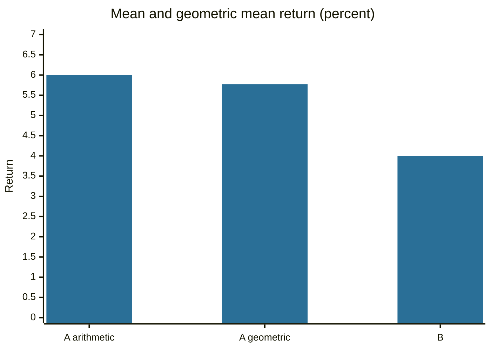

# Risk and return

## Summary

Return is what an investment gains or loses over a period, and risk is the uncertainty of that return. In financial theory risk is usually measured by the standard deviation of returns, which tells how far outcomes typically fall from the average. Higher expected return has to be paid for with higher risk, otherwise nobody would hold the safer asset. This note defines the measures that the rest of portfolio management uses: holding period return, arithmetic and geometric averages, standard deviation, drawdown and the Sharpe ratio.

*This note is educational. It is not investment advice.*

## Prerequisites

- [Types of investments](../financial-instruments/types-of-investments.md).
- [Time value of money](../corporate-finance/time-value-of-money.md).

## Core concepts

### Definition

- **Holding period return** = (ending value - starting value + income) / starting value.
- **Arithmetic mean return:** the simple average of period returns.
- **Geometric mean return** (compound annual growth rate): the constant rate that gives the same final value, (product of (1 + r))^(1/n) - 1.
- **Risk** in the textbook sense is the *standard deviation* of returns (volatility). Investors also care about **drawdown**, the fall from a peak to a later low, and about the chance of a permanent loss.
- **Risk-free rate:** the return on an asset with no default risk in the investor's currency, usually short-term government bills.
- **Risk premium:** the expected return above the risk-free rate that investors demand for taking risk.
- **Sharpe ratio** = (mean return - risk-free rate) / standard deviation. It is the excess return per unit of risk (Sharpe, 1964, laid the basis with the capital asset pricing model).

### Analogy

Risk and return are like speed and fuel use in a car. A faster trip uses more fuel, and nobody gets both a very high speed and very low fuel use. The Sharpe ratio is the distance per liter. The analogy fails because fuel use is known in advance, while risk is an estimate from history.

### Mechanism: why the geometric mean is lower

Arithmetic and geometric averages differ when returns vary. A rise of 50% followed by a fall of 50% gives an arithmetic average of 0% and a real result of 1.5 × 0.5 - 1 = -25%. Volatility drags down compound growth, approximately by half the variance. This is why the geometric mean is the right measure of what an investor earned, and the arithmetic mean is the right input for forecasting a single future period.



Risk has parts. *Systematic* (market) risk affects all assets and is rewarded with a premium. *Specific* risk affects one company and can be removed by diversification (see [diversification](diversification.md)), so it is not rewarded. Other risks are inflation, interest rate, credit, liquidity and currency risk, each described in the notes on instruments.

The long-run US data show the trade-off. In Damodaran's 1928 to 2024 dataset, 3-month bills averaged 3.36% a year with a standard deviation of 3.1%, 10-year bonds 4.50% with 7.9%, and the S&P 500 9.94% with 19.5% (see [types of investments](../financial-instruments/types-of-investments.md)). The extra return for stocks over bills, roughly 6.6 percentage points, is called the equity premium. Mehra and Prescott (1985) noted that this premium is larger than standard theory explains.

## Worked example

Two assets produced these returns over five years, and the risk-free rate is 2%.

| Year | A | B |
| --- | --- | --- |
| 1 | 10% | 4% |
| 2 | -5% | 4% |
| 3 | 15% | 4% |
| 4 | 8% | 4% |
| 5 | 2% | 4% |

```python
# Python 3.12. Mean, geometric mean, standard deviation and Sharpe ratio.
import statistics as st
a = [10, -5, 15, 8, 2]
b = [4, 4, 4, 4, 4]
def geo(r):
    g = 1
    for x in r: g *= 1 + x / 100
    return (g ** (1 / len(r)) - 1) * 100
for name, r in (("A", a), ("B", b)):
    sd = st.stdev(r)
    sharpe = (st.mean(r) - 2) / sd if sd else None
    print(name, round(st.mean(r), 2), round(geo(r), 2), round(sd, 2), sharpe and round(sharpe, 2))
```

Output:

```text
A 6 5.77 7.71 0.52
B 4 4.0 0.0 None
```

Asset A has a higher average (6% against 4%) and a higher risk (7.71%). The geometric mean of A is 5.77%, below its arithmetic mean, because of volatility. A's Sharpe ratio is 0.52. B has no variation in this sample, so the ratio is undefined, which is a warning that five data points say little about real risk.



## Trade offs and when to use it

Standard deviation is easy to compute and compare, and it treats gains and losses alike, while investors fear losses more. Drawdown and downside measures capture that. Past volatility is an estimate that changes, and it understates risk in calm periods and before crises. Use risk measures to compare options, to size positions and to check that a portfolio matches the investor's ability to bear a loss (see [asset allocation](asset-allocation.md)).

## Common mistakes

- **Comparing returns without risk.** A higher return can be a higher risk.
- **Using the arithmetic mean for long-run growth.** Use the geometric mean.
- **Treating the standard deviation as the maximum loss.** Outcomes can be worse than one or two standard deviations.
- **Reading a short, smooth history as low risk.**

## Practice

1. A portfolio loses 20% and then gains 25%. What is the total return and the average?
2. An asset returns 8% with a standard deviation of 12% and the risk-free rate is 2%. What is the Sharpe ratio?
3. Why can diversification reduce risk without lowering expected return?

### Answers

1. 1.25 × 0.8 - 1 = 0%. The arithmetic average is +2.5%.
2. (8 - 2) / 12 = 0.5.
3. Specific risk of individual assets partly cancels in a portfolio, while expected return is the weighted average.

## Further reading

- Sharpe, W. F. (1964). Capital asset prices: a theory of market equilibrium under conditions of risk. *The Journal of Finance*, 19(3), 425-442. [DOI](https://doi.org/10.1111/j.1540-6261.1964.tb02865.x). The original statement of the capital asset pricing model and of systematic risk.
- Markowitz, H. (1952). Portfolio selection. *The Journal of Finance*, 7(1), 77-91. [DOI](https://doi.org/10.1111/j.1540-6261.1952.tb01525.x). The paper that introduced mean-variance portfolio theory and the case for diversification.
- Mehra, R. and Prescott, E. C. (1985). The equity premium: a puzzle. *Journal of Monetary Economics*, 15(2), 145-161. [DOI](https://doi.org/10.1016/0304-3932(85)90061-3). Shows how large the historical stock premium over bills has been relative to standard theory.
- Damodaran, A. Damodaran Online. NYU Stern. [Link](https://pages.stern.nyu.edu/~adamodar/). Free datasets on historical returns, multiples and valuation by industry.
- Bodie, Z., Kane, A. and Marcus, A. J. (2021). *Investments (12th ed.)*. McGraw Hill. The standard university textbook on securities, portfolio theory and market efficiency.
