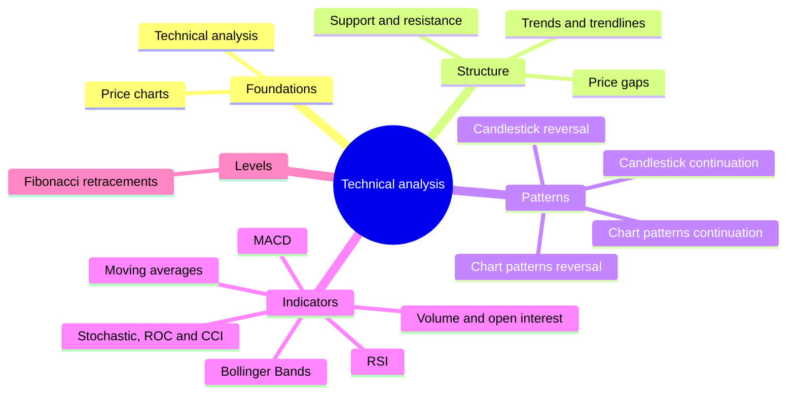

# Technical analysis

How traders read price charts: chart types, trends, support and resistance, chart and candlestick patterns, gaps, volume and the main indicators. This subfield belongs to [Finance and investing](../README.md). It describes the methods and their definitions. Whether they produce profits after costs is a separate and disputed question, and the notes give the evidence for and against. The method that studies the business behind the price is in [fundamental analysis](../fundamental-analysis/README.md).

## Map of the subfield

The map shows how the notes are organized from the chart to the signals.

## Notes in reading order

**Foundations**

1. [Technical analysis](technical-analysis.md): premises, comparison with fundamental analysis and the evidence.
2. [Price charts](price-charts.md): line, bar and candlestick charts, timeframes and scales.

**Structure of price**

3. [Trends and trendlines](trends-and-trendlines.md): up, down and sideways trends, trendlines and channels.
4. [Support and resistance](support-and-resistance.md): levels, breakouts and role reversal.
5. [Fibonacci retracements](fibonacci-retracements.md): the standard retracement levels and their limits.
6. [Price gaps](price-gaps.md): gap types, island reversal and the key reversal day.

**Patterns**

7. [Reversal chart patterns](chart-patterns-reversal.md): head and shoulders, double tops and bottoms and others.
8. [Continuation chart patterns](chart-patterns-continuation.md): triangles, rectangles, flags and wedges.
9. [Candlestick reversal patterns](candlestick-patterns-reversal.md): hammers, engulfing patterns, stars and others.
10. [Candlestick continuation patterns](candlestick-patterns-continuation.md): three methods, tasuki gaps and neck lines.

**Indicators**

11. [Moving averages](moving-averages.md): SMA and EMA, crossovers and lag.
12. [MACD](macd.md): construction and signals.
13. [Relative strength index](relative-strength-index.md): the RSI and its use.
14. [Stochastic oscillator and momentum indicators](stochastic-oscillator-and-momentum.md): stochastic, ROC and CCI.
15. [Bollinger Bands](bollinger-bands.md): volatility bands and the squeeze.
16. [Volume and open interest](volume-and-open-interest.md): volume confirmation and on-balance volume.

## Planned topics

- Dow theory in detail
- Elliott wave theory
- Ichimoku cloud
- Point and figure charts
- Backtesting and the statistics of trading rules
- Market breadth and sentiment indicators

## How to use this subfield

Read notes 1 to 4 first. Then read the pattern and indicator notes that you use. Before relying on any rule, read the evidence section of note 1 and the data snooping example in it, and read [market efficiency](../financial-markets/market-efficiency.md).

These notes are educational. They are not investment advice.

## Navigation

- Back to [Finance and investing](../README.md).
