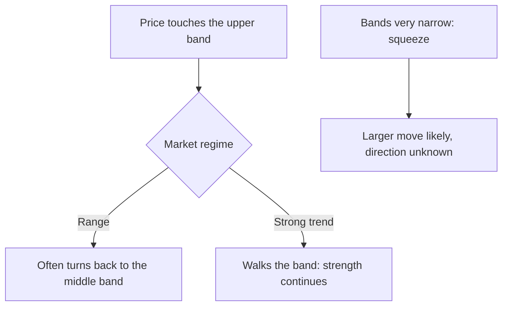
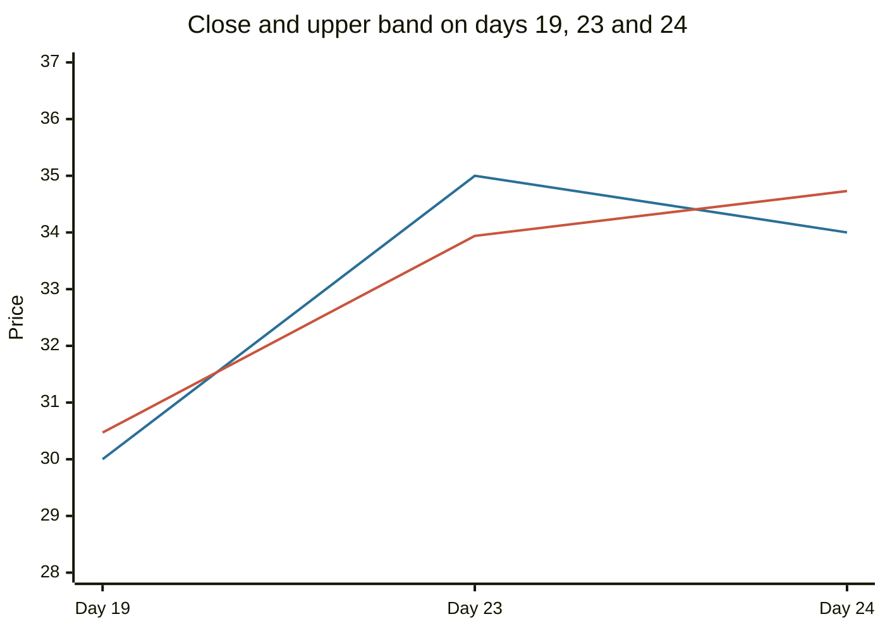

# Bollinger Bands

## Summary

Bollinger Bands are a volatility envelope drawn around a moving average. The standard setting is a 20-period simple moving average with bands two standard deviations above and below it. The bands widen when volatility rises and narrow when it falls. Price touching or leaving a band is not by itself a signal to trade against the move: in a strong trend price can follow the band for a long time. John Bollinger describes the bands as a way to judge whether price is high or low relative to its recent range, to be combined with other tools.

*This note is educational. It is not investment advice.*

## Prerequisites

- [Moving averages](moving-averages.md).

## Core concepts

### Definition

```text
Middle band = SMA of the close over n periods (n = 20 by default)
Upper band  = middle band + k × standard deviation of the close over n periods (k = 2)
Lower band  = middle band - k × standard deviation
%b          = (close - lower band) / (upper band - lower band)
Bandwidth   = (upper band - lower band) / middle band
```

The standard deviation is computed over the same window as the average (the population form is the usual choice). If returns were normal, about 95% of closes would lie within two standard deviations, but price changes are not normal, so the share inside the bands differs. The bands do not predict direction, they show how far price is from its recent average in units of its own volatility.

### Analogy

The bands are a stretchy corridor that adapts to the weather: calm weather, narrow corridor, storm, wide corridor. A walker who often hits the walls of the corridor is moving a lot. If the corridor itself is moving upward, the walker will keep touching the upper wall, and that is how an uptrend behaves.

### Reading the bands

1. **Relative position (%b).** Above 1 means the close is above the upper band, below 0 below the lower band, and 0.5 the middle.
2. **Mean reversion in ranges.** In a sideways market price tends to turn back from the bands toward the middle. Buying near the lower band and selling near the upper one works only if no trend develops.
3. **Walking the band.** In a strong trend price can ride the upper band (or lower band) for many periods. A close outside the band is then a sign of strength, not of reversal.
4. **The squeeze.** A period of very narrow bands (low bandwidth) is usually followed by a larger move, because volatility moves in cycles. The squeeze gives no direction, and the direction is taken from the breakout.
5. **Confirmation.** Bollinger suggests using other indicators, such as the RSI or volume, to confirm signals.



Some popular summaries state that a close outside the bands is a signal of a short-term reversal in all markets. This is correct for sideways markets only. In long rises or falls, price often stays outside the bands.

## Worked example

Twenty-five closes in a rising series, with the last three days accelerating.

```python
# Python 3.12. Bollinger Bands (20 periods, 2 standard deviations) and %b.
import statistics as st
closes = [20, 21, 20, 22, 21, 23, 22, 24, 23, 25, 24, 26, 25, 27, 26, 28, 27, 29, 28, 30,
          29, 31, 33, 35, 34]
n, width = 20, 2
for i in (n - 1, len(closes) - 2, len(closes) - 1):
    window = closes[i - n + 1:i + 1]
    mid, sd = st.mean(window), st.pstdev(window)
    upper, lower = mid + width * sd, mid - width * sd
    pct_b = (closes[i] - lower) / (upper - lower)
    print(f"day {i}: close {closes[i]}, lower {lower:.2f}, middle {mid:.2f}, upper {upper:.2f}, %b {pct_b:.2f}")
```

Output:

```text
day 19: close 30, lower 18.63, middle 24.55, upper 30.47, %b 0.96
day 23: close 35, lower 19.66, middle 26.80, upper 33.94, %b 1.07
day 24: close 34, lower 20.17, middle 27.45, upper 34.73, %b 0.95
```

On day 19, the close of 30 is just under the upper band (%b 0.96). On day 23 the close of 35 is above the upper band (%b 1.07), a "sell" signal in the simplified reading. The next day the price is 34, back inside the band (%b 0.95), and the price is still far above where it was 20 days before. A trader who sold at 35 on the signal would have sold a market that was in a steady advance. The example shows the main point: the band tells you that price is extended, not that it must turn.



The first line is the close and the second is the upper band.

## Trade offs and when to use it

Bollinger Bands adapt to volatility automatically, which makes stop distances and targets scale with market conditions, and they work in both ranges and trends if the regime is identified first. Weaknesses: the signal depends on the regime, the two-standard-deviation rule has no universal meaning because returns are not normal, and the bands lag as moving averages do. They are a context tool and not a standalone system.

## Common mistakes

- **Selling every touch of the upper band.** In trends, it fails.
- **Using the squeeze to guess direction.**
- **Applying the default settings to every timeframe** without checking.
- **Treating the bands as support and resistance.** They move with price.

## Practice

1. The middle band is 50, the standard deviation 3 and k = 2. What are the bands?
2. What does %b of 1.1 mean?
3. What does a squeeze signal?

### Answers

1. Upper 56 and lower 44.
2. The close is above the upper band.
3. Low volatility, which is usually followed by a larger move in an unknown direction.

## Further reading

- Bollinger, J. (2001). *Bollinger on Bollinger Bands*. McGraw Hill. The inventor of the bands explains their construction and use.
- Murphy, J. J. (1999). *Technical Analysis of the Financial Markets*. New York Institute of Finance. A broad practitioner textbook on charts, trends, patterns and indicators.
- Park, C.-H. and Irwin, S. H. (2007). What do we know about the profitability of technical analysis?. *Journal of Economic Surveys*, 21(4), 786-826. [DOI](https://doi.org/10.1111/j.1467-6419.2007.00519.x). A survey of 95 modern studies on whether technical trading rules earn profits.
