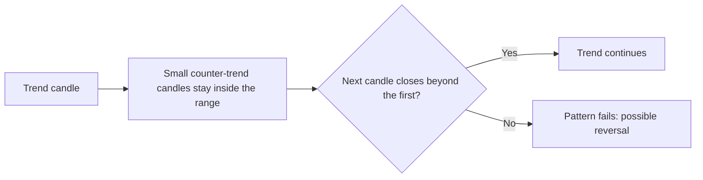
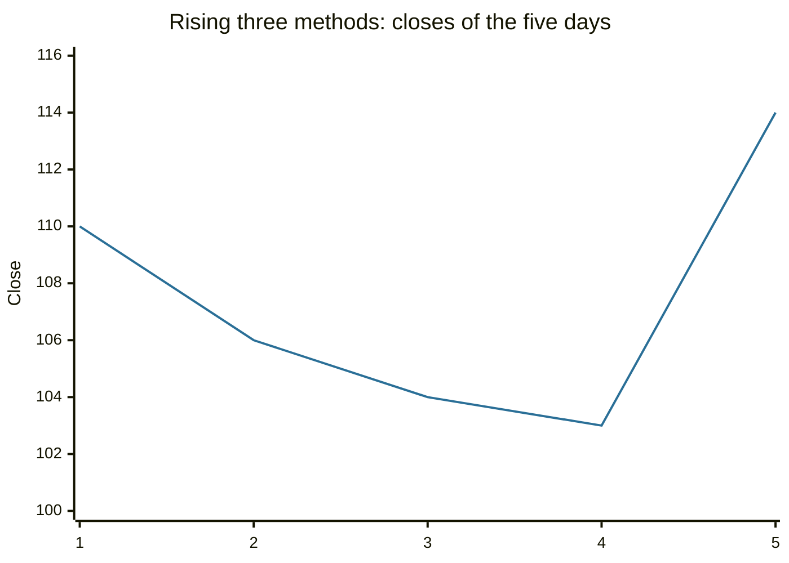

# Candlestick continuation patterns

## Summary

Candlestick continuation patterns are short sequences of candles that suggest a trend will go on after a pause. They include rising and falling three methods, the upside and downside tasuki gaps, side-by-side white lines, gap three methods, separating lines, the on-neck, in-neck and thrusting lines, and the mat hold. They are less well known than reversal patterns and share the same limits: they depend on the prior trend, on definitions that differ between authors, and on confirmation by price.

*This note is educational. It is not investment advice.*

## Prerequisites

- [Candlestick reversal patterns](candlestick-patterns-reversal.md).
- [Trends and trendlines](trends-and-trendlines.md).

## Core concepts

### Definition

A *candlestick continuation pattern* is a formation in which a pause or a small counter-move occurs inside a trend and does not break the structure of the trend. The Japanese tradition treats gaps (*windows*) as support or resistance and reads a failure to close a gap as a sign that the trend is intact.

### Analogy

A continuation pattern is a runner who walks for a few steps and sprints again. The walk is the group of small candles, and the sprint is the next long candle in the original direction. If the walk turns into a long stop, the pattern is dead.

### The patterns

| Pattern | Shape | Trend | Reading |
| --- | --- | --- | --- |
| Rising three methods | A long white candle, three small candles that stay within its range and fall slightly, then a long white candle that closes above the first | Up | Bullish continuation |
| Falling three methods | The mirror image, with small rising candles inside a long dark candle | Down | Bearish continuation |
| Upside tasuki gap | A gap up between two white candles, then a dark candle that opens inside the second white body and closes inside the gap without filling it | Up | Bullish: the gap holds |
| Downside tasuki gap | The mirror image | Down | Bearish: the gap holds |
| Side-by-side white lines | After a gap up, two white candles of similar size that open at about the same level | Up | Bullish |
| Upside and downside gap three methods | Two candles of the trend's color separated by a gap, then a candle of the opposite color that closes in the gap but does not fill it | Up or down | The gap holds, and the trend continues |
| Separating lines | Two opposite-color candles that open at the same price, with the second in the trend direction | Up or down | Continuation after a counter-move |
| On-neck line | After a long dark candle in a downtrend, a white candle that closes at the low of the dark candle | Down | Bearish: weak bounce |
| In-neck line | A white candle that closes slightly into the dark body | Down | Bearish |
| Thrusting line | A white candle that closes well into the dark body but below its midpoint | Down | Bearish: if it closed above the midpoint, it would be a piercing line |
| Mat hold | A long white candle, a gap up, three small candles that hold above the first body, and a white candle that makes a new high | Up | Bullish |

A bullish version of each pattern reads as a pause in an uptrend and a bearish version as a pause in a downtrend. Pattern names follow Nison (2001).

## Worked example

Rising three methods in an uptrend, with (open, high, low, close) for five days.

| Day | Open | High | Low | Close | Role |
| --- | --- | --- | --- | --- | --- |
| 1 | 100 | 111 | 99 | 110 | Long white candle |
| 2 | 109 | 110 | 105 | 106 | Small dark candle inside day 1's range |
| 3 | 107 | 108 | 103 | 104 | Small dark candle |
| 4 | 105 | 107 | 102 | 103 | Small dark candle, low 102 is above day 1's low of 99 |
| 5 | 104 | 115 | 103 | 114 | Long white candle, closes above day 1's close of 110 |

The three small candles stay between 99 and 111, so they do not damage the uptrend. The fifth candle closes at 114, above 110, which confirms the pattern. A trader who enters at 114 may place the stop below the low of the small candles, at 101, a risk of 13, and aims at least at a rise equal to the first candle, 10. The ratio is below 1, which shows that a pattern can be recognizable and still not give a good trade.

## Trade offs and when to use it

Continuation candles help distinguish a pause from a reversal, and they give a stop level beyond the pause. The cost is that they are rare, subjective and open to more than one reading. They need a trend to continue, so in sideways markets they have no use. Use them together with trend, volume and levels.

## Common mistakes

- **Mistaking a deep correction for a three methods pattern.** The small candles must stay inside the first candle's range.
- **Ignoring the confirming candle.**
- **Using them in a range.**
- **Memorizing patterns without testing them.**

## Practice

1. What is the difference between a thrusting line and a piercing line?
2. What does a tasuki gap tell you if the gap is filled?
3. In rising three methods, what must the last candle do?

### Answers

1. A thrusting line closes below the midpoint of the previous dark body, a piercing line closes above it.
2. The gap did not hold, so the continuation is in doubt.
3. Close above the close of the first long white candle.

## Further reading

- Nison, S. (2001). *Japanese Candlestick Charting Techniques (2nd ed.)*. New York Institute of Finance. The reference that introduced Japanese candlestick patterns to Western traders.
- Murphy, J. J. (1999). *Technical Analysis of the Financial Markets*. New York Institute of Finance. A broad practitioner textbook on charts, trends, patterns and indicators.
- Marshall, B. R., Young, M. R. and Rose, L. C. (2006). Candlestick technical trading strategies: can they create value for investors?. *Journal of Banking & Finance*, 30(8), 2303-2323. [DOI](https://doi.org/10.1016/j.jbankfin.2005.08.001). A statistical test of candlestick patterns on Dow Jones Industrial Average stocks, which did not find profitable trading rules.
