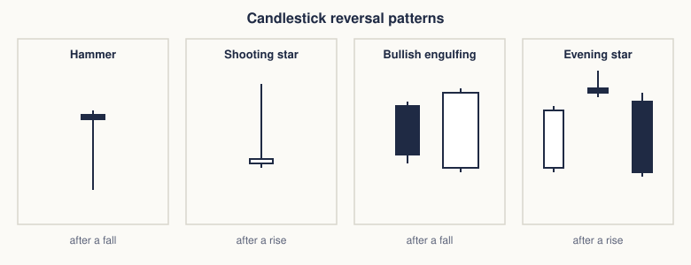
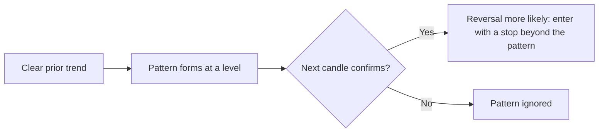

# Candlestick reversal patterns

## Summary

Candlestick reversal patterns are one to three candle formations that, according to the Japanese charting tradition, warn that a trend may turn. Examples are the hammer and hanging man, the shooting star, the doji, engulfing and harami patterns, the piercing line and dark cloud cover, and the morning and evening stars. Each depends on the trend before it, on the position of the candles within the range and on confirmation by the next candle. Statistical tests on US stocks have not found reliable trading profits from them, so they work best as a way to read the balance of buyers and sellers at a level.

*This note is educational. It is not investment advice.*

## Prerequisites

- [Price charts](price-charts.md) for the parts of a candle.
- [Trends and trendlines](trends-and-trendlines.md).
- [Support and resistance](support-and-resistance.md).

## Core concepts

### Definition

A *candlestick reversal pattern* is a short sequence of candles whose shape and position suggest a change of direction. The *body* shows who won the period (white, close above open, or dark, close below open), and the *shadows* show how far price was pushed before it came back. A reversal pattern needs a prior trend: a bullish pattern after a fall, a bearish one after a rise.

### Analogy

A candle is a tug of war between buyers and sellers for one period. The body shows where the rope ended, and the shadows show how far each side pulled it before losing ground. A reversal pattern is a sequence of rounds in which the side that was winning loses its grip.



The figure shows one pattern from each of the main families: a single candle with a long shadow, a two-candle engulfing and a three-candle star.

### Single-candle patterns

| Pattern | Shape | Where | Reading |
| --- | --- | --- | --- |
| Hammer | Small body at the top, lower shadow at least twice the body, almost no upper shadow | After a fall | Bullish. Sellers pushed price down and buyers took it back |
| Hanging man | Same shape as the hammer | After a rise | Bearish. Needs a dark candle next as confirmation |
| Inverted hammer | Small body at the bottom, long upper shadow | After a fall | Possibly bullish. Needs confirmation |
| Shooting star | Same shape as the inverted hammer | After a rise | Bearish. Buyers failed to hold the highs |
| Doji | Open and close almost equal | At the end of a trend | Indecision. A long-legged doji, a dragonfly doji (long lower shadow) and a gravestone doji (long upper shadow) differ in where the pressure came from |

### Two-candle patterns

| Pattern | Shape | Where | Reading |
| --- | --- | --- | --- |
| Bullish engulfing | A white body that covers the whole body of the previous dark candle | After a fall | Bullish |
| Bearish engulfing | A dark body that covers the previous white body | After a rise | Bearish |
| Harami and harami cross | A small body (or a doji) inside the large body of the previous candle | At the end of a trend | Loss of momentum. A possible reversal |
| Piercing line | A white candle that opens below the previous low and closes above the midpoint of the previous dark body | After a fall | Bullish |
| Dark cloud cover | A dark candle that opens above the previous high and closes below the midpoint of the previous white body | After a rise | Bearish |
| Tweezer top and bottom | Two candles with the same high (top) or low (bottom) | At the end of a trend | Level held twice |
| Meeting lines | Two opposite candles that close at the same price | After a trend | Possible turn |
| Homing pigeon, matching low | Two dark candles with the second inside the first, or with equal closes | After a fall | Bullish |

### Three-candle patterns

| Pattern | Shape | Where | Reading |
| --- | --- | --- | --- |
| Morning star | A long dark candle, a small body that gaps down, a white candle that closes well into the first body | After a fall | Bullish |
| Evening star | A long white candle, a small body that gaps up, a dark candle that closes well into the first body | After a rise | Bearish |
| Morning and evening doji star | The middle candle is a doji | As above | Stronger than the plain star |
| Abandoned baby | A doji with gaps on both sides, with no overlap of shadows | At the end of a trend | Strong, rare reversal |
| Three white soldiers | Three long white candles, each opening inside the previous body and closing higher | After a fall | Bullish |
| Three black crows | Three long dark candles, each closing lower | After a rise | Bearish |
| Three inside up and down | A harami confirmed by a third candle that closes beyond the first | At the end of a trend | Reversal confirmed |
| Three outside up and down | An engulfing pattern confirmed by a third candle | At the end of a trend | Reversal confirmed |
| Tri-star | Three dojis with the middle one gapped | At the end of a trend | Rare reversal |
| Unique three river bottom, ladder bottom, concealing baby swallow, stick sandwich, three stars in the south | Rare sequences of dark candles that stop falling | After a fall | Bullish |
| Two crows, advance block, deliberation | Rising white candles that lose momentum, or a dark candle after a gap up | After a rise | Bearish |

These names follow Nison (2001). Rules differ in details between authors, for example how deep the second candle must penetrate the first.

### How to read a pattern



Strength increases when the pattern forms at a support or resistance level, when volume is high and when several signals agree. A single candle with no trend, no level and no confirmation has little meaning.

### Evidence

Marshall, Young and Rose (2006) tested candlestick patterns on Dow Jones Industrial Average stocks and found no profitable trading rules. This does not prove that patterns carry no information in any market, and it does warn against treating them as a system.

## Worked example

A rule-based detector shows that the definitions can be coded, and what a precise definition requires.

```python
# Python 3.12. Rule-based detection of a hammer and a bullish engulfing pattern.
def hammer(o, h, l, c):
    body, rng = abs(c - o), h - l
    lower_wick = min(o, c) - l
    upper_wick = h - max(o, c)
    return rng > 0 and lower_wick >= 2 * body and upper_wick <= 0.1 * rng and body > 0

def bullish_engulfing(prev, cur):
    po, _, _, pc = prev
    co, _, _, cc = cur
    return pc < po and cc > co and co <= pc and cc >= po

candles = [(50, 51, 48, 49), (49, 49.2, 45, 48.8), (48.8, 52, 48.5, 51.5)]   # (open, high, low, close)
print("hammer on candle 2:", hammer(*candles[1]))
print("bullish engulfing on candles 1 and 3:", bullish_engulfing(candles[0], candles[2]))
print("hammer on candle 1:", hammer(*candles[0]))
```

Output:

```text
hammer on candle 2: True
bullish engulfing on candles 1 and 3: True
hammer on candle 1: False
```

Candle 2 has a body of 0.2, a lower shadow of 3.8 and almost no upper shadow, so it is a hammer. Candles 1 and 3 form an engulfing pattern, since the body of candle 3 (48.8 to 51.5) covers the body of candle 1 (49 to 50). Both patterns come after a fall in this series, which is what makes them bullish signals.


## Trade offs and when to use it

Candlesticks show the intraday battle in a compact form, and they help time entries near levels. The patterns are numerous, the definitions vary, and most patterns occur often with no follow-through. Use them to read the context, require confirmation and a level, and do not treat a single name as a signal.

## Common mistakes

- **Trading a pattern with no prior trend.**
- **Memorizing names without context.** Location matters more than the shape.
- **Ignoring the confirmation candle,** especially for the hanging man and the inverted hammer.
- **Counting rare patterns** as common ones. Many of them occur a few times a year.

## Practice

1. What is the difference between a hammer and a hanging man?
2. What defines an evening star?
3. Why does a doji suggest indecision?

### Answers

1. The shape is the same. A hammer follows a fall and is bullish, a hanging man follows a rise and is bearish.
2. A long white candle, a small body gapping up, and a dark candle closing well into the first body, after a rise.
3. The open and close are almost equal, so neither buyers nor sellers won the period.

## Further reading

- Nison, S. (2001). *Japanese Candlestick Charting Techniques (2nd ed.)*. New York Institute of Finance. The reference that introduced Japanese candlestick patterns to Western traders.
- Marshall, B. R., Young, M. R. and Rose, L. C. (2006). Candlestick technical trading strategies: can they create value for investors?. *Journal of Banking & Finance*, 30(8), 2303-2323. [DOI](https://doi.org/10.1016/j.jbankfin.2005.08.001). A statistical test of candlestick patterns on Dow Jones Industrial Average stocks, which did not find profitable trading rules.
- Murphy, J. J. (1999). *Technical Analysis of the Financial Markets*. New York Institute of Finance. A broad practitioner textbook on charts, trends, patterns and indicators.
