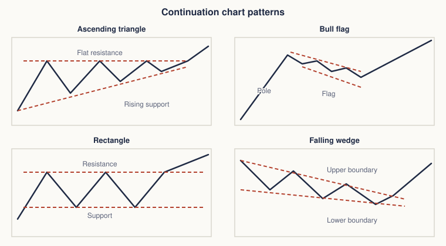
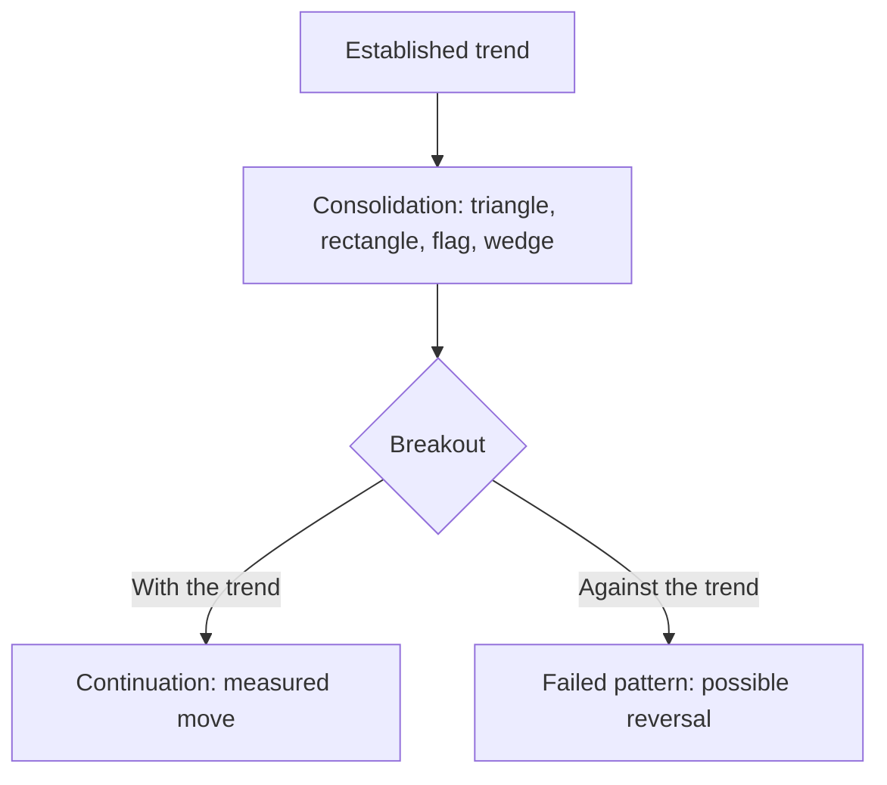
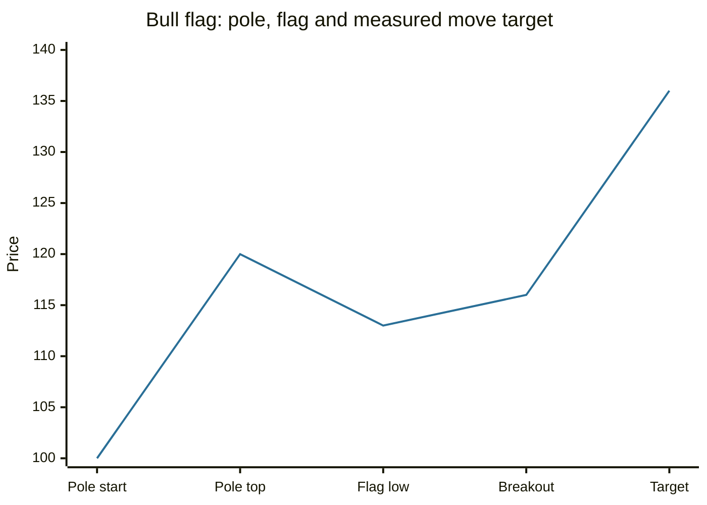

# Continuation chart patterns

## Summary

Continuation patterns are pauses inside a trend: price consolidates in a narrowing or sideways shape and then, according to the pattern's usual reading, continues in the original direction. The main ones are triangles (symmetrical, ascending, descending), the rectangle, flags and pennants, and wedges. Volume tends to fall inside the pattern and rise on the breakout. A breakout against the expected direction is a warning that the trend may be changing.

*This note is educational. It is not investment advice.*

## Prerequisites

- [Trends and trendlines](trends-and-trendlines.md).
- [Support and resistance](support-and-resistance.md).
- [Reversal chart patterns](chart-patterns-reversal.md) for the contrast.

## Core concepts

### Definition

A *continuation pattern* is a consolidation in which buyers and sellers are balanced for a while, after which the earlier trend usually resumes. Patterns on a daily chart last from a few days (flags) to several months (large triangles and rectangles). Because the breakout can go either way, a pattern is a hypothesis until price closes outside it.

### Analogy

A continuation pattern is a runner catching their breath. They slow down, jog in place and then start again in the same direction, usually. Sometimes the runner stops for good, which is why the breakout needs confirmation.

The figure shows each pattern with the dashed boundaries whose break is the signal.

### The patterns

| Pattern | Shape | Usual bias | Measured move |
| --- | --- | --- | --- |
| Symmetrical triangle | Highs fall and lows rise, converging | Follows the prior trend, often broken before the apex (the end of the triangle) | Height at the widest point, added to the breakout |
| Ascending triangle | Flat resistance, rising support | Bullish | Height at the widest point |
| Descending triangle | Flat support, falling resistance | Bearish | Height at the widest point |
| Rectangle | Price moves between flat support and resistance | Follows the prior trend | Height of the rectangle |
| Flag | A sharp move (the pole) followed by a short, parallel channel against the trend | Continues the trend | Length of the pole, added to the breakout |
| Pennant | A pole followed by a small symmetrical triangle | Continues the trend | Length of the pole |
| Rising wedge | Both lines slope up and converge | Bearish: in a downtrend it continues the trend, after an uptrend it is a reversal | Retracement of the wedge |
| Falling wedge | Both lines slope down and converge | Bullish: in an uptrend it continues the trend, after a downtrend it is a reversal | Retracement of the wedge |

Volume normally shrinks as the pattern forms and expands on the breakout. A breakout on low volume is more likely to fail. Flags and pennants form quickly (days to a few weeks), and long ones lose their meaning.

## Worked example

A bull flag. A stock climbs from 100 to 120 in two weeks (the pole is 20). It then drifts down in a narrow channel between 116 and 113 for six days, with falling volume, and breaks above 116 on higher volume.

| Item | Value |
| --- | --- |
| Pole | 120 - 100 = 20 |
| Breakout level | 116 |
| Target | 116 + 20 = 136 |
| Stop | Below the flag low, 112 |
| Risk and reward | Risk 4 (116 to 112), reward 20 (116 to 136), a ratio of 5 to 1 |

The 5 to 1 ratio assumes that the target is reached. If the breakout fails and price falls under 112, the loss is the stop distance. In practice a fraction of flags fail, which a trader must accept and size for.

## Trade offs and when to use it

Continuation patterns offer trades in the direction of the trend with a nearby stop, so the risk is small relative to the target. The weak points are false breakouts, the subjectivity of the boundaries and the fact that the direction is only likely, not certain. Triangles that break near the apex tend to be less reliable. Combine them with trend direction, volume and higher timeframe levels.

## Common mistakes

- **Trading the pattern before the breakout.**
- **Ignoring volume.** A breakout without volume often fails.
- **Reading a wedge as a continuation after the wrong trend.** The meaning depends on the prior trend.
- **Setting the stop far beyond the pattern,** which removes the benefit of the setup.

## Practice

1. What is the usual bias of an ascending triangle?
2. A flag follows a pole from 50 to 70. A breakout occurs at 66. What is the target?
3. How does the meaning of a rising wedge depend on the prior trend?

### Answers

1. Bullish, with flat resistance and rising support.
2. 66 + 20 = 86.
3. In a downtrend it continues the downtrend, after an uptrend it signals a possible reversal. Both readings are bearish.

## Further reading

- Murphy, J. J. (1999). *Technical Analysis of the Financial Markets*. New York Institute of Finance. A broad practitioner textbook on charts, trends, patterns and indicators.
- Lo, A. W., Mamaysky, H. and Wang, J. (2000). Foundations of technical analysis: computational algorithms, statistical inference, and empirical implementation. *The Journal of Finance*, 55(4), 1705-1765. [DOI](https://doi.org/10.1111/0022-1082.00265). Tests chart patterns such as head and shoulders statistically and finds some informational value.
- Park, C.-H. and Irwin, S. H. (2007). What do we know about the profitability of technical analysis?. *Journal of Economic Surveys*, 21(4), 786-826. [DOI](https://doi.org/10.1111/j.1467-6419.2007.00519.x). A survey of 95 modern studies on whether technical trading rules earn profits.
