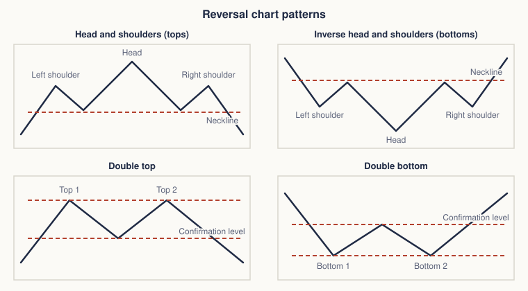
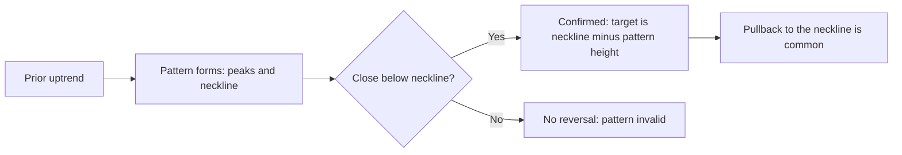
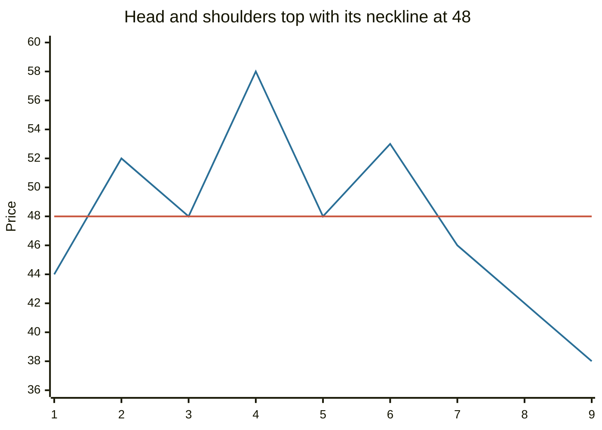

# Reversal chart patterns

## Summary

Reversal patterns are shapes on a price chart that analysts read as the end of a trend. The best known are head and shoulders (and its inverse), the double top and double bottom, the rounding bottom, the V reversal and the diamond. Each has a confirmation point, usually a close beyond a neckline or a support level, and a projected target equal to the height of the pattern. Patterns are probabilities, not certainties, and many fail.

*This note is educational. It is not investment advice.*

## Prerequisites

- [Trends and trendlines](trends-and-trendlines.md).
- [Support and resistance](support-and-resistance.md).

## Core concepts

### Definition

A *reversal pattern* is a price formation that signals that the prevailing trend is likely to change direction. It needs a prior trend to reverse: a double top after a sideways market means nothing. Patterns take weeks to months to form on a daily chart, and longer patterns tend to lead to larger moves.

### Analogy

A reversal pattern is a car slowing, stopping and turning in a car park. You can see the deceleration (smaller swings), the stop (the top or bottom) and the first move back (the breakout). The analogy breaks because the car's driver decides, while the market has thousands of drivers, and sometimes the car just rolls on.

The figure shows the shape of each pattern and the dashed level whose break confirms it.

### The patterns

| Pattern | Shape | Confirmation | Typical volume |
| --- | --- | --- | --- |
| Head and shoulders (top) | Three peaks, the middle one highest, with a neckline through the two troughs | Close below the neckline | Higher on the left shoulder and head, lower on the right shoulder, rising on the break |
| Inverse head and shoulders (bottom) | Mirror image: three troughs, the middle one lowest | Close above the neckline | Rising on the breakout |
| Double top ("M") | Two peaks at about the same level, with a trough between | Close below the trough | Lower on the second peak |
| Double bottom ("W") | Two troughs at about the same level, with a peak between | Close above the peak | Rising on the breakout |
| Rounding bottom (saucer) | A slow, curved decline and recovery | Sustained move above the starting level | Falls into the low, rises on the way up |
| V reversal | A sharp fall followed by a sharp rise, with no base | Hard to confirm, often news driven | Spike at the turn |
| Diamond | A widening range followed by a narrowing one, shaped like a diamond, usually at tops | Break of either lower boundary (more often down at tops) | High in the first half, lower in the second |

**Measured move.** The projected target is the height of the pattern, measured from the head (or the peaks) to the neckline, and subtracted from (or added to) the breakout level. It is a rule of thumb, not a forecast.

### Evidence

Lo, Mamaysky and Wang (2000) built an algorithm to detect head and shoulders, double tops and bottoms and other patterns on US stock data, and found that several of them changed the distribution of returns in a way that carried information, with differences between groups of stocks. Their result does not show that a trader can make a profit after costs. Park and Irwin (2007) show that profits from pattern trading are less certain than the early studies suggested.

## Worked example

A head and shoulders top. The left shoulder peaks at 52, the head at 58, the right shoulder at 53, and the troughs between are at 48.

| Item | Value |
| --- | --- |
| Neckline | 48 |
| Head | 58 |
| Pattern height | 58 - 48 = 10 |
| Confirmation | Close below 48 |
| Target | 48 - 10 = 38 |
| Stop | Above the right shoulder, 53 |
| Risk and reward from an entry at 47 | Risk 6 (47 to 53), reward 9 (47 to 38) |

The line that crosses the neckline is the price, and the flat line is the neckline at 48. The sequence ends at the target of 38. A close above 53 before the target would mean the pattern failed.

## Trade offs and when to use it

Patterns give a structure for entries, stops and targets, and tell you where the idea is wrong. They are subjective (what counts as a shoulder?), form slowly and fail often. Failed patterns can be informative: a head and shoulders that fails and goes up shows strong demand. Use them with volume, trend and support and resistance, and test your rule on past charts with costs.

## Common mistakes

- **Calling the pattern before the break.** Wait for the neckline to break.
- **Seeing patterns without a prior trend.**
- **Ignoring volume** on the breakout.
- **Using the target as certain.** Most moves stop short or overshoot.
- **Forcing patterns** on short intraday charts full of noise.

## Practice

1. What confirms a double top?
2. A head and shoulders has a head at 90 and a neckline at 80. What is the target after a break below 80?
3. Why does a reversal pattern need a prior trend?

### Answers

1. A close below the trough between the two peaks.
2. 80 - 10 = 70.
3. A reversal means a change of direction, and without a trend, there is nothing to reverse.

## Further reading

- Murphy, J. J. (1999). *Technical Analysis of the Financial Markets*. New York Institute of Finance. A broad practitioner textbook on charts, trends, patterns and indicators.
- Lo, A. W., Mamaysky, H. and Wang, J. (2000). Foundations of technical analysis: computational algorithms, statistical inference, and empirical implementation. *The Journal of Finance*, 55(4), 1705-1765. [DOI](https://doi.org/10.1111/0022-1082.00265). Tests chart patterns such as head and shoulders statistically and finds some informational value.
- Park, C.-H. and Irwin, S. H. (2007). What do we know about the profitability of technical analysis?. *Journal of Economic Surveys*, 21(4), 786-826. [DOI](https://doi.org/10.1111/j.1467-6419.2007.00519.x). A survey of 95 modern studies on whether technical trading rules earn profits.
