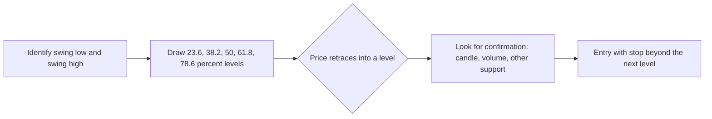
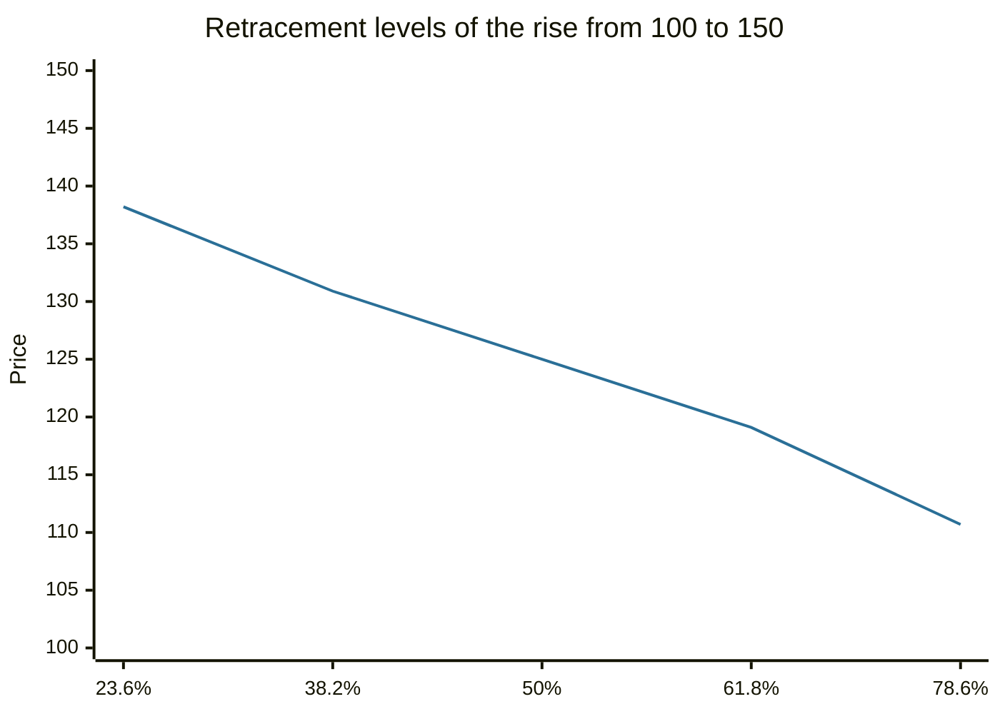

# Fibonacci retracements

## Summary

Fibonacci retracements are horizontal levels drawn between a swing low and a swing high at 23.6%, 38.2%, 50%, 61.8% and 78.6% of the move. Technical analysts watch them as places where a correction against the trend may stop. The ratios come from the Fibonacci sequence, and there is no proof that markets respect them. Their value, if any, is as a common reference that many traders use, which makes them partly self-fulfilling.

*This note is educational. It is not investment advice.*

## Prerequisites

- [Support and resistance](support-and-resistance.md).
- [Trends and trendlines](trends-and-trendlines.md).

## Core concepts

### Definition

The *Fibonacci sequence* is 1, 1, 2, 3, 5, 8, 13, 21, 34, 55, 89, ... where each number is the sum of the two before it. The ratio of a number to the next tends to 0.618 (the golden ratio's inverse), to the one two places later 0.382, and to the one three places later 0.236. The square root of 0.618 is 0.786.

A *retracement* is a partial reversal of the previous move. Fibonacci retracement levels are computed as:

```text
level = high - ratio × (high - low)      (after a rise)
level = low + ratio × (high - low)       (after a fall)
```

The 50% level is not a Fibonacci ratio, and comes from the Dow theory idea that corrections often retrace about half of a move. The 38.2% to 61.8% zone is treated as the "normal" correction range, and a retracement of more than 78.6% suggests that the trend is in doubt.

### Analogy

A retracement grid is a ruler laid on the last move. It does not know where the price will stop, and it marks the points that many traders have agreed to watch. The analogy breaks because a ruler measures a fixed object, while here the ruler works only if people act on it.

### Mechanism

1. Identify a clear swing low and swing high in the current trend.
2. Draw the levels between them.
3. Look for signs that price stops at a level: a candlestick reversal, a bounce on volume, a coincidence with another level such as a moving average or an earlier support.
4. Place a stop beyond the next level, and a target at the previous high.



Evidence: the levels have no theoretical basis, and none of the studies cited in [technical analysis](technical-analysis.md) tests them directly. Because they are drawn from subjective swing points and produce many levels close together, almost any retracement will touch one of them. A tendency to stop at them, where it exists, comes from the number of traders who watch them.

## Worked example

A stock rises from 100 to 150 and starts to fall.

```python
# Python 3.12. Fibonacci retracement levels after a rise from 100 to 150.
low, high = 100.0, 150.0
for ratio in (0.236, 0.382, 0.5, 0.618, 0.786):
    print(f"{ratio:.1%}: {high - ratio * (high - low):.1f}")
```

Output:

```text
23.6%: 138.2
38.2%: 130.9
50.0%: 125.0
61.8%: 119.1
78.6%: 110.7
```

If the stock falls to 130.9 (38.2%) and forms a bullish candlestick, a trader may buy with a stop under 125 (below the 50% level) and a target of 150. The risk is about 6 (130.9 - 125) and the reward about 19 (150 - 130.9), a ratio of about 3 to 1. If the price instead closes under 119.1 (61.8%), the idea has failed in the usual reading, and a fall below 110.7 means the rise is probably over.



## Trade offs and when to use it

Retracements give objective-looking entry and stop areas with defined risk, and they combine well with other levels. The weaknesses are subjectivity in the choice of swing points, the abundance of levels, confirmation bias and the lack of statistical support. Use them with other tools, and treat them as zones.

## Common mistakes

- **Choosing swing points after the fact** to make a level fit.
- **Treating a level as a guaranteed turning point.**
- **Using Fibonacci levels alone** without confirmation.
- **Forgetting that there are many levels,** so one is always close.

## Practice

1. A price rises from 80 to 120. Where is the 38.2% retracement?
2. Which of the standard levels is not a Fibonacci ratio?
3. Why might retracement levels work at all, if they have no theory behind them?

### Answers

1. 120 - 0.382 × 40 = 104.7.
2. 50%.
3. Many traders watch them and place orders there, which makes them partly self-fulfilling.

## Further reading

- Murphy, J. J. (1999). *Technical Analysis of the Financial Markets*. New York Institute of Finance. A broad practitioner textbook on charts, trends, patterns and indicators.
- Park, C.-H. and Irwin, S. H. (2007). What do we know about the profitability of technical analysis?. *Journal of Economic Surveys*, 21(4), 786-826. [DOI](https://doi.org/10.1111/j.1467-6419.2007.00519.x). A survey of 95 modern studies on whether technical trading rules earn profits.
- Lo, A. W., Mamaysky, H. and Wang, J. (2000). Foundations of technical analysis: computational algorithms, statistical inference, and empirical implementation. *The Journal of Finance*, 55(4), 1705-1765. [DOI](https://doi.org/10.1111/0022-1082.00265). Tests chart patterns such as head and shoulders statistically and finds some informational value.
