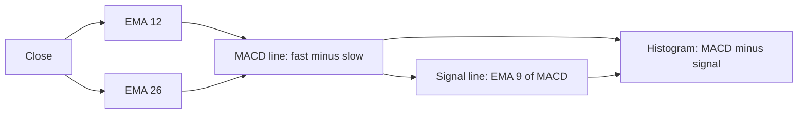
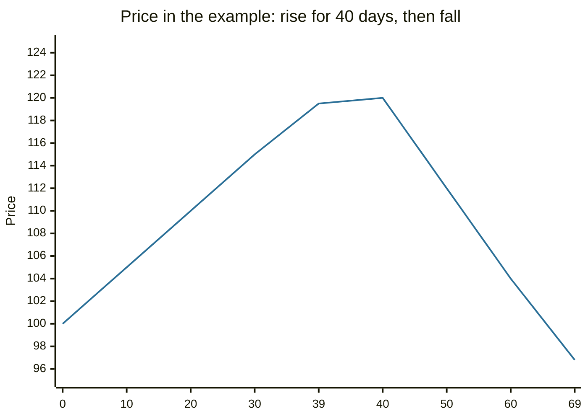

# MACD

## Summary

The moving average convergence divergence indicator (MACD) is the difference between a fast and a slow exponential moving average of price, usually 12 and 26 periods, plotted with a 9-period average of itself called the signal line. It turns a pair of moving averages into an oscillator that shows trend direction and momentum. The best known signals are the MACD line crossing the signal line, the crossing of the zero line, and divergence between MACD and price.

*This note is educational. It is not investment advice.*

## Prerequisites

- [Moving averages](moving-averages.md).

## Core concepts

### Definition

```text
MACD line   = EMA(12) of close - EMA(26) of close
Signal line = EMA(9) of the MACD line
Histogram   = MACD line - signal line
```

The indicator was developed by Gerald Appel in the late 1970s (Appel, 2005). The numbers 12, 26 and 9 are conventions and not constants of nature. The MACD is positive when the fast average is above the slow one (short-term trend above long-term) and negative when below.

### Analogy

The MACD is the speedometer of a trend. The two moving averages are two runners, one quick and one slow. The gap between them grows when the quick runner pulls away (strong trend) and shrinks when the slow one catches up (momentum fading). The signal line is a smoothed view of that gap, and the histogram is how fast the gap is changing.

### Signals

1. **Signal line crossover.** MACD crossing above the signal line is a buy signal, below it a sell signal. These are frequent and, as with all crossovers, lag.
2. **Zero line crossover.** MACD crossing above zero means the 12-period average has crossed above the 26-period average, a trend change signal that is slower than the signal line crossover.
3. **Divergence.** Price makes a new high and the MACD does not (bearish divergence), or price makes a new low and the MACD does not (bullish divergence). It warns that momentum is fading, and it can persist for long before price turns.
4. **Histogram.** The shrinking of the histogram bars before a crossover shows momentum losing strength.



The MACD works in trending markets. In a range it crosses the signal line often and gives false signals. As the indicator is built from price, it adds no new information, and it only presents price changes in another form.

## Worked example

A price series rises for 40 days and then falls for 30 days.

```python
# Python 3.12. MACD (12, 26, 9) on a price series with an up leg and a down leg.
def ema(values, n):
    k = 2 / (n + 1)
    out = [values[0]]
    for v in values[1:]:
        out.append(v * k + out[-1] * (1 - k))
    return out

closes = [100 + 0.5 * i for i in range(40)] + [120 - 0.8 * i for i in range(30)]
macd = [a - b for a, b in zip(ema(closes, 12), ema(closes, 26))]
signal = ema(macd, 9)
hist = [m - s for m, s in zip(macd, signal)]
cross = [i for i in range(26, len(closes)) if (macd[i] > signal[i]) != (macd[i - 1] > signal[i - 1])]   # skip the warm-up
print("peak close at day", closes.index(max(closes)))
print("signal line crossings at days", cross)
print("MACD, signal and histogram at the last day:", round(macd[-1], 2), round(signal[-1], 2), round(hist[-1], 2))
```

Output:

```text
peak close at day 40
signal line crossings at days [42]
MACD, signal and histogram at the last day: -3.94 -3.27 -0.67
```

The price peaks on day 40 and the MACD crosses below its signal line on day 42, two days later. The signal was timely in this clean series with a sharp turn, and in real data with noise, the lag is longer and false crossings occur. At the last day the MACD (-3.94) is below the signal line (-3.27) and below zero, which is the usual reading of a downtrend.



## Trade offs and when to use it

The MACD is popular because it combines trend and momentum in one display and is easy to read. Its weaknesses are lag, whipsaws in ranges and the fact that the parameters are conventions. Optimizing them on past data tends to overfit. It is more useful for judging the strength of a trend and for divergence warnings than as a mechanical entry rule.

## Common mistakes

- **Trading every crossover in a sideways market.**
- **Treating divergence as a sell signal by itself.** It can last long before price turns.
- **Changing the parameters until the backtest looks good.**
- **Comparing MACD values across securities.** The scale depends on the price level.

## Practice

1. What is the histogram of the MACD?
2. What does a MACD above zero mean?
3. Why does the MACD lag price?

### Answers

1. The MACD line minus the signal line.
2. The 12-period EMA is above the 26-period EMA, so the short-term trend is above the longer one.
3. It is built from moving averages of past prices, which respond after price has moved.

## Further reading

- Appel, G. (2005). *Technical Analysis: Power Tools for Active Investors*. FT Press. Written by the creator of the MACD indicator.
- Murphy, J. J. (1999). *Technical Analysis of the Financial Markets*. New York Institute of Finance. A broad practitioner textbook on charts, trends, patterns and indicators.
- Park, C.-H. and Irwin, S. H. (2007). What do we know about the profitability of technical analysis?. *Journal of Economic Surveys*, 21(4), 786-826. [DOI](https://doi.org/10.1111/j.1467-6419.2007.00519.x). A survey of 95 modern studies on whether technical trading rules earn profits.
