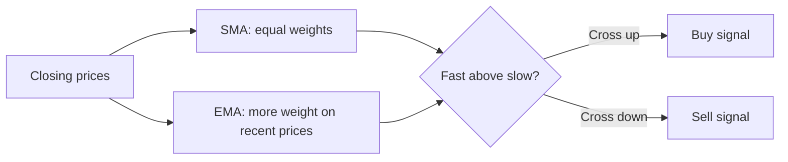
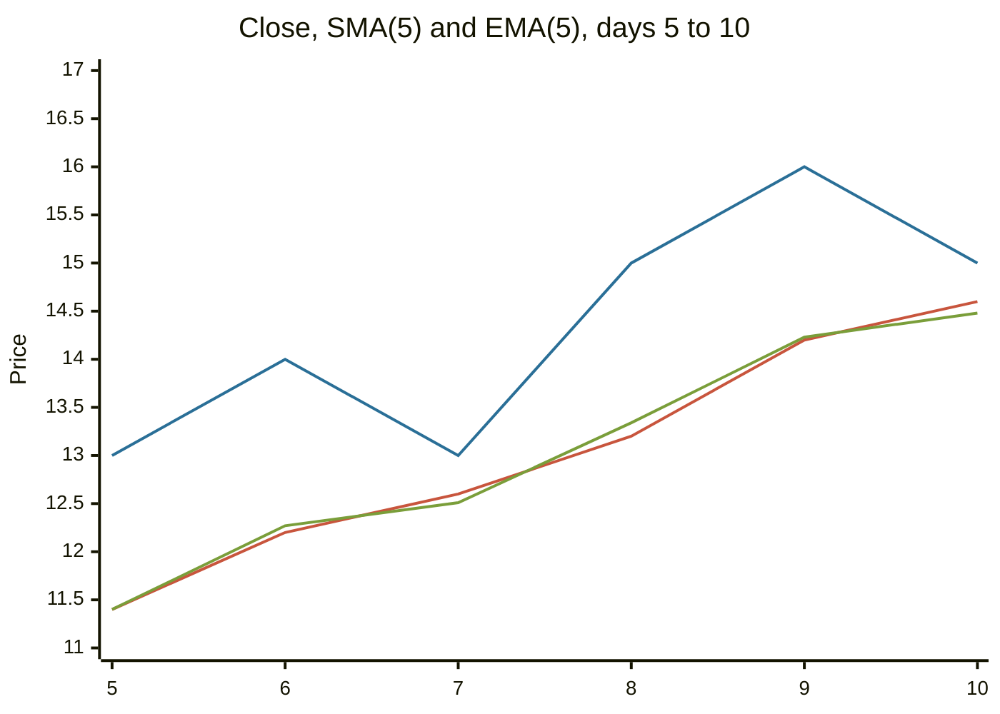

# Moving averages

## Summary

A moving average is the average of the last n prices, recalculated as each new price arrives. It smooths out noise and shows the direction of the trend, at the cost of lag. The simple moving average (SMA) weights all n prices equally, and the exponential moving average (EMA) weights recent prices more. Two common signals are the price crossing its average and a faster average crossing a slower one, such as the 50 and 200 day averages.

*This note is educational. It is not investment advice.*

## Prerequisites

- [Trends and trendlines](trends-and-trendlines.md).

## Core concepts

### Definition

- **Simple moving average (SMA):** SMA(n) = (sum of the last n closes) / n.
- **Exponential moving average (EMA):** EMA(today) = close × k + EMA(yesterday) × (1 - k), where k = 2 / (n + 1). The first EMA is usually set to the first SMA.
- **Lag:** a moving average follows price, so it turns after price does. A shorter n lags less and gives more false signals. A longer n lags more and gives fewer signals.

### Analogy

A moving average is a rolling-average car speed over the last few minutes. It ignores a short burst of speed and shows your steady pace, and it responds only after the burst has lasted. The EMA is the same average with more attention to the last minute.

### Mechanism and signals

1. **Price versus the average.** Price above a rising average is an uptrend, below a falling one is a downtrend. The average also acts as a moving support or resistance level.
2. **Slope.** A rising average means an uptrend, and a flat one means no trend.
3. **Crossovers.** A faster average crossing above a slower one is a buy signal, and below it is a sell signal. The crossing of the 50 day average above the 200 day average is called a *golden cross*, and the reverse a *death cross*. The names are popular and the signals are late: both averages are built from the past.



Moving averages work in trending markets and fail in ranges, where price crosses the average repeatedly (whipsaws). Brock, Lakonishok and LeBaron (1992) found that simple moving average rules had predictive power on 90 years of Dow Jones data. Later studies found smaller or no profits after costs (Park and Irwin, 2007), and the random data experiment in [technical analysis](technical-analysis.md) shows that a crossover rule has no edge where prices follow no pattern.

## Worked example

Ten closes and a 5-day window.

```python
# Python 3.12. Simple and exponential moving averages of a 5-day window.
closes = [10, 11, 12, 11, 13, 14, 13, 15, 16, 15]
n = 5
k = 2 / (n + 1)                                   # smoothing factor of the EMA
sma = [sum(closes[i - n + 1:i + 1]) / n for i in range(n - 1, len(closes))]
ema = [sum(closes[:n]) / n]                        # seed the EMA with the first SMA
for c in closes[n:]:
    ema.append(c * k + ema[-1] * (1 - k))
print("SMA:", [round(x, 2) for x in sma])
print("EMA:", [round(x, 2) for x in ema])
print("last close:", closes[-1])
```

Output:

```text
SMA: [11.4, 12.2, 12.6, 13.2, 14.2, 14.6]
EMA: [11.4, 12.27, 12.51, 13.34, 14.23, 14.48]
last close: 15
```

The averages cover days 5 to 10. On day 5 the SMA is (10 + 11 + 12 + 11 + 13) / 5 = 11.4. The last close, 15, is above both averages, which is consistent with an uptrend. The EMA reacts faster on the way up: on day 6 it is 12.27 against 12.2 for the SMA, because it gives more weight to the jump to 14.



The top line is the close, and the other two follow it with a lag.

## Trade offs and when to use it

Use moving averages to define the trend, to filter trades (trade only in the direction of the 200 day average) and as dynamic support. The cost is the lag, and the whipsaws in a sideways market. The window should match the horizon: 10 to 20 days for short-term, 50 for medium-term and 200 for long-term views are common conventions with no theoretical basis.

## Common mistakes

- **Using a crossover in a range.**
- **Optimizing the window on past data** until the backtest looks good.
- **Reading the golden cross as a forecast.** It confirms what has already happened.
- **Ignoring costs.** Crossover rules trade often.

## Practice

1. Closes 4, 6, 8 and 10. What is the 4-day SMA, and what is k for a 4-day EMA?
2. Why does an EMA react faster than an SMA?
3. What is a golden cross?

### Answers

1. SMA = 28 / 4 = 7, and k = 2 / 5 = 0.4.
2. It gives more weight to recent prices.
3. The 50 day average crossing above the 200 day average.

## Further reading

- Brock, W., Lakonishok, J. and LeBaron, B. (1992). Simple technical trading rules and the stochastic properties of stock returns. *The Journal of Finance*, 47(5), 1731-1764. [DOI](https://doi.org/10.1111/j.1540-6261.1992.tb04681.x). Tests moving average and trading range break rules on 90 years of Dow Jones data.
- Park, C.-H. and Irwin, S. H. (2007). What do we know about the profitability of technical analysis?. *Journal of Economic Surveys*, 21(4), 786-826. [DOI](https://doi.org/10.1111/j.1467-6419.2007.00519.x). A survey of 95 modern studies on whether technical trading rules earn profits.
- Murphy, J. J. (1999). *Technical Analysis of the Financial Markets*. New York Institute of Finance. A broad practitioner textbook on charts, trends, patterns and indicators.
