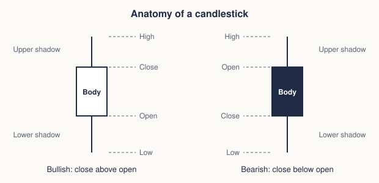
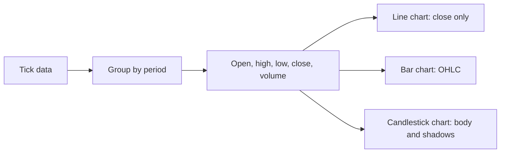

# Price charts

## Summary

A price chart plots the price of a security against time. The three common types are the line chart (closing prices joined by a line), the bar chart (open, high, low and close for each period) and the candlestick chart (the same four values drawn as a body and shadows). Each bar or candle covers one period, which can be a minute, a day or a month, and the choice of period and of arithmetic or logarithmic scale changes what the chart appears to say.

*This note is educational. It is not investment advice.*

## Prerequisites

- [Technical analysis](technical-analysis.md).

## Core concepts

### Definition

Most charts summarize each period with four prices: *open* (first trade), *high*, *low* and *close* (last trade), often with volume. A *timeframe* is the length of one period: intraday (1, 5, 15, 60 minutes), daily, weekly or monthly. Longer timeframes show the main trend, shorter ones show detail and more noise.

### Analogy

Chart types are different maps of the same city. The line chart is the subway map: it keeps only closing prices, so it is clean. The bar and candlestick charts are street maps, which show the range of each period. The same data drawn at a different zoom (timeframe) can look calm or chaotic, which is why you decide the timeframe before reading the picture.

### Chart types

| Type | What it shows | Strength | Weakness |
| --- | --- | --- | --- |
| Line | Closing prices joined by a line | Clear trend, simple | Loses open, high, low |
| Bar (OHLC) | A vertical line from low to high, with a tick left for the open and right for the close | All four prices | Harder to read quickly |
| Candlestick | A body between open and close, and shadows to the high and low | All four prices, the body and shadows show pressure at a glance | Many patterns to learn |
| Point and figure | Columns of X and O that ignore time | Filters small moves | Less common |

**Candlesticks** are said to come from Japanese rice trading in the eighteenth century, and were introduced to Western analysts by Nison (2001). A candle with a white (or green) body closed higher than it opened (bullish), and one with a dark (or red) body closed lower (bearish). The thin lines above and below are the *shadows* or *wicks*.

The figure labels the parts of both candles: the body spans the open and close, and the shadows reach the high and the low.

### Scale

An *arithmetic* scale spaces equal price changes equally. A *logarithmic* scale spaces equal percentage changes equally. For long periods or large moves, a log scale is more honest: a rise from 10 to 20 (100%) should look as large as 20 to 40, and on an arithmetic scale the second looks twice as big.

## Worked example

One day of trading in a stock: open 100, high 105, low 98, close 103.

- Body: from 100 to 103, so 3 wide. The close is above the open, so the candle is bullish.
- Upper shadow: 105 - 103 = 2.
- Lower shadow: 100 - 98 = 2.
- Range: 105 - 98 = 7. The body is 3 / 7 = 43% of the range.

The next day opens at 103 and closes at 101 with a high of 104 and a low of 100. The body is 2 wide and the candle is bearish. On a line chart these two days appear as two points, 103 and 101, with no trace of the intraday range.

## Trade offs and when to use it

Use candlesticks for pattern work and line charts for the long-term trend. Use several timeframes: the higher one for direction and the lower one for entry. A very short timeframe has more noise and higher trading costs relative to the move. Charts are also affected by adjustments for splits and dividends, and by the data source's definition of the close for markets that trade around the clock.

## Common mistakes

- **Using an arithmetic scale for a multi-year chart** with large price changes.
- **Switching timeframes until a signal appears.**
- **Reading a single candle without context.**
- **Mixing unadjusted and adjusted prices** across a split or a dividend.

## Practice

1. A day opens at 50, reaches 55, falls to 48 and closes at 52. Is the candle bullish or bearish, and what are the shadows?
2. Why is a log scale better for a ten-year chart?
3. Which chart type hides the intraday range?

### Answers

1. Bullish, because the close is above the open. The upper shadow is 55 - 52 = 3 and the lower shadow is 50 - 48 = 2.
2. Equal percentage moves take equal space, so early and late periods are comparable.
3. The line chart, which uses only the close.

## Further reading

- Nison, S. (2001). *Japanese Candlestick Charting Techniques (2nd ed.)*. New York Institute of Finance. The reference that introduced Japanese candlestick patterns to Western traders.
- Murphy, J. J. (1999). *Technical Analysis of the Financial Markets*. New York Institute of Finance. A broad practitioner textbook on charts, trends, patterns and indicators.
