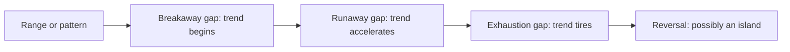
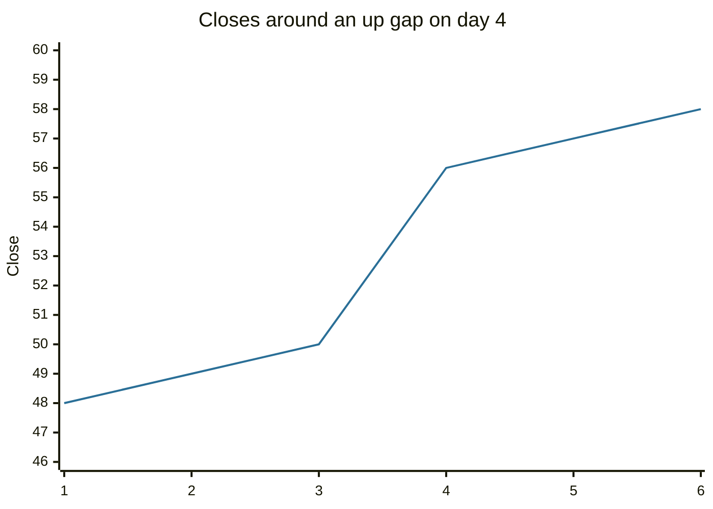

# Price gaps

## Summary

A price gap is an empty space on the chart between one period's range and the next: the price jumps and no trades occur between the two levels. Gaps appear in stocks when news arrives while the exchange is closed, and rarely in markets that trade around the clock. Analysts classify them as common, breakaway, runaway (continuation) and exhaustion gaps, and read their meaning from where they occur in the trend and from the volume. The idea that every gap is always filled is a myth.

*This note is educational. It is not investment advice.*

## Prerequisites

- [Price charts](price-charts.md).
- [Trends and trendlines](trends-and-trendlines.md).

## Core concepts

### Definition

An *up gap* occurs when the low of a period is above the high of the previous period, and a *down gap* when the high is below the previous low. The *gap size* is the empty space. A gap is *filled* when price later trades back through the whole space. On a daily chart, gaps arise from overnight news such as earnings, a rating change or a macro surprise, and the opening auction sets the new level.

### Analogy

A gap is a missing step in a staircase. Price walked up the stairs and then, after the night, jumped to a higher floor without touching the steps between. Whether it later comes back down to climb those steps depends on why it jumped.

### Types

| Type | Where it occurs | Meaning |
| --- | --- | --- |
| Common gap | Inside a range or pattern | Little meaning, usually filled quickly |
| Breakaway gap | At the start of a trend, when price leaves a pattern or range, often on high volume | Signals a new trend. Often not filled soon |
| Runaway (continuation) gap | In the middle of a strong trend | Shows strong momentum. Sometimes called a measuring gap, because the trend often covers about as much again |
| Exhaustion gap | Near the end of a trend, on very high volume | Last burst of the trend. Usually filled within days, and a reversal often follows |

Two related reversal signals:

- **Island reversal:** an exhaustion gap in one direction followed by a breakaway gap in the opposite direction, which leaves a group of candles isolated like an island.
- **Key reversal day (reversal day):** a day that makes a new high (or low), then closes beyond the previous day's low (or high) on high volume, which shows a change in control.

The sequence shows the usual position of each gap type in a trend, with the caveat that you can only name the type afterwards, because you cannot tell if a gap is the last one until the trend has turned.

## Worked example

A stock closes at 50.0 with a high of 50.5 on day 3. After positive earnings, it opens on day 4 at 54, trades at a low of 53 and closes at 56.

| Day | High | Low | Close |
| --- | --- | --- | --- |
| 1 | 48.8 | 47.5 | 48 |
| 2 | 49.6 | 48.2 | 49 |
| 3 | 50.5 | 49.2 | 50 |
| 4 | 57.0 | 53.0 | 56 |
| 5 | 57.5 | 55.8 | 57 |
| 6 | 58.4 | 56.5 | 58 |

The gap is from 50.5 (the high of day 3) to 53.0 (the low of day 4), which is 2.5 wide. The jump from the close of 50 to the open of 54 is 8%. If the gap occurred after a long advance on very high volume, it could be an exhaustion gap, and a trader would expect to see it filled soon. If it occurred when price leaves a long base on high volume, it is a breakaway gap, and the gap area (50.5 to 53) becomes support. A close back under 50.5 would fill the gap and show that the move has failed.

## Trade offs and when to use it

Gaps give clear levels: the edges of the gap are support or resistance, and a fill is a signal. They are less useful in 24-hour markets such as currencies, where weekend gaps are the main case. Classification is possible only after the fact, and "gaps always fill" is wrong: breakaway and runaway gaps often stay open for months. Analyses with volume and the surrounding pattern improve the reading.

## Common mistakes

- **Fading every gap.** Selling a breakaway gap can be costly.
- **Ignoring the news behind a gap.** Earnings and macro news change the fundamentals.
- **Assuming a gap will be filled by a date.**
- **Trading the open without a plan.** The first minutes after a gap are volatile.

## Practice

1. When is an up gap filled?
2. Which gap type tends to appear at the end of a trend on very high volume?
3. Why do currency charts show few gaps on weekdays?

### Answers

1. When price later trades back down through the whole gap, to the high of the day before it.
2. The exhaustion gap.
3. The market trades almost continuously, so there is no overnight period in which news arrives while the market is closed.

## Further reading

- Murphy, J. J. (1999). *Technical Analysis of the Financial Markets*. New York Institute of Finance. A broad practitioner textbook on charts, trends, patterns and indicators.
- Nison, S. (2001). *Japanese Candlestick Charting Techniques (2nd ed.)*. New York Institute of Finance. The reference that introduced Japanese candlestick patterns to Western traders.
