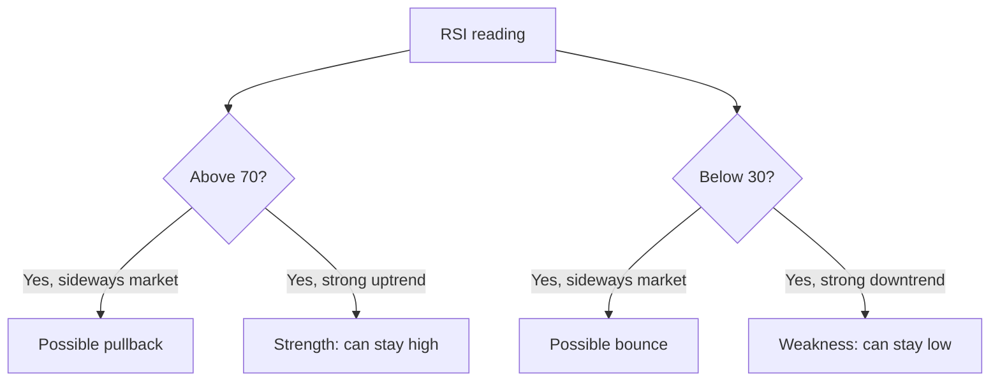
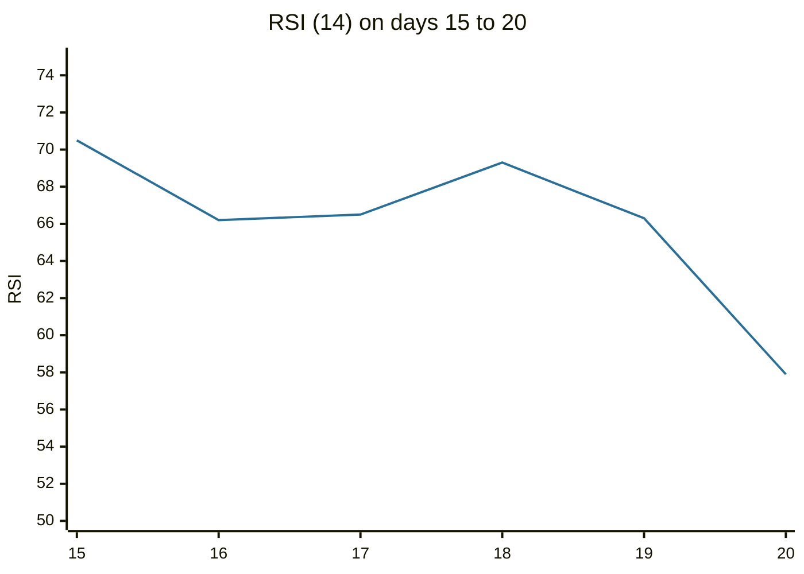

# Relative strength index

## Summary

The relative strength index (RSI) compares the size of recent gains with the size of recent losses and scales the result from 0 to 100. J. Welles Wilder introduced it in 1978 with a period of 14. Readings above 70 are conventionally called overbought and below 30 oversold, which suggests a pullback or a bounce may be near. In a strong trend, the RSI can stay above 70 or below 30 for a long time, so these levels are warnings and not signals.

*This note is educational. It is not investment advice.*

## Prerequisites

- [Trends and trendlines](trends-and-trendlines.md).
- [Moving averages](moving-averages.md).

## Core concepts

### Definition

```text
RS  = average gain over n periods / average loss over n periods
RSI = 100 - 100 / (1 + RS)
```

For the first value, the averages are simple averages of the n gains and n losses. Afterward Wilder's smoothing is used: new average = (previous average × (n - 1) + current value) / n. If there are no losses RSI is 100, and if there are no gains it is 0. An oscillator that is bounded between 0 and 100 can be compared between securities, unlike the raw momentum of price.

### Analogy

The RSI is a pressure gauge: it shows how much of the recent movement was upward and how much downward. A high reading says the recent effort has been mostly upward, which can mean strength and can also mean the spring is stretched. The gauge does not tell which of the two it is.

### Reading the RSI

1. **Overbought and oversold.** Wilder used 70 and 30. Some analysts use 80 and 20 in strong trends, and the levels should be adapted to the security's behavior.
2. **Divergence.** If price makes a new high and RSI makes a lower high, momentum is fading (bearish divergence), and the reverse at lows (bullish divergence).
3. **Failure swings.** An RSI that rises above 70, falls, rises again but not to 70, and then breaks below the previous low is a reversal signal in Wilder's method.
4. **Midline and trend.** In an uptrend the RSI tends to stay above 40 and often reaches 70 or more. In a downtrend it tends to stay below 60. A hold above 50 shows an uptrend is intact.
5. **Best in ranges.** In sideways markets the 70 and 30 levels give timely signals, and in trends they give early, losing ones.



## Worked example

Twenty closes and a 14-period RSI with Wilder smoothing.

```python
# Python 3.12. Relative strength index with Wilder smoothing (14 periods).
closes = [44.34, 44.09, 44.15, 43.61, 44.33, 44.83, 45.10, 45.42, 45.84, 46.08,
          45.89, 46.03, 45.61, 46.28, 46.28, 46.00, 46.03, 46.41, 46.22, 45.64]
n = 14
changes = [b - a for a, b in zip(closes, closes[1:])]
gains = [max(c, 0) for c in changes]
losses = [max(-c, 0) for c in changes]
avg_gain = sum(gains[:n]) / n
avg_loss = sum(losses[:n]) / n
rsi = [100 - 100 / (1 + avg_gain / avg_loss)]
for g, l in zip(gains[n:], losses[n:]):
    avg_gain = (avg_gain * (n - 1) + g) / n
    avg_loss = (avg_loss * (n - 1) + l) / n
    rsi.append(100 - 100 / (1 + avg_gain / avg_loss))
print([round(x, 1) for x in rsi])
```

Output:

```text
[70.5, 66.2, 66.5, 69.3, 66.3, 57.9]
```

The six values belong to days 15 to 20. The first reading, 70.5, is at the overbought line after a rise from 44 to 46. The price then moves sideways and the RSI falls to 57.9 after the drop to 45.64 on the last day. A trader who sold at 70.5 would have caught a small pullback, in a series that has not changed trend.



## Trade offs and when to use it

The RSI is simple and widely used, and it works best as a context tool: to see when a move has run far, to confirm a trend (RSI holding above 50) and to spot divergences. Its weaknesses are false signals in trends, dependence on the period chosen and no information beyond price. Many traders combine it with a trend filter: they take oversold readings only in an uptrend.

## Common mistakes

- **Selling every reading above 70** in a strong uptrend.
- **Ignoring the trend.** Oversold in a downtrend can stay oversold.
- **Using the default levels everywhere.** Adjust them to the market.
- **Mixing smoothing methods** between charting packages and getting different values.

## Practice

1. Average gain 0.6 and average loss 0.3. What is the RSI?
2. What does bearish divergence between price and RSI show?
3. Why can the RSI stay above 70 for a long time?

### Answers

1. RS = 2, so RSI = 100 - 100 / 3 = 66.7.
2. Price makes a new high while RSI makes a lower high, so momentum is fading.
3. In a strong uptrend, gains are consistently larger than losses, so the ratio stays high.

## Further reading

- Wilder, J. W. (1978). *New Concepts in Technical Trading Systems*. Trend Research. The original definition of the relative strength index.
- Murphy, J. J. (1999). *Technical Analysis of the Financial Markets*. New York Institute of Finance. A broad practitioner textbook on charts, trends, patterns and indicators.
- Park, C.-H. and Irwin, S. H. (2007). What do we know about the profitability of technical analysis?. *Journal of Economic Surveys*, 21(4), 786-826. [DOI](https://doi.org/10.1111/j.1467-6419.2007.00519.x). A survey of 95 modern studies on whether technical trading rules earn profits.
