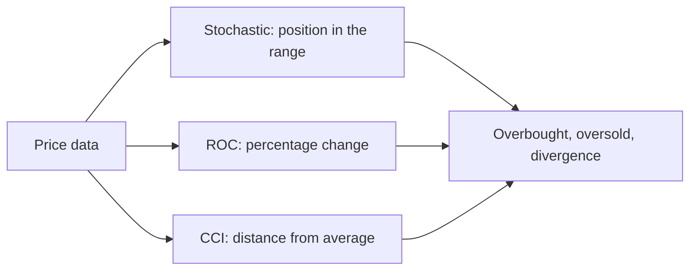
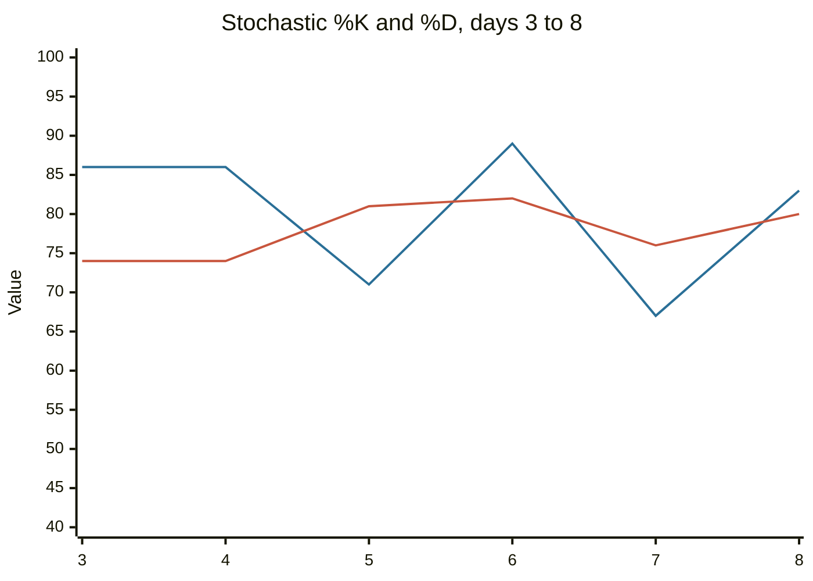

# Stochastic oscillator and momentum indicators

## Summary

Three oscillators measure momentum in different ways. The stochastic oscillator shows where the close sits within the recent high-low range, from 0 to 100. The rate of change (ROC) is the percentage change in price over n periods. The commodity channel index (CCI) measures how far the typical price is from its average, in units of mean deviation. All three are used to spot overbought and oversold conditions and turning points, and all of them behave like the RSI: reliable in ranges, early and misleading in strong trends.

*This note is educational. It is not investment advice.*

## Prerequisites

- [Relative strength index](relative-strength-index.md).
- [Moving averages](moving-averages.md).

## Core concepts

### Definition

**Stochastic oscillator** (George Lane, 1950s):

```text
%K = 100 × (close - lowest low of n periods) / (highest high of n periods - lowest low of n periods)
%D = 3-period simple moving average of %K
```

The idea behind it is that in an uptrend closes tend to be near the high of the range, and in a downtrend near the low. Common settings are n = 14 with %D of 3. The "slow" version smooths %K first. Overbought and oversold levels are usually 80 and 20. Some authors use 90 and 10.

**Rate of change (ROC)**: ROC = 100 × (close / close n periods ago - 1). It is a pure momentum measure, centered on zero. Overbought and oversold levels are not fixed: they are set from the history of the instrument, for example at the levels that contain about 90% of past values.

**Commodity channel index (CCI)** (Donald Lambert, 1980): CCI = (typical price - SMA of typical price) / (0.015 × mean deviation), where the typical price is (high + low + close) / 3. The constant 0.015 scales the index so that about 70% to 80% of values fall between -100 and +100. Readings above +100 indicate a strong move up and below -100 a strong move down. It can be used with the signal line (an average of the CCI) or the ±100 levels.

### Analogy

Stochastic is a thermometer that shows where today's temperature stands between the recent low and high: close to the high means a warm spell, close to the low a cold one. ROC is how many degrees the temperature has changed since ten days ago. CCI is how many "normal swings" away from the average the temperature is.

### Signals

| Indicator | Overbought | Oversold | Typical signal |
| --- | --- | --- | --- |
| Stochastic | Above 80 | Below 20 | %K crosses %D from above in the overbought zone (sell) or from below in the oversold zone (buy). The signal is usually taken as the oscillator leaves the zone |
| ROC | Above a historical upper level | Below a historical lower level | Turn from an extreme or a crossing of zero |
| CCI | Above +100 | Below -100 | A cross back through ±100 or through the signal line |

Divergences with price are read as for the [RSI](relative-strength-index.md). In a strong uptrend the stochastic can stay above 80 for weeks, and selling every reading above 80 means selling a rising market. Many traders use the oscillators only in the direction of the larger trend: take oversold readings in an uptrend.



## Worked example

Twelve days of highs, lows and closes. The code computes a 5-period stochastic with a 3-period %D, the 10-period ROC and the 10-period CCI.

```python
# Python 3.12. Stochastic oscillator, rate of change (ROC) and commodity channel index (CCI).
import statistics as st

highs  = [51, 53, 52, 55, 56, 54, 57, 59, 58, 61, 60, 62]
lows   = [49, 51, 50, 53, 54, 52, 55, 57, 56, 59, 58, 60]
closes = [50, 52, 51, 54, 55, 53, 56, 58, 57, 60, 59, 61]

# Stochastic: 5-period %K and 3-period %D
n = 5
k = []
for i in range(n - 1, len(closes)):
    hh, ll = max(highs[i - n + 1:i + 1]), min(lows[i - n + 1:i + 1])
    k.append(100 * (closes[i] - ll) / (hh - ll))
d = [sum(k[i - 2:i + 1]) / 3 for i in range(2, len(k))]
print("%K:", [round(x) for x in k])
print("%D:", [round(x) for x in d])

# ROC over 10 periods
print("ROC(10): %.1f%%" % ((closes[-1] / closes[-11] - 1) * 100))

# CCI over 10 periods, with the constant 0.015
tp = [(h + l + c) / 3 for h, l, c in zip(highs, lows, closes)]   # typical price
window = tp[-10:]
mean = st.mean(window)
mean_dev = st.mean(abs(x - mean) for x in window)
print("CCI(10): %.0f" % ((tp[-1] - mean) / (0.015 * mean_dev)))
```

Output:

```text
%K: [86, 50, 86, 86, 71, 89, 67, 83]
%D: [74, 74, 81, 82, 76, 80]
ROC(10): 17.3%
CCI(10): 118
```

The price is in a steady uptrend, rising from 50 to 61. %K swings between 50 and 89 and %D stays between 74 and 82, mostly in the overbought area but not above 90, which shows that the stochastic can remain high for the entire trend. ROC is +17.3%, a strong 10-day gain, and CCI is 118, above +100. All three say the same thing: the move is strong and extended, and none says that it must reverse.



The first line is %K and the second line is %D. Both start on day 3, the first day with three values of %K.


## Trade offs and when to use it

The oscillators are quick to compute and show momentum changes before price turns, which suits range-bound markets and short-term timing. In trends they warn too early. They disagree with each other, and their parameters are conventions. Use one or two, together with the trend, and avoid stacking many similar indicators: stochastic, RSI and CCI are all functions of price, and agreement among them is not independent confirmation.

## Common mistakes

- **Selling every overbought reading in an uptrend.**
- **Using several oscillators as if they were independent evidence.**
- **Using the same overbought level for every instrument** in the case of ROC.
- **Ignoring the period.** A 5-period stochastic and a 21-period one give very different signals.

## Practice

1. Close 108, highest high 110, lowest low 100 over the period. What is %K?
2. A price rises from 40 to 46 over 10 periods. What is the ROC?
3. Why does a CCI above +100 not mean "sell"?

### Answers

1. 100 × (108 - 100) / (110 - 100) = 80.
2. 100 × (46 / 40 - 1) = 15%.
3. It shows a strong move. In trends, the CCI can stay above +100 for a long time.

## Further reading

- Murphy, J. J. (1999). *Technical Analysis of the Financial Markets*. New York Institute of Finance. A broad practitioner textbook on charts, trends, patterns and indicators.
- Wilder, J. W. (1978). *New Concepts in Technical Trading Systems*. Trend Research. Describes the RSI, the closest relative of these oscillators and the source of the overbought and oversold convention
- Park, C.-H. and Irwin, S. H. (2007). What do we know about the profitability of technical analysis?. *Journal of Economic Surveys*, 21(4), 786-826. [DOI](https://doi.org/10.1111/j.1467-6419.2007.00519.x). A survey of 95 modern studies on whether technical trading rules earn profits.
