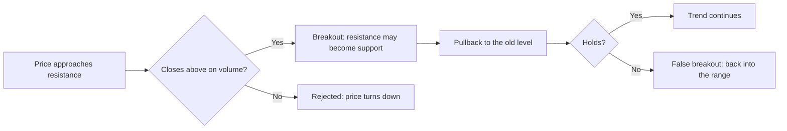
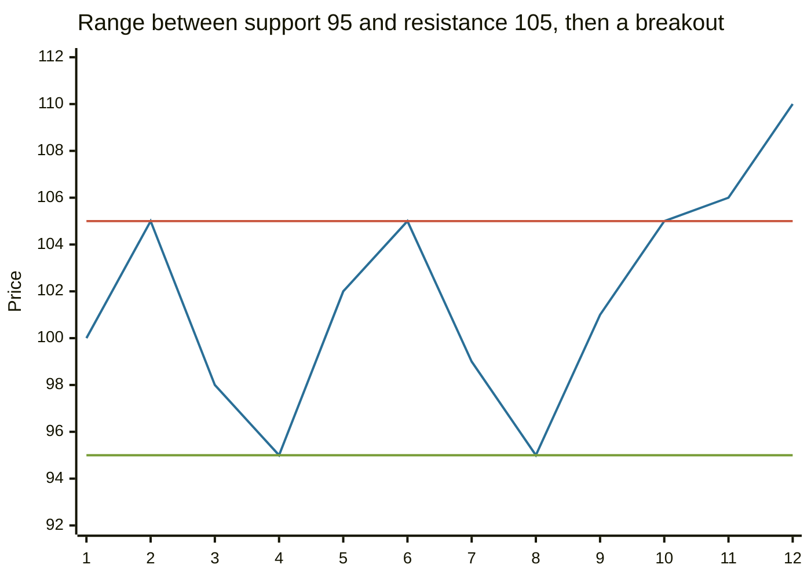

# Support and resistance

## Summary

Support is a price level where falling prices have tended to stop because buyers step in, and resistance is a level where rising prices have tended to stop because sellers step in. The more often a level has held, the more traders watch it. When a level breaks, it often changes role: broken resistance becomes support and broken support becomes resistance. Levels show where decisions are likely to be made, and they do not guarantee a reversal.

*This note is educational. It is not investment advice.*

## Prerequisites

- [Trends and trendlines](trends-and-trendlines.md).

## Core concepts

### Definition

- **Support:** a price area below the market where demand has been strong enough to halt a decline.
- **Resistance:** a price area above the market where supply has been strong enough to halt a rise.
- **Breakout:** a move beyond a level with a close past it, ideally with higher volume.
- **Role reversal (polarity):** after a breakout, the old level acts on the opposite side.
- **False breakout:** a move beyond the level that reverses quickly.

Levels are areas, not exact prices: they are drawn as thin bands, because stops and orders cluster around them.

### Analogy

Support is a floor and resistance is a ceiling in a room that price bounces around in. If price breaks through the ceiling, the old ceiling becomes the floor of the room above. The analogy has a limit: a floor holds because it is solid, while a price level holds only because enough people believe in it and act on it.

### Where levels come from

1. **Previous swing highs and lows**, where price turned before.
2. **Round numbers** such as 100 or 1,000, where orders cluster.
3. **Trendlines and moving averages**, which act as dynamic levels (see [moving averages](moving-averages.md)).
4. **Retracement levels** of an earlier move (see [Fibonacci retracements](fibonacci-retracements.md)).
5. **Areas of heavy trading volume**, where many holders have their cost.

A common explanation for role reversal is psychological. Holders who bought near a high and watched the price fall hope to sell at break-even when it returns, which creates resistance. Buyers who missed a breakout wait for a pullback to the broken level, which makes it support. Whatever the cause, the pattern is a tendency, not a law.

## Worked example

A stock moves between 95 and 105 for twelve days and then breaks out.

| Day | 1 | 2 | 3 | 4 | 5 | 6 | 7 | 8 | 9 | 10 | 11 | 12 |
| --- | --- | --- | --- | --- | --- | --- | --- | --- | --- | --- | --- | --- |
| Close | 100 | 105 | 98 | 95 | 102 | 105 | 99 | 95 | 101 | 105 | 106 | 110 |

Support is at 95 (touched on days 4 and 8) and resistance at 105 (touched on days 2, 6 and 10). On day 11 the stock closes at 106, above 105, and on day 12 it reaches 110. A trader who buys the breakout may place a stop just below 105, say at 103, because a fall back under the old resistance would mean the breakout failed. A cautious trader waits for a pullback to 105 and a bounce.

The flat lines are resistance at 105 and support at 95, and the third line is the close.

## Trade offs and when to use it

Support and resistance give concrete places for entries, stops and targets: the distance from entry to the stop and to the next level defines the reward-to-risk ratio. The method is subjective, levels fail often, and as more traders use them, stop orders cluster beyond levels, which can cause quick false breaks. Combine levels with volume, trend and timeframe.

## Common mistakes

- **Treating a level as a line.** Use a zone.
- **Buying support without a stop.** If it breaks, the loss runs.
- **Chasing a breakout without confirmation.** Many are false.
- **Using too many levels,** so that every price is near one.

## Practice

1. What is role reversal?
2. A trader buys at 105 after a breakout above resistance at 105, and the next resistance is at 115. Where does a stop go, and what is the reward-to-risk ratio if the stop is at 103?
3. Why are round numbers often levels?

### Answers

1. A broken resistance becomes support, and a broken support becomes resistance.
2. Just below the old resistance, for example 103. The reward is 115 - 105 = 10 and the risk is 2, a ratio of 5 to 1.
3. Many traders place orders and stops at round numbers, which concentrates supply and demand there.

## Further reading

- Murphy, J. J. (1999). *Technical Analysis of the Financial Markets*. New York Institute of Finance. A broad practitioner textbook on charts, trends, patterns and indicators.
- Park, C.-H. and Irwin, S. H. (2007). What do we know about the profitability of technical analysis?. *Journal of Economic Surveys*, 21(4), 786-826. [DOI](https://doi.org/10.1111/j.1467-6419.2007.00519.x). A survey of 95 modern studies on whether technical trading rules earn profits.
- Brock, W., Lakonishok, J. and LeBaron, B. (1992). Simple technical trading rules and the stochastic properties of stock returns. *The Journal of Finance*, 47(5), 1731-1764. [DOI](https://doi.org/10.1111/j.1540-6261.1992.tb04681.x). Tests trading range break rules, which buy when price breaks above resistance and sell below support
