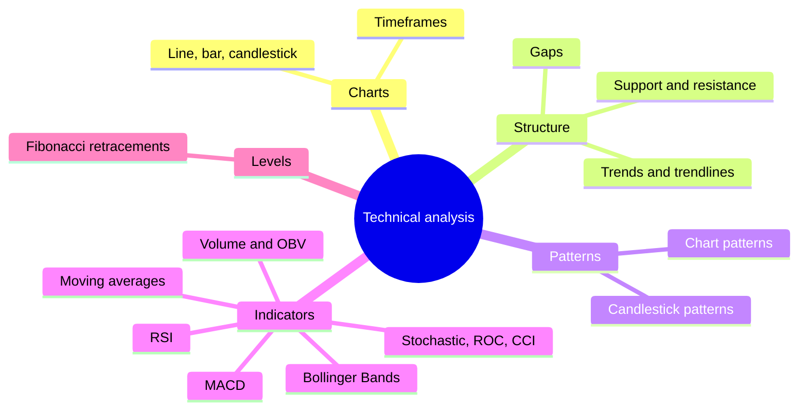
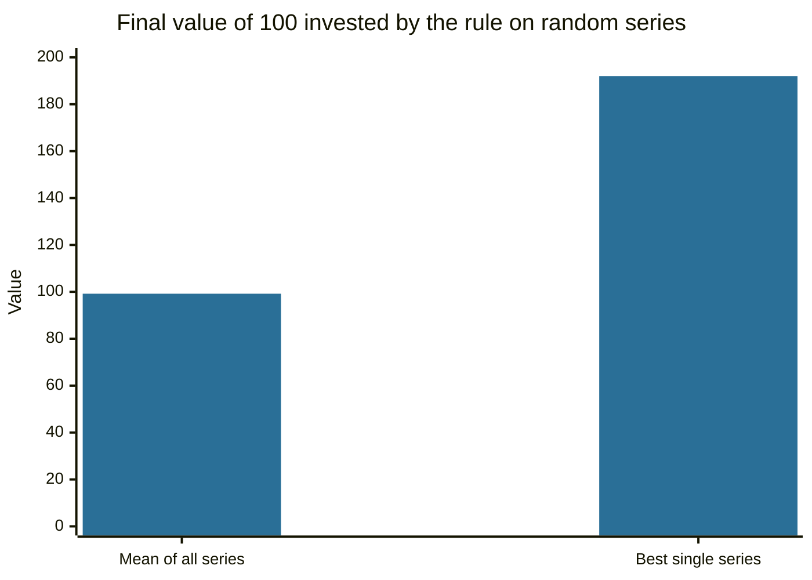

# Technical analysis

## Summary

Technical analysis studies past prices and volume, mostly on charts, to judge the likely direction of a price. It rests on three ideas: price reflects all available information, prices move in trends, and patterns repeat because human behavior repeats. It is used in stocks, currencies, commodities and crypto markets, often for timing entries and exits. The evidence for profit from it is mixed: some studies find value in simple rules in certain markets and periods, and many find that the edge disappears after costs and in later data.

*This note is educational. It is not investment advice. Technical trading carries a high risk of loss.*

## Prerequisites

- [Financial markets overview](../financial-markets/financial-markets-overview.md).
- [Market efficiency](../financial-markets/market-efficiency.md), because the debate about technical analysis is a debate about the weak form of efficiency.

## Core concepts

### Definition

*Technical analysis* is the forecasting of price movements from the study of market data, mainly price and volume. A *technical analyst* (chartist) looks at charts and indicators. *Fundamental analysis* looks at the business and the economy (see [fundamental analysis](../fundamental-analysis/fundamental-analysis.md)).

### Analogy

A technical analyst reads a market the way a sailor reads wind patterns on the water: not why the wind blows, only where it has been going and how strongly. The analogy breaks because wind follows physical laws, while prices follow the decisions of people who may also read the same charts.

### The three premises

1. **Price discounts everything.** The price already includes fundamentals, news and sentiment, so only price needs to be studied.
2. **Prices move in trends.** A trend tends to continue until there is evidence it has ended (see [trends and trendlines](trends-and-trendlines.md)).
3. **History repeats.** Patterns have appeared before because investor psychology, fear and greed, changes little.

These ideas come from Dow theory, developed from the writings of Charles Dow in the late nineteenth century, and were collected in books such as Murphy (1999).

### Technical versus fundamental analysis

| | Technical | Fundamental |
| --- | --- | --- |
| Question | When to buy or sell, and in which direction | What is it worth, and is the price below it |
| Data | Price, volume, open interest | Financial statements, industry, economy |
| Horizon | Days to months, sometimes minutes | Months to years |
| Tools | Trendlines, patterns, moving averages, oscillators | Ratios, discounted cash flow |
| Main criticism | Patterns are subjective, and the edge may not exist | Estimates are uncertain, and public information may already be priced in |

Many investors combine the two: fundamentals for selection, technicals for timing.

### Tools in this subfield



### What the evidence says

- **Efficient markets.** If the weak form holds, past prices cannot predict future prices, and technical analysis has no value (Fama, 1970). See [market efficiency](../financial-markets/market-efficiency.md).
- **Some support.** Brock, Lakonishok and LeBaron (1992) tested moving average and trading range rules on the Dow Jones index over about 90 years and found that buy signals had higher returns than sell signals. Lo, Mamaysky and Wang (2000) tested chart patterns such as head and shoulders with statistical methods and found that several patterns carry incremental information. Brown and Jennings (1989) show in theory that past prices can be informative when investors have private signals and the market is noisy.
- **Doubts.** Park and Irwin (2007) reviewed 95 modern studies: a majority reported profits from technical rules, and the profits tended to be smaller in later data, and many studies had weaknesses such as data snooping and underestimating costs. Marshall, Young and Rose (2006) found no profitable candlestick rules on Dow Jones stocks.
- **Behavior.** Barber and Odean (2000) show that active individual traders earn lower net returns than inactive ones, which is a caution for short-term trading.

## Worked example

Data snooping is the main trap: with enough rules and enough data, some rule will look good by chance. The code applies a 20 and 50 day moving average crossover rule to 1,000 random price series with zero expected return, a trading cost of 0.1% per trade.

```python
# Python 3.12. A moving average crossover rule tested on random data that contains no pattern.
import random, statistics as st

def backtest(seed, n=1000, fast=20, slow=50, cost=0.001):
    random.seed(seed)
    prices = [100.0]
    for _ in range(n):
        prices.append(prices[-1] * (1 + random.gauss(0, 0.01)))   # daily returns with mean zero
    total, pos, trades = 0.0, 0, 0
    for t in range(slow, n):
        f = sum(prices[t - fast + 1:t + 1]) / fast
        s = sum(prices[t - slow + 1:t + 1]) / slow
        new = 1 if f > s else 0                                    # long when the fast average is above the slow one
        if new != pos:
            total -= cost                                          # cost of each trade
            trades += 1
            pos = new
        total += pos * (prices[t + 1] / prices[t] - 1)
    return total, trades

res = [backtest(seed) for seed in range(1000)]
rets = [r for r, _ in res]
print("series tested:", len(rets))
print("mean total return: %.1f%%" % (st.mean(rets) * 100))
print("series with a positive result: %.0f%%" % (sum(r > 0 for r in rets) / len(rets) * 100))
print("best single series: %.0f%%" % (max(rets) * 100))
print("mean number of trades: %.0f" % st.mean(t for _, t in res))
```

Output:

```text
series tested: 1000
mean total return: -0.8%
series with a positive result: 47%
best single series: 92%
mean number of trades: 22
```

On average the rule loses (-0.8%, the cost of about 22 trades), and about half of the series show a profit by chance. A trader who looked only at the best series would see a gain of 92% from a rule that has no edge. This is why a rule must be tested on data it was not built from, with costs, and across many markets.



The mean series ends at 99.2 and the best one at 192, although the data contain no pattern.

## Trade offs and when to use it

Technical analysis gives a structured way to define entries, exits and risk, such as stops placed beyond a support level, and it forces rules in place of impulse. Its costs are subjectivity (two analysts draw different lines), overfitting and the risk that a widely known pattern stops working. Use it as a framework for timing and risk control, test rules out of sample with costs, and keep position sizes small enough to survive being wrong.

## Common mistakes

- **Seeing patterns in noise.** The human eye finds shapes in random series.
- **Testing on the same data used to build the rule.**
- **Ignoring costs, slippage and taxes.**
- **Using one indicator alone.** Signals disagree, and context matters.
- **Treating a pattern as a certainty.** Each is a probability at best.

## Practice

1. State the three premises of technical analysis.
2. Why does the existence of weak-form efficiency contradict technical analysis?
3. What did the random series experiment show about backtests?

### Answers

1. Price discounts everything, prices move in trends and history repeats.
2. If past prices are already reflected in the current price, they cannot predict future changes.
3. Many random series show profits by chance, so a good backtest alone is weak evidence, especially when many rules were tried.

## Further reading

- Murphy, J. J. (1999). *Technical Analysis of the Financial Markets*. New York Institute of Finance. A broad practitioner textbook on charts, trends, patterns and indicators.
- Lo, A. W., Mamaysky, H. and Wang, J. (2000). Foundations of technical analysis: computational algorithms, statistical inference, and empirical implementation. *The Journal of Finance*, 55(4), 1705-1765. [DOI](https://doi.org/10.1111/0022-1082.00265). Tests chart patterns such as head and shoulders statistically and finds some informational value.
- Brock, W., Lakonishok, J. and LeBaron, B. (1992). Simple technical trading rules and the stochastic properties of stock returns. *The Journal of Finance*, 47(5), 1731-1764. [DOI](https://doi.org/10.1111/j.1540-6261.1992.tb04681.x). Tests moving average and trading range break rules on 90 years of Dow Jones data.
- Park, C.-H. and Irwin, S. H. (2007). What do we know about the profitability of technical analysis?. *Journal of Economic Surveys*, 21(4), 786-826. [DOI](https://doi.org/10.1111/j.1467-6419.2007.00519.x). A survey of 95 modern studies on whether technical trading rules earn profits.
- Brown, D. P. and Jennings, R. H. (1989). On technical analysis. *The Review of Financial Studies*, 2(4), 527-551. [DOI](https://doi.org/10.1093/rfs/2.4.527). A theoretical argument for why past prices can carry information in a noisy market.
- Marshall, B. R., Young, M. R. and Rose, L. C. (2006). Candlestick technical trading strategies: can they create value for investors?. *Journal of Banking & Finance*, 30(8), 2303-2323. [DOI](https://doi.org/10.1016/j.jbankfin.2005.08.001). A statistical test of candlestick patterns on Dow Jones Industrial Average stocks, which did not find profitable trading rules.
- Fama, E. F. (1970). Efficient capital markets: a review of theory and empirical work. *The Journal of Finance*, 25(2), 383-417. [DOI](https://doi.org/10.1111/j.1540-6261.1970.tb00518.x). Defines the weak, semi-strong and strong forms of market efficiency.
