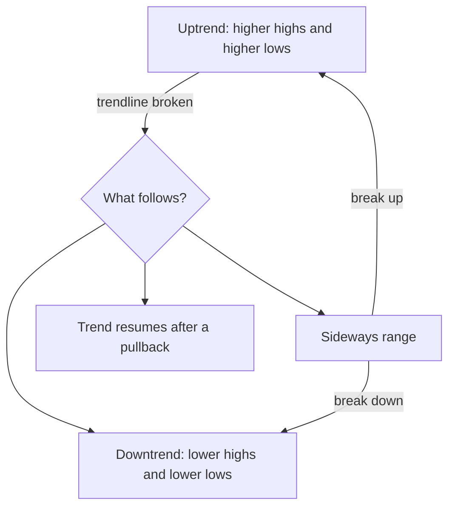
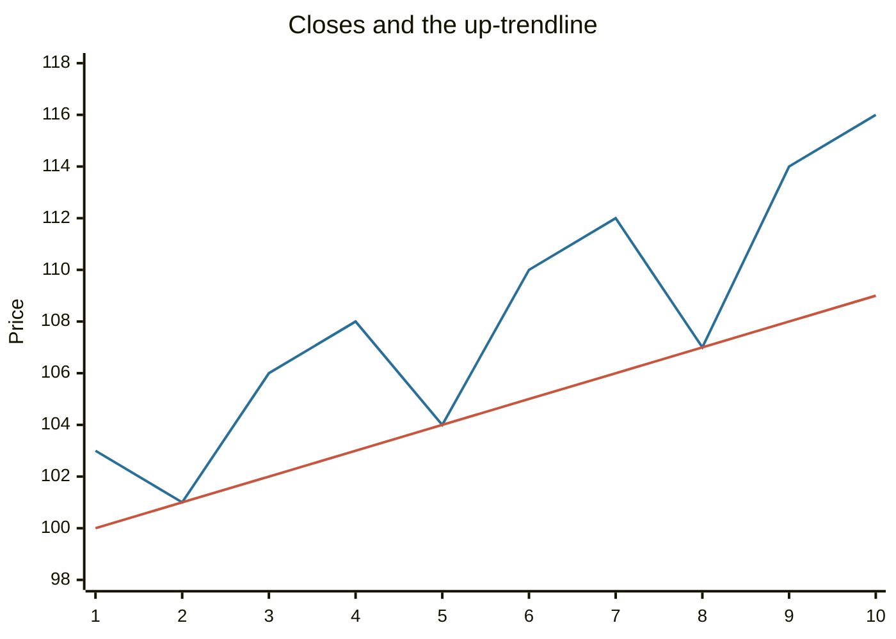

# Trends and trendlines

## Summary

A trend is the general direction of a price over a period. In an uptrend each peak and each trough is higher than the one before, in a downtrend each is lower, and in a sideways trend prices move within a band. A trendline is a straight line drawn along the lows of an uptrend or the highs of a downtrend. The central rule of technical analysis is that a trend is assumed to continue until the evidence shows that it has ended, usually by a break of the trendline.

*This note is educational. It is not investment advice.*

## Prerequisites

- [Price charts](price-charts.md).

## Core concepts

### Definition

- **Uptrend:** a series of higher highs and higher lows.
- **Downtrend:** a series of lower highs and lower lows.
- **Sideways (horizontal) trend, or range:** highs and lows at about the same levels.
- **Trendline:** a line joining at least two lows in an uptrend (the *support line*) or two highs in a downtrend (the *resistance line*). A third touch that holds confirms it.
- **Channel:** a second line drawn parallel to the trendline, through the opposite extremes, so that price moves in a band.

### Analogy

A trend is the direction of a river. Water moves around rocks, back eddies and small waves, and it still flows downstream. A trendline is a line along the bank. A boat can drift from it for a moment, but if the boat crosses the bank, the river has changed course.

### Trends by duration

Dow theory distinguishes three degrees:

| Degree | Typical length | Role |
| --- | --- | --- |
| Primary | Months to years | The main bull or bear market |
| Secondary | Weeks to months | Corrections against the primary trend, often retracing one third to two thirds of it |
| Minor | Days to weeks | Short-term fluctuations, mostly noise |

The retracement figures come from the Dow theory tradition (see [Fibonacci retracements](fibonacci-retracements.md)) and are rules of thumb.

### How to draw a trendline

1. Identify two clear swing lows (uptrend) or highs (downtrend).
2. Join them with a straight line and extend it to the right.
3. Wait for a third touch that holds: the more touches, the more significant the line.
4. Treat a close beyond the line, preferably with higher volume and by more than a small margin (many analysts use 3% for daily charts or two days), as a break. A break is a warning, not a proof of reversal: price can return or the line can be redrawn at a steeper or flatter angle.
5. A steep trendline is less reliable than a gentle one, because steep trends are hard to sustain.

## Worked example

Ten daily closes and an up-trendline drawn through the lows on days 2, 5 and 8.

| Day | 1 | 2 | 3 | 4 | 5 | 6 | 7 | 8 | 9 | 10 |
| --- | --- | --- | --- | --- | --- | --- | --- | --- | --- | --- |
| Close | 103 | 101 | 106 | 108 | 104 | 110 | 112 | 107 | 114 | 116 |
| Trendline | 100 | 101 | 102 | 103 | 104 | 105 | 106 | 107 | 108 | 109 |

The line is y = 99 + day. It touches the closes on days 2, 5 and 8, so three lows define it. If the close on day 11 fell to 105 while the trendline is at 110, that would be a break, a warning that the up-trend may be ending. A break is not a sell order by itself.

The upper line is the close and the lower line is the trendline.

## Trade offs and when to use it

Trend following is simple: buy in uptrends, sell or stay out in downtrends, and the trendline gives a place for a stop. It performs best when prices trend and poorly in sideways markets, where it produces repeated false signals ("whipsaws"). Drawing is subjective: the same chart can support two lines. Trends on longer timeframes outweigh trends on shorter ones.

## Common mistakes

- **Drawing a line through two points and treating it as confirmed.** Wait for a third touch.
- **Forcing a line through all points.** Use the main lows or highs.
- **Acting on the first intraday break.** Use a close.
- **Trading against the higher timeframe trend** without a reason.

## Practice

1. How is an uptrend defined?
2. How many touches confirm a trendline?
3. What does a break of an up-trendline tell you, and what does it not?

### Answers

1. A series of higher highs and higher lows.
2. At least three, with the first two defining the line.
3. It warns that the trend may be changing. It does not prove a reversal, since price can recover or move sideways.

## Further reading

- Murphy, J. J. (1999). *Technical Analysis of the Financial Markets*. New York Institute of Finance. A broad practitioner textbook on charts, trends, patterns and indicators.
- Park, C.-H. and Irwin, S. H. (2007). What do we know about the profitability of technical analysis?. *Journal of Economic Surveys*, 21(4), 786-826. [DOI](https://doi.org/10.1111/j.1467-6419.2007.00519.x). A survey of 95 modern studies on whether technical trading rules earn profits.
- Brock, W., Lakonishok, J. and LeBaron, B. (1992). Simple technical trading rules and the stochastic properties of stock returns. *The Journal of Finance*, 47(5), 1731-1764. [DOI](https://doi.org/10.1111/j.1540-6261.1992.tb04681.x). Tests moving average and trading range break rules on 90 years of Dow Jones data.
