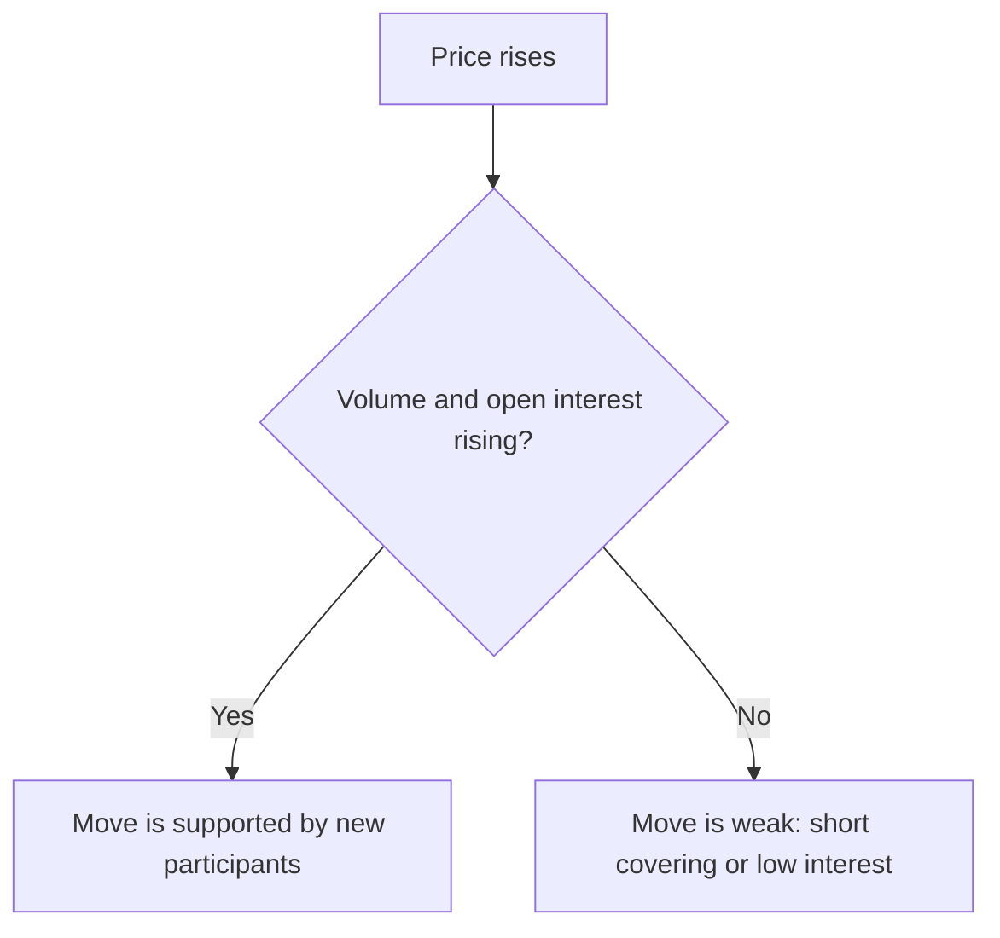
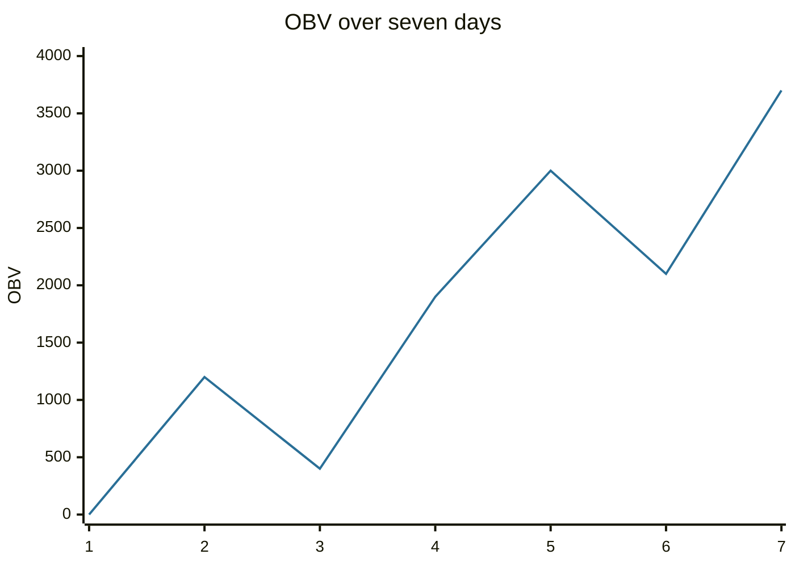

# Volume and open interest

## Summary

Volume is the number of shares or contracts traded in a period, and it measures how much conviction stands behind a price move. A rise on high volume is read as stronger than a rise on low volume. In futures and options, open interest counts the contracts that remain open and shows whether money is entering or leaving the market. The on-balance volume (OBV) line adds volume on up days and subtracts it on down days to show whether volume flows with the price trend.

*This note is educational. It is not investment advice.*

## Prerequisites

- [Price charts](price-charts.md).
- [Trends and trendlines](trends-and-trendlines.md).

## Core concepts

### Definition

- **Volume:** the quantity traded in the period, drawn as bars under the price chart. For a stock it is the number of shares, for a futures contract the number of contracts.
- **Open interest:** the number of outstanding futures or options contracts not yet closed or settled. It increases when a new buyer and a new seller open a position, and falls when positions are closed. Volume counts every trade, open interest counts positions.
- **On-balance volume (OBV):** a running total that adds the day's volume when the close is above the previous close, subtracts it when the close is lower, and leaves it unchanged when equal (Granville, 1963).

### Analogy

Price is the direction a crowd walks, and volume is the size of the crowd. A move supported by a large crowd is hard to reverse, while a move by a few people can reverse when someone else arrives. Open interest is the number of people who have bought a ticket and are still in the building.

### Reading volume

| Price | Volume | Reading |
| --- | --- | --- |
| Rises | Rises | Healthy up move with broad participation |
| Rises | Falls | Weak rally, losing support |
| Falls | Rises | Strong selling pressure |
| Falls | Falls | Weak decline, selling pressure fading |
| Breaks a level | High | Breakout more likely to hold |
| Breaks a level | Low | Higher chance of a false break |
| New high with lower volume | | Possible exhaustion |

For futures, open interest adds to the picture: rising price with rising open interest suggests new money is entering the uptrend, rising price with falling open interest suggests short covering and a weaker rally, and falling price with rising open interest means new shorts are entering.



### OBV and divergence

OBV is read through its trend. If price makes a new high and OBV also makes a new high, volume confirms the move. If price makes a new high and OBV does not, there is a *divergence*, a sign that the rise lacks support and may reverse. A break of OBV's own trendline can precede a price reversal. Volume is a probabilistic aid and not a rule, and the OBV can be distorted by one very large volume day.

## Worked example

Seven days of closes and volume.

```python
# Python 3.12. On-balance volume.
closes = [50, 51, 50, 52, 53, 52, 54]
volume = [1000, 1200, 800, 1500, 1100, 900, 1600]
obv = [0]
for i in range(1, len(closes)):
    if closes[i] > closes[i - 1]:
        obv.append(obv[-1] + volume[i])
    elif closes[i] < closes[i - 1]:
        obv.append(obv[-1] - volume[i])
    else:
        obv.append(obv[-1])
print(obv)
```

Output:

```text
[0, 1200, 400, 1900, 3000, 2100, 3700]
```

On day 2 the close rises, so OBV adds 1,200. On day 3 it falls, so OBV subtracts 800 and reaches 400. By day 7, the price is at 54, a new high, and OBV is at 3,700, also a new high, so volume confirms the move. If price had made a new high on day 7 with OBV below its day 5 peak of 3,000, that would be a bearish divergence.



## Trade offs and when to use it

Volume is among the few data that are not derived from price, so it adds independent information, especially for confirming breakouts. For stocks, volume is reliable on exchanges and fragmented across venues, so consolidated figures matter. In currency markets there is no central volume. OBV treats a day with a tiny gain like a day with a large gain, which is crude. Use volume together with price patterns and levels.

## Common mistakes

- **Ignoring volume on a breakout.**
- **Comparing volume across stocks without scaling** by shares outstanding or average volume.
- **Using tick volume or venue-limited volume as total volume.**
- **Reading one high-volume day as a trend.**

## Practice

1. Price rises while volume falls. What does the standard reading say?
2. What does rising open interest with a rising price in a futures market suggest?
3. Closes 10, 11, 10 with volumes 100, 200, 150. What is the OBV after three days?

### Answers

1. The rally is weak and losing support.
2. New money is entering the uptrend.
3. 0, then +200, then -150, so 50.

## Further reading

- Granville, J. E. (1963). *Granville's New Key to Stock Market Profits*. Prentice Hall. The book that introduced on-balance volume.
- Murphy, J. J. (1999). *Technical Analysis of the Financial Markets*. New York Institute of Finance. A broad practitioner textbook on charts, trends, patterns and indicators.
- Park, C.-H. and Irwin, S. H. (2007). What do we know about the profitability of technical analysis?. *Journal of Economic Surveys*, 21(4), 786-826. [DOI](https://doi.org/10.1111/j.1467-6419.2007.00519.x). A survey of 95 modern studies on whether technical trading rules earn profits.
