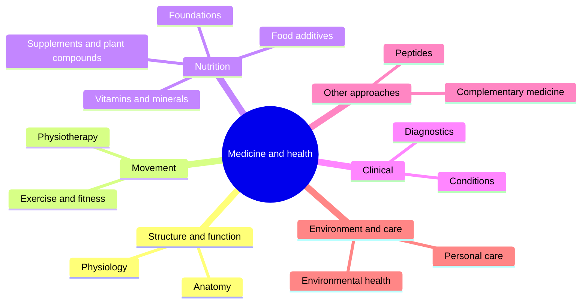

# Medicine and health

The human body, its care and its performance. This field belongs to [Applied sciences](../README.md). It starts with the structure of the body (anatomy) and how it works (physiology), applies this to training (exercise and fitness) and rehabilitation (physiotherapy), and covers nutrition, laboratory diagnostics, selected conditions, complementary medicine, peptides, environmental health and personal care. The underlying chemistry and cell biology are in [biochemistry](../../natural-sciences/chemistry/biochemistry/README.md) and [cell biology](../../natural-sciences/biology/cell-biology/README.md).

All notes in this field are educational. They are not medical advice. Claims about nutrients, supplements and remedies carry evidence grades defined in [Evidence grades](nutrition/evidence-grades.md).

## Map of the field

## Reading order

1. [Anatomy](anatomy/README.md): terminology, the skeleton bone by bone, joints and the muscles from head to foot.
2. [Physiology](physiology/README.md): muscle, energy systems, breathing, the heart and circulation, hormones and sleep.
3. [Exercise and fitness](exercise-and-fitness/README.md): biomechanics, training variables, programming, intensification methods, training types, mobility and recovery.
4. [Physiotherapy](physiotherapy/README.md): eccentric and isometric methods, taping and relaxation techniques.
5. [Nutrition](nutrition/README.md): foundations, vitamins, minerals, supplements, phytonutrients, prebiotics, algae, herbal extracts, mushrooms, foods and food additives.
6. [Diagnostics](diagnostics/README.md): common blood tests.
7. [Conditions](conditions/README.md): allergy.
8. [Complementary medicine](complementary-medicine/README.md): natural remedies, home recipes and essential oils.
9. [Peptides](peptides/README.md): collagen peptides and unapproved research peptides.
10. [Environmental health](environmental-health/README.md): chemicals in cosmetics and cleaners, plastics and natural cleaning.
11. [Personal care](personal-care/README.md): teeth and hair.

## Planned topics

- Mental health
- Public health
