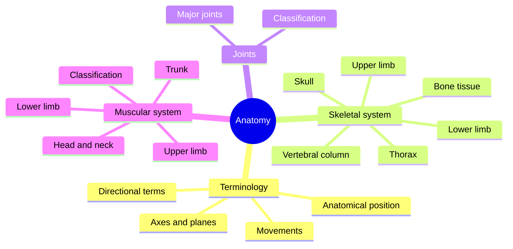

# Anatomy

Anatomy describes the structure of the human body: its bones, joints and muscles, and how they are arranged. The notes start with the shared vocabulary of position, planes, directions and movements, then cover the skeleton bone by bone, the joints, and the muscles region by region. How these structures work is covered in [Physiology](../physiology/README.md), and how they are trained in [Exercise and fitness](../exercise-and-fitness/README.md).

## Map of the field

The map shows the four groups of anatomy notes.

## Reading order

1. [Anatomical terminology](anatomical-terminology/README.md): position, axes and planes, directional terms and movements. Read this first.
2. [Skeletal system](skeletal-system/README.md): bone tissue and every major bone.
3. [Joints](joints/README.md): how bones connect and move.
4. [Muscular system](muscular-system/README.md): how muscles are classified and one note per muscle or muscle group.
5. [Regions](regions/README.md): surface anatomy of body regions, starting with the neck.

## Scope and evidence

- Attachments and innervation follow standard references (Gray's Anatomy, OpenStax Anatomy and Physiology). Anatomical variation is common, and textbooks differ in detail, for example in the spinal nerve roots given for a muscle.
- Latin names follow Terminologia Anatomica, the international standard of anatomical terms.
