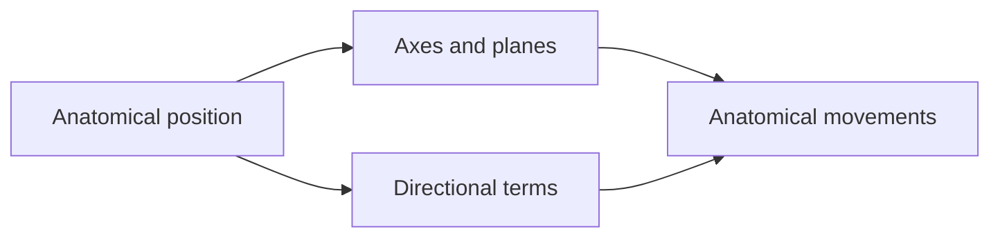

# Anatomical terminology

Anatomy uses a fixed reference posture and a shared, mostly Latin vocabulary, so that every description of a structure or a movement means the same thing to every reader, whatever their language. These four notes define that vocabulary.

## Map

## Reading order

1. [Anatomical position](anatomical-position.md): the reference posture.
2. [Axes and planes of the body](axes-and-planes.md): the three axes and three planes of the body.
3. [Directional terms](directional-terms.md): superior, inferior, medial, lateral and the other pairs.
4. [Anatomical movements](anatomical-movements.md): flexion, extension, abduction, rotation and the rest, by plane.
