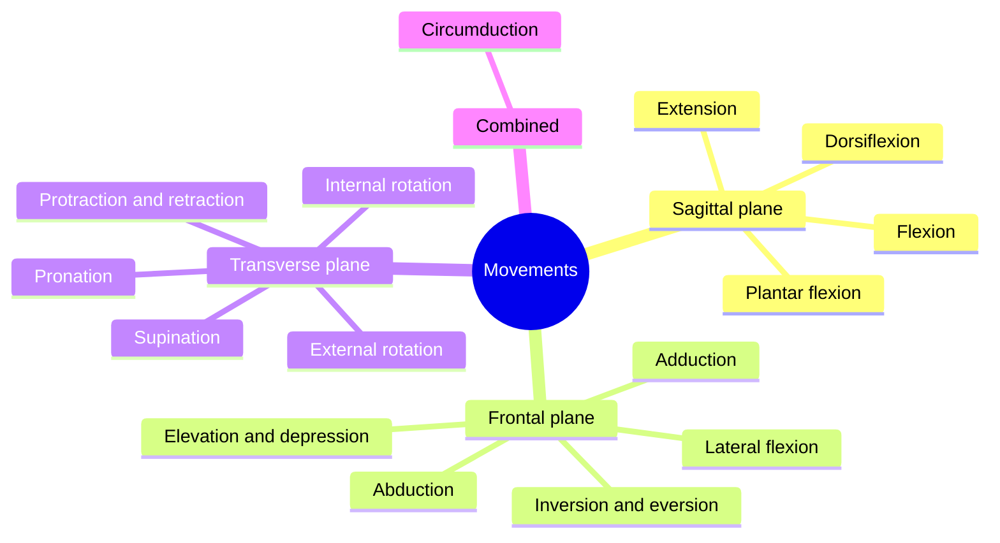

# Anatomical movements

## Summary

Movements at joints are named in pairs of opposites and each pair belongs to one plane: flexion and extension in the sagittal plane, abduction and adduction (and lateral flexion of the trunk) in the frontal plane, and rotation, pronation and supination in the transverse plane. Elevation and depression, protraction and retraction, and circumduction complete the basic set. These terms describe exercises, range of motion tests and the actions of every muscle.

## Prerequisites

- [Axes and planes of the body](axes-and-planes.md)

## Core concepts

### Definition

An *anatomical movement* is a change of position of a body segment at a joint, described relative to the anatomical position. Each movement type is defined by the plane in which it occurs and the axis around which it rotates.

### Analogy

The movement vocabulary works like the controls of an aircraft: pitch (nose up and down), roll (wing tilt) and yaw (nose left and right) describe any rotation around three axes. Flexion and extension are the body's "pitch", abduction and adduction its "roll", and rotation its "yaw". The analogy breaks because joints are limited: the knee can "pitch" but barely "yaw" when straight, while the shoulder can do all three.

### Mechanism

| Movement | Plane (axis) | Definition | Example |
| --- | --- | --- | --- |
| Flexion | Sagittal (transverse) | Decreasing the angle between segments, usually forward | Bending the elbow |
| Extension | Sagittal (transverse) | Increasing the angle, returning from flexion | Straightening the knee |
| Abduction | Frontal (sagittal) | Moving away from the midline | Raising the arm to the side |
| Adduction | Frontal (sagittal) | Moving toward the midline | Lowering the arm to the side |
| Lateral flexion | Frontal (sagittal) | Bending the trunk or neck to the side | Side bend |
| Internal (medial) rotation | Transverse (vertical) | Turning the front of a limb toward the midline | Turning the thigh inward |
| External (lateral) rotation | Transverse (vertical) | Turning the front of a limb away from the midline | Turning the thigh outward |
| Pronation | Transverse (vertical) | Turning the palm to face backward or down | Turning a doorknob counterclockwise with the right hand |
| Supination | Transverse (vertical) | Turning the palm to face forward or up | Holding a bowl of soup |
| Elevation and depression | Frontal | Moving a part up or down | Shrugging the shoulders |
| Protraction and retraction | Transverse | Moving forward and back | Pushing the shoulder blades forward and pulling them together |
| Circumduction | Combined | Moving the distal end in a circle | Arm circles |
| Dorsiflexion and plantar flexion | Sagittal | Lifting the top of the foot, pointing the toes | Walking on heels, standing on tiptoe |
| Inversion and eversion | Frontal (oblique) | Turning the sole inward or outward | Rolling the ankle |

The diagram groups the movements by plane.

### Using the terms in measurement

Range of motion is measured with a goniometer from the anatomical (or neutral) position. A typical healthy knee flexes to about 135 to 150 degrees and extends to 0 degrees; the shoulder abducts to about 180 degrees. The results are written by plane and movement, so a physiotherapist in any country can read them.

## Worked example

Describe a barbell back squat on the way down. The hips flex and the knees flex (sagittal plane), the ankles dorsiflex (sagittal), and the hips may also abduct and externally rotate slightly if the knees track over the toes with a wide stance (frontal and transverse). On the way up, the same joints extend and plantar flex. Describing the squat this way shows which muscles act: hip and knee extensors on the way up, working eccentrically on the way down (see [Muscle actions: concentric, eccentric and isometric](../../exercise-and-fitness/biomechanics/muscle-actions.md)).

## Trade offs and when to use it

- The vocabulary describes joint movement, not muscle effort. A muscle that extends the knee may be lengthening (controlling flexion) during a squat descent.
- Some movements are named relative to the anatomical position and others to the neutral position; the forearm is the most common source of confusion.

## Common mistakes

- **Calling shoulder flexion "raising the arm".** Raising the arm forward is flexion, raising it to the side is abduction.
- **Mixing pronation of the forearm with pronation of the foot.** Foot pronation is a combined movement including eversion.
- **Calling ankle plantar flexion "extension" without context.** Use dorsiflexion and plantar flexion for the ankle.

## Practice

1. In which plane do abduction and adduction occur?
2. What movement turns the palm up?
3. Which movements occur at the hip and knee when standing up from a chair?

### Answers

1. The frontal plane.
2. Supination.
3. Hip extension and knee extension.

## Further reading

- Betts, J. G., Young, K. A., Wise, J. A. et al. (2022). *Anatomy and Physiology 2e*. OpenStax, Rice University. [Link](https://openstax.org/details/books/anatomy-and-physiology-2e). Section 1.6 on anatomical terminology, with figures of planes and directions.
- Standring, S. (Ed.) (2020). *Gray's Anatomy: The Anatomical Basis of Clinical Practice (42nd ed.)*. Elsevier. Standard anatomical terms used in clinical practice.
