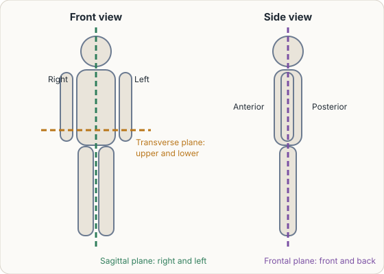
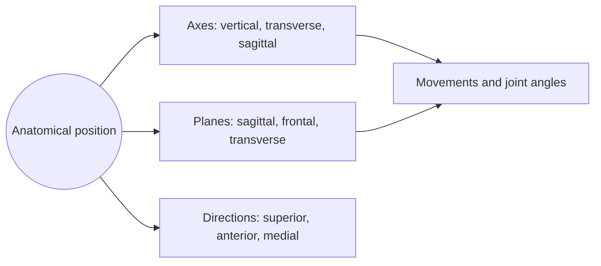

# Anatomical position

## Summary

The anatomical position is the standard posture to which all descriptions of the body refer: standing upright, head and eyes facing forward, arms hanging at the sides with the palms facing forward, feet close together. Axes, planes, directions and movements are all defined relative to it. Using one reference posture lets clinicians and anatomists describe structures without ambiguity, whatever position the person is actually in.

## Prerequisites

No prior notes are needed.

## Core concepts

### Definition

The *anatomical position* is a standardized posture of the human body used as the reference for anatomical description. In it, the person:

- stands upright with the head facing forward and the eyes open, looking straight ahead;
- has a neutral facial expression with the mouth closed;
- has the upper limbs straight and hanging freely at the sides of the trunk, with the palms facing forward (the forearms supinated);
- has the lower limbs close together, the feet together, toes pointing forward or in slight external rotation, and the toes straight.

It is used in anatomy atlases, textbooks and clinical records so that professionals worldwide can describe structures with a shared, often Latin, vocabulary.

### Analogy

The anatomical position works like the "north up" convention on maps. A map can be held in any direction, but "north" always means the same edge of the paper, so two people can agree on where a city lies. A patient lying on their side is described as if standing in the anatomical position, just as a map is read as if north were up. The analogy breaks because maps have one reference direction, while the body needs a full posture, including how the forearms are turned.

### Mechanism

All other terms derive from this posture:

- **Axes and planes** are drawn through the body in this position ([Axes and planes of the body](axes-and-planes.md)).
- **Directional terms** such as anterior or lateral refer to it ([Directional terms](directional-terms.md)). Because the palms face forward, the thumb is lateral and the little finger medial.
- **Movements** are described as departures from it; the anatomical position is the zero point for measuring joint angles ([Anatomical movements](anatomical-movements.md)).

The figure shows the posture with the main planes.

The flowchart shows how the rest of the vocabulary depends on the anatomical position.

### Related reference positions

| Position | Description | Used for |
| --- | --- | --- |
| Anatomical position | Standing, palms forward | All anatomical description |
| Fundamental (neutral) position | Standing, palms facing the thighs | Measuring forearm rotation, some range of motion tests |
| Supine | Lying on the back, face up | Examination, surgery |
| Prone | Lying on the front, face down | Examination of the back |

## Worked example

A patient lying face down (prone) has a wound on the side of the forearm nearest the thumb. In the anatomical position, the thumb side is lateral, so the record says "lateral forearm", even though in the prone position with the palm down the thumb points toward the body's midline. Recording it relative to the patient's current posture would confuse the next clinician.

## Trade offs and when to use it

- The convention is arbitrary but universal. Its value lies in everyone using it.
- Range of motion measurement often uses the neutral position (palms facing the body) as the zero for forearm rotation, which is a deliberate exception. Records should state which reference was used.

## Common mistakes

- **Describing structures relative to the patient's current posture.** Always refer to the anatomical position.
- **Forgetting the palms face forward.** This decides which forearm bone is lateral (the radius).
- **Confusing the patient's right with the viewer's right.** "Right" always means the patient's right.

## Practice

1. Describe the position of the hands in the anatomical position.
2. In the anatomical position, is the radius medial or lateral to the ulna?
3. A patient is lying on their back. Which term describes this?

### Answers

1. The arms hang at the sides with the palms facing forward.
2. Lateral, on the thumb side.
3. Supine.

## Further reading

- Betts, J. G., Young, K. A., Wise, J. A. et al. (2022). *Anatomy and Physiology 2e*. OpenStax, Rice University. [Link](https://openstax.org/details/books/anatomy-and-physiology-2e). Section 1.6 on anatomical terminology, with figures of planes and directions.
- Standring, S. (Ed.) (2020). *Gray's Anatomy: The Anatomical Basis of Clinical Practice (42nd ed.)*. Elsevier. Standard anatomical terms used in clinical practice.
