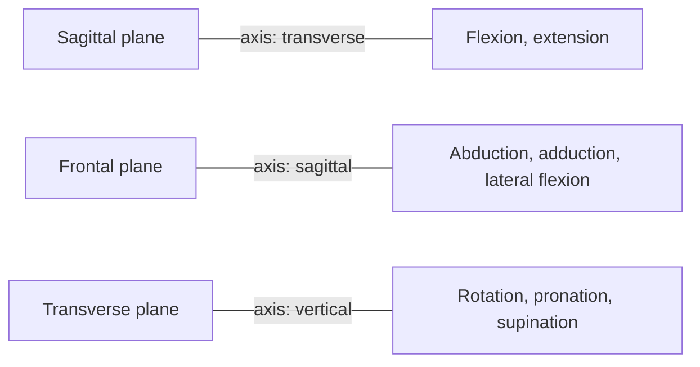

# Axes and planes of the body

## Summary

Three axes and three planes, all at right angles to each other, describe positions and movements in the body. The vertical axis runs from head to feet, the transverse axis from side to side and the sagittal axis from front to back. The sagittal plane divides the body into right and left, the frontal plane into front and back, and the transverse plane into upper and lower parts. Each type of movement happens in one plane around the axis perpendicular to it.

## Prerequisites

- [Anatomical position](anatomical-position.md)

## Core concepts

### Definition

An *axis* is a straight line around which a body part rotates. A *plane* is a flat surface that cuts through the body. In the anatomical position there are three main axes, which intersect at right angles:

- **Vertical (longitudinal) axis** (*axis verticalis*): runs from top to bottom. It is the longest, from the top of the head to a point between the feet.
- **Transverse (horizontal) axis** (*axis transversalis*): runs from side to side, perpendicular to the vertical axis.
- **Sagittal axis** (*axis sagittalis*): runs from front to back, perpendicular to the other two.

Each pair of axes defines a plane:

- **Sagittal plane** (*planum sagittale*): defined by the sagittal and vertical axes. It divides the body into right and left parts. The sagittal plane through the midline is the *median (midsagittal) plane*, which divides the body into two equal halves.
- **Frontal (coronal) plane** (*planum frontale*): defined by the transverse and vertical axes. It divides the body into anterior (front) and posterior (back) parts.
- **Transverse (horizontal) plane** (*planum transversale*): defined by the transverse and sagittal axes. It divides the body into superior (upper) and inferior (lower) parts. Cross-sectional images in CT and MRI are usually transverse ("axial") slices.

### Analogy

Think of slicing a loaf of bread standing on its end. Cutting it into left and right halves is a sagittal cut, cutting off the front crust from the back is a frontal cut, and cutting horizontal slices is a transverse cut. A door hinge is an axis: the door moves in a plane perpendicular to the hinge. The analogy breaks because bread slices are straight, while in the body the planes follow the anatomical position, not the actual posture of a bent limb.

### Mechanism

Movement in a plane happens around the axis perpendicular to that plane:

| Plane | Axis of rotation | Movements |
| --- | --- | --- |
| Sagittal | Transverse | Flexion and extension |
| Frontal | Sagittal | Abduction and adduction, lateral flexion of the trunk |
| Transverse | Vertical | Internal and external rotation, pronation and supination |

The figure shows the planes on a schematic body.

The diagram links each plane to its axis and movements.

Using planes to describe movement makes range of motion results readable for anyone, regardless of nationality and language. Biomechanics uses the same system to describe exercises (see [Biomechanics overview](../../exercise-and-fitness/biomechanics/biomechanics-overview.md)).

## Worked example

Which plane and axis does a biceps curl use? The forearm moves forward and up, toward the front of the body, so it moves in the sagittal plane around a transverse axis through the elbow. A lateral raise with dumbbells lifts the arms to the sides, which is abduction in the frontal plane around a sagittal axis through the shoulder. A cable wood chop combines trunk rotation (transverse plane) with diagonal arm movement, so it crosses planes.

## Trade offs and when to use it

- The three-plane system is simple, but most natural movements, such as throwing, are combinations across planes. Describing them requires either combining planes or using diagonal patterns.
- The planes are defined in the anatomical position. Once a joint is flexed, the anatomical planes and the actual planes of motion no longer coincide.

## Common mistakes

- **Mixing up the axis and the plane.** Flexion happens in the sagittal plane but around the transverse axis.
- **Calling every horizontal cut "frontal".** A horizontal cut is transverse.
- **Assuming exercises happen in one plane.** Many involve two or three.

## Practice

1. Which plane divides the body into front and back?
2. Around which axis does rotation of the head (saying "no") happen?
3. A side lunge moves the leg out to the side. Which plane is it in?

### Answers

1. The frontal (coronal) plane.
2. The vertical (longitudinal) axis.
3. The frontal plane.

## Further reading

- Betts, J. G., Young, K. A., Wise, J. A. et al. (2022). *Anatomy and Physiology 2e*. OpenStax, Rice University. [Link](https://openstax.org/details/books/anatomy-and-physiology-2e). Section 1.6 on anatomical terminology, with figures of planes and directions.
- Standring, S. (Ed.) (2020). *Gray's Anatomy: The Anatomical Basis of Clinical Practice (42nd ed.)*. Elsevier. Standard anatomical terms used in clinical practice.
