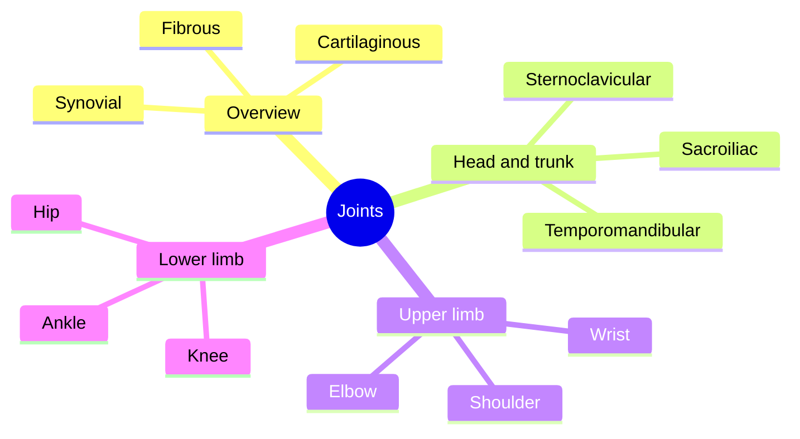

# Joints

Joints connect bones and decide how they can move. This subfield starts with how joints are built and classified, then describes the major joints of the body one by one.

## Map

## Reading order

1. [Joints overview](joints-overview.md): structure of joints and their classification by number of bones and axes.
2. [Temporomandibular joint](temporomandibular-joint.md)
3. [Sternoclavicular joint](sternoclavicular-joint.md)
4. [Shoulder joint](shoulder-joint.md)
5. [Elbow joint](elbow-joint.md)
6. [Wrist joint](wrist-joint.md)
7. [Sacroiliac joint](sacroiliac-joint.md)
8. [Hip joint](hip-joint.md)
9. [Knee joint](knee-joint.md)
10. [Ankle joint](ankle-joint.md)
