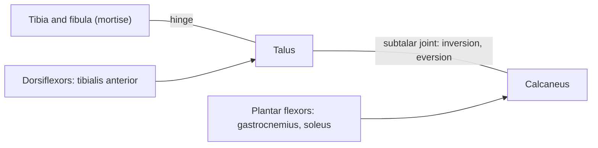

# Ankle joint

## Summary

The ankle (talocrural) joint is a hinge between the tibia and fibula above and the talus below. It allows dorsiflexion and plantar flexion. Side-to-side movement of the foot (inversion and eversion) happens below it, at the subtalar joint. Ankle sprains, mostly of the outer ligaments, are among the most common injuries in sport.

## Prerequisites

- [Joints overview](joints-overview.md)

## Core concepts

### Definition

The *ankle joint* is a uniaxial hinge synovial joint in which the trochlea of the talus fits into a mortise formed by the tibia and the medial and lateral malleoli. Latin: *articulatio talocruralis*.

### Analogy

The ankle is like a tenon in a carpenter's mortise: the talus fits snugly between the two malleoli. Because the talus is wider in front, the fit is tightest when the foot is pulled up (dorsiflexion) and loosest when pointed (plantar flexion), which is why sprains happen with the foot pointed and turned in. The analogy breaks because ligaments, not wood, hold the joint together.

### Mechanism

Dorsiflexion is produced by the tibialis anterior and toe extensors; plantar flexion by the gastrocnemius and soleus (via the Achilles tendon), with help from deep calf muscles and the fibularis muscles. The lateral ligaments (anterior talofibular, calcaneofibular, posterior talofibular) are weaker than the medial deltoid ligament.

### Facts

| Feature | Description |
| --- | --- |
| Type | Synovial, uniaxial hinge |
| Bones | Tibia, fibula, talus |
| Movements | Dorsiflexion about 20 degrees, plantar flexion about 50 degrees |
| Ligaments | Lateral: anterior talofibular, calcaneofibular, posterior talofibular; medial: deltoid |

## Worked example

About 85 percent of ankle sprains are inversion injuries that stretch or tear the anterior talofibular ligament first. Early weight bearing and balance training reduce the risk of repeat sprains, while about a third of people who sprain an ankle report lasting instability or pain without rehabilitation.

## Trade offs and when to use it

A snug mortise gives stability in dorsiflexion, but the pointed foot is less protected, especially on the lateral side.

## Common mistakes

- **Calling inversion an ankle (talocrural) movement.** Inversion and eversion happen mainly at the subtalar joint.

## Practice

1. Which ligament is injured first in an inversion sprain?
2. Why is the ankle less stable when the foot is pointed?

### Answers

1. The anterior talofibular ligament.
2. The talus is narrower at the back, so it fits loosely in the mortise in plantar flexion.

## Further reading

- Standring, S. (Ed.) (2020). *Gray's Anatomy: The Anatomical Basis of Clinical Practice (42nd ed.)*. Elsevier. Reference text for attachments, innervation and relations.
- Betts, J. G., Young, K. A., Wise, J. A. et al. (2022). *Anatomy and Physiology 2e*. OpenStax, Rice University. [Link](https://openstax.org/details/books/anatomy-and-physiology-2e). Open textbook with illustrations of the skeletal and muscular systems.
