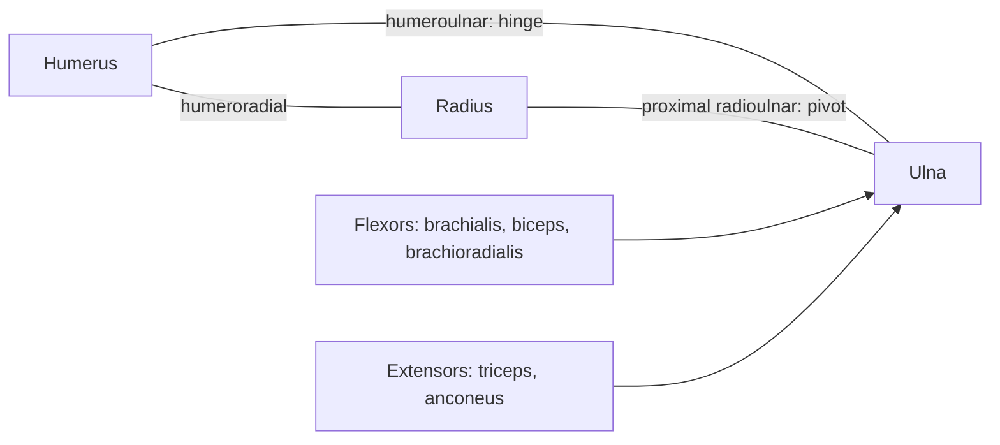

# Elbow joint

## Summary

The elbow is a compound joint where the humerus meets the ulna and radius within one capsule. The humeroulnar part works as a hinge for flexion and extension, and the proximal radioulnar part as a pivot for pronation and supination. It is a classic example of a compound joint.

## Prerequisites

- [Joints overview](joints-overview.md)

## Core concepts

### Definition

The *elbow joint* is a compound synovial joint comprising three articulations: humeroulnar (hinge), humeroradial (ball-like but limited) and proximal radioulnar (pivot). Latin: *articulatio cubiti*.

### Analogy

The elbow is like a door hinge combined with a rotating doorknob in the same housing: the hinge bends the forearm, and the knob (radial head) turns the hand over. The analogy breaks because the parts share one capsule and influence each other.

### Mechanism

Flexion is produced by the brachialis, biceps brachii and brachioradialis; extension by the triceps and anconeus. Supination by the biceps and supinator; pronation by the pronator teres and quadratus. The annular ligament holds the radial head against the ulna. The ulnar and radial collateral ligaments stabilize the sides.

### Facts

| Feature | Description |
| --- | --- |
| Type | Compound synovial: hinge and pivot |
| Bones | Humerus, ulna, radius |
| Movements | Flexion about 145 degrees, extension to 0, pronation and supination about 80 to 90 degrees each |
| Ligaments | Ulnar and radial collateral, annular ligament |

## Worked example

"Pulled elbow" in toddlers happens when a child is lifted or yanked by the hand: the radial head slips partly out of the annular ligament. The child stops using the arm. A simple maneuver by a clinician (supination and flexion, or hyperpronation) usually reduces it within seconds.

## Trade offs and when to use it

Packing a hinge and a pivot in one joint saves space and gives the hand great versatility, but injuries often affect both functions.

## Common mistakes

- **Saying the biceps is the main elbow flexor.** The brachialis is the main flexor in all forearm positions; the biceps is strongest with the forearm supinated.

## Practice

1. Which three articulations make up the elbow?
2. Which ligament holds the radial head?

### Answers

1. Humeroulnar, humeroradial and proximal radioulnar.
2. The annular ligament.

## Further reading

- Standring, S. (Ed.) (2020). *Gray's Anatomy: The Anatomical Basis of Clinical Practice (42nd ed.)*. Elsevier. Reference text for attachments, innervation and relations.
- Betts, J. G., Young, K. A., Wise, J. A. et al. (2022). *Anatomy and Physiology 2e*. OpenStax, Rice University. [Link](https://openstax.org/details/books/anatomy-and-physiology-2e). Open textbook with illustrations of the skeletal and muscular systems.
