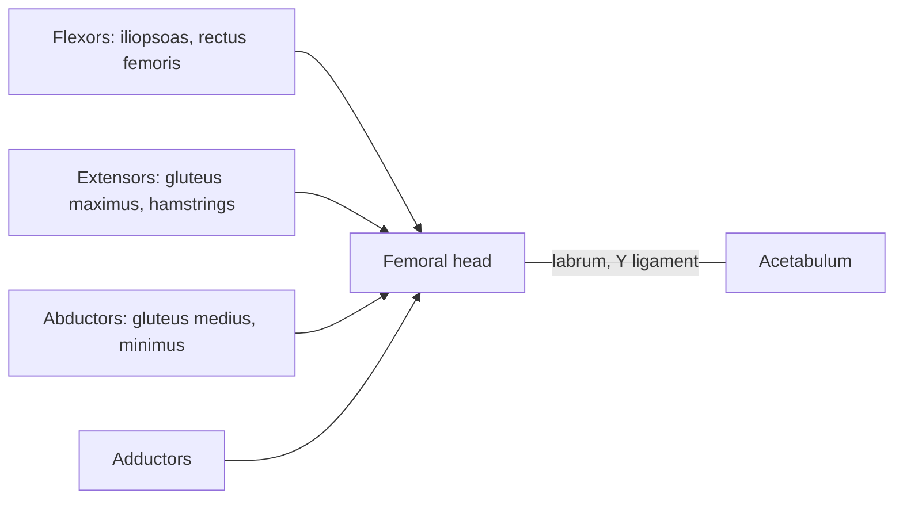

# Hip joint

## Summary

The hip is a deep ball and socket joint between the head of the femur and the acetabulum of the hip bone. Its deep socket and very strong ligaments make it stable enough to carry body weight, at some cost to range of motion compared with the shoulder. It is moved by the strongest muscles of the body, including the gluteus maximus and iliopsoas.

## Prerequisites

- [Joints overview](joints-overview.md)

## Core concepts

### Definition

The *hip joint* is a multiaxial synovial joint of the cup-shaped ball and socket type (enarthrosis), in which the socket covers more than half of the ball. The acetabular labrum deepens the socket further. Latin: *articulatio coxae*.

### Analogy

The hip is like a ball sunk deep into a cup: it can rotate in every direction, but cannot pop out without great force. The analogy breaks because the ligaments wind around the neck in a spiral, tightening in extension, which pulls the ball deeper when we stand upright.

### Mechanism

The iliofemoral (Y) ligament, among the strongest in the body, limits extension, so we can stand with little muscle effort. Flexors: iliopsoas, rectus femoris, sartorius, tensor fasciae latae. Extensors: gluteus maximus, hamstrings. Abductors: gluteus medius and minimus. Adductors: adductor group. Rotators: deep lateral rotators (piriformis, obturators, gemelli, quadratus femoris) and medial rotators (gluteus medius and minimus anterior fibers, tensor fasciae latae).

### Facts

| Feature | Description |
| --- | --- |
| Type | Synovial, multiaxial, deep ball and socket |
| Bones | Femur, hip bone |
| Movements | Flexion about 120 degrees (knee bent), extension about 10 to 30, abduction about 45, adduction about 30, internal rotation about 35, external rotation about 45 |
| Ligaments | Iliofemoral, pubofemoral, ischiofemoral, ligament of the head |

## Worked example

When standing on one leg, the gluteus medius of the standing side must hold the pelvis level. If it is weak, the pelvis drops on the opposite side (Trendelenburg sign). This test is used after hip surgery and in runners with hip pain, and it explains why gluteus medius strength matters for walking.

## Trade offs and when to use it

Deep, strong and stable for weight bearing; the price is less range than the shoulder and wear over decades (hip osteoarthritis).

## Common mistakes

- **Pointing to the side of the pelvis as "the hip joint".** The joint lies deep in the groin, below the middle of the inguinal ligament.

## Practice

1. Which ligament limits hip extension and helps us stand?
2. What does a positive Trendelenburg sign indicate?

### Answers

1. The iliofemoral (Y) ligament.
2. Weakness of the hip abductors (gluteus medius) on the standing side.

## Further reading

- Standring, S. (Ed.) (2020). *Gray's Anatomy: The Anatomical Basis of Clinical Practice (42nd ed.)*. Elsevier. Reference text for attachments, innervation and relations.
- Betts, J. G., Young, K. A., Wise, J. A. et al. (2022). *Anatomy and Physiology 2e*. OpenStax, Rice University. [Link](https://openstax.org/details/books/anatomy-and-physiology-2e). Open textbook with illustrations of the skeletal and muscular systems.
