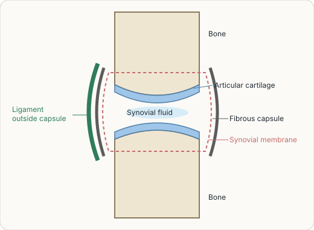
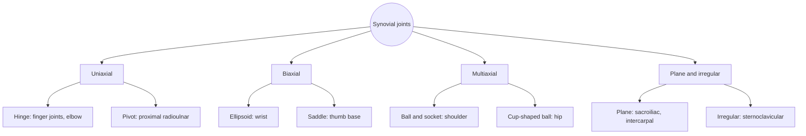

# Joints overview

## Summary

A joint (*articulatio*) is a connection between parts of the skeleton. Joints that allow free movement are synovial joints: their bone ends are covered with smooth, wear-resistant hyaline cartilage and enclosed in a capsule filled with lubricating synovial fluid, because friction is the main problem in a moving joint, as in machine bearings. Joints are classified by structure (fibrous, cartilaginous, synovial), by the number of bones involved (simple or compound) and by the number of axes of movement (uniaxial, biaxial, multiaxial).

## Prerequisites

- [Skeletal system overview](../skeletal-system/skeletal-system-overview.md)
- [Anatomical movements](../anatomical-terminology/anatomical-movements.md)

## Core concepts

### Definition

A *joint* is a movable or immovable connection between elements of a skeleton, internal or external. Joints occur in arthropods (between parts of the exoskeleton) and in vertebrates. In vertebrates, the movable joints have a specific structure and are called *synovial joints* (*juncturae synoviales*). The broader term *connections of bones* includes immovable ones such as sutures.

### Analogy

A synovial joint is like a well-built machine bearing. Two moving parts have polished surfaces (articular cartilage), are bathed in lubricant (synovial fluid) and are sealed in a housing (joint capsule) held by straps (ligaments). The main enemy is friction and wear. The analogy breaks because cartilage is living tissue that is nourished by the lubricant itself, through repeated loading and unloading, so a joint that does not move is poorly fed.

### Mechanism

**Structural classes.**

| Class | Tissue joining the bones | Movement | Examples |
| --- | --- | --- | --- |
| Fibrous | Dense connective tissue | None or very little | Skull sutures, tooth sockets (gomphoses), distal tibiofibular syndesmosis |
| Cartilaginous | Hyaline cartilage or fibrocartilage | Little | Growth plates and first rib (synchondroses), pubic symphysis and intervertebral discs (symphyses) |
| Synovial | Capsule and synovial cavity | Free within limits | Shoulder, hip, knee, finger joints |

**Parts of a synovial joint.** Articular cartilage covers the bone ends; the joint cavity holds synovial fluid; the synovial membrane lines the capsule and produces the fluid; the fibrous capsule and ligaments hold the bones together. Some joints have discs or menisci (knee, jaw) and bursae (fluid-filled sacs that reduce friction near tendons).

The figure shows a schematic section of a synovial joint.

**By number of bones.**

- *Simple joint* (*articulatio simplex*): only two bones, for example the hip.
- *Compound joint* (*articulatio composita*): more than two bones, for example the elbow (humerus, ulna and radius).

**By number of axes.**

| Axes | Type | Example |
| --- | --- | --- |
| One (uniaxial) | Hinge (ginglymus) | Interphalangeal joints, humeroulnar part of the elbow |
| | Pivot (trochoid) | Proximal radioulnar joint |
| | Screw-shaped hinge (cochlear) | Talocrural joint is sometimes classed here; in some texts the median atlantoaxial joint |
| Two (biaxial) | Ellipsoid (condylar) | Radiocarpal (wrist) joint |
| | Saddle | Carpometacarpal joint of the thumb |
| Many (multiaxial) | Free ball and socket | Shoulder (glenohumeral) joint |
| | Cup-shaped ball and socket (enarthrosis) | Hip joint |
| Irregular | Irregular | Sternoclavicular joint |
| Gliding | Plane | Sacroiliac joint, intercarpal joints |

The classification of the atlantoaxial and ankle joints differs between textbooks. A frequent version lists the median atlantoaxial joint as a pivot joint.

The diagram summarizes the axis classification.

### Stability and mobility

A joint trades mobility for stability. The shoulder has a shallow socket and the widest range of motion but dislocates most often. The hip has a deep socket and strong ligaments and dislocates rarely. Muscles add *dynamic* stability on top of the *passive* stability of bone shape, capsule and ligaments.

## Worked example

Osteoarthritis is the gradual loss of articular cartilage with changes in the bone beneath. Because cartilage has no nerves and no blood vessels, early damage is painless and heals poorly. The knee and hip are most often affected. Regular loading, such as walking and strength training, helps nourish cartilage, and exercise therapy reduces pain and improves function in knee osteoarthritis according to guidelines, while complete rest tends to worsen stiffness.

## Trade offs and when to use it

- The structural and axis classifications describe different things and are used together: the knee is a synovial, compound, modified hinge joint.
- Joint classifications are simplifications; most joints allow small accessory movements outside their main axes.

## Common mistakes

- **Using "joint" only for movable joints.** Sutures and symphyses are joints too.
- **Thinking cartilage regenerates easily.** Adult articular cartilage repairs poorly.
- **Resting a stiff arthritic joint completely.** Graded movement usually helps.

## Practice

1. Give an example of a compound joint.
2. Which type of joint is the thumb base?
3. Why does the hip dislocate less often than the shoulder?

### Answers

1. The elbow (humerus, ulna and radius).
2. A saddle joint (carpometacarpal joint of the thumb).
3. The hip has a deep socket and strong ligaments; the shoulder has a shallow socket and depends on muscles.

## Further reading

- Standring, S. (Ed.) (2020). *Gray's Anatomy: The Anatomical Basis of Clinical Practice (42nd ed.)*. Elsevier. Reference text for attachments, innervation and relations.
- Betts, J. G., Young, K. A., Wise, J. A. et al. (2022). *Anatomy and Physiology 2e*. OpenStax, Rice University. [Link](https://openstax.org/details/books/anatomy-and-physiology-2e). Open textbook with illustrations of the skeletal and muscular systems.
