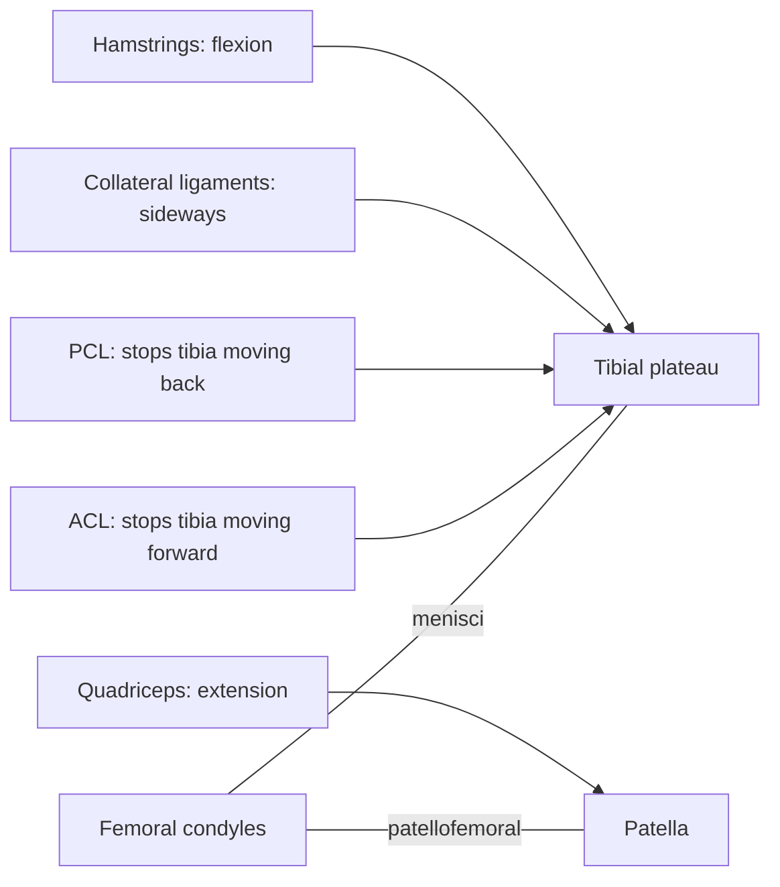

# Knee joint

## Summary

The knee is the largest joint of the body, a compound joint between the femur, tibia and patella. It works mainly as a hinge, with a small rotation when bent. Because the bone surfaces fit poorly, stability depends on the cruciate and collateral ligaments, the menisci and the surrounding muscles. Ligament and meniscus injuries are common in sports.

## Prerequisites

- [Joints overview](joints-overview.md)

## Core concepts

### Definition

The *knee joint* is a compound synovial joint made of the tibiofemoral joint (a modified hinge, sometimes called bicondylar) and the patellofemoral joint. Two C-shaped fibrocartilage menisci sit between femur and tibia. Latin: *articulatio genus*.

### Analogy

The knee is like two rounded rockers (femoral condyles) on a nearly flat table (tibial plateau), held by crossed ropes inside (cruciate ligaments) and straps on the sides (collateral ligaments). Rubber wedges (menisci) make the table slightly concave. The analogy breaks because the rockers roll and slide at the same time, and the ropes stay tight in different positions.

### Mechanism

The anterior cruciate ligament (ACL) prevents the tibia from sliding forward and limits rotation; the posterior cruciate ligament (PCL) prevents it from sliding back. The medial and lateral collateral ligaments resist sideways bending. The menisci spread load and absorb shock. In the last degrees of extension, the tibia rotates slightly outward ("screw-home mechanism"), locking the knee for standing; the popliteus releases this lock.

### Facts

| Feature | Description |
| --- | --- |
| Type | Compound synovial: modified hinge plus patellofemoral |
| Bones | Femur, tibia, patella |
| Movements | Flexion about 135 to 150 degrees, extension to 0 (slight hyperextension possible), rotation about 30 to 40 degrees when flexed |
| Ligaments | ACL, PCL, medial and lateral collateral, patellar ligament |
| Menisci | Medial (C-shaped, attached to MCL), lateral (more circular, more mobile) |

## Worked example

A soccer player plants the foot, cuts sideways and feels a pop with immediate swelling: a typical non-contact ACL tear. Women have a two- to eightfold higher rate in some sports. Neuromuscular warm-up programs (such as FIFA 11+) that train landing, cutting and hamstring strength reduce ACL injuries by roughly a half in trials.

## Trade offs and when to use it

A large range of flexion with a stable straight leg for standing, at the cost of reliance on soft tissues that tear.

## Common mistakes

- **Thinking "knees over toes" is always dangerous.** Knees traveling forward in a squat is normal; control and load progression matter more.

## Practice

1. What does the ACL prevent?
2. What is the screw-home mechanism?
3. Which meniscus is more often torn, and why?

### Answers

1. Forward sliding of the tibia on the femur and excessive rotation.
2. A small external rotation of the tibia at the end of extension that locks the knee.
3. The medial meniscus, because it is attached to the medial collateral ligament and less mobile.

## Further reading

- Standring, S. (Ed.) (2020). *Gray's Anatomy: The Anatomical Basis of Clinical Practice (42nd ed.)*. Elsevier. Reference text for attachments, innervation and relations.
- Betts, J. G., Young, K. A., Wise, J. A. et al. (2022). *Anatomy and Physiology 2e*. OpenStax, Rice University. [Link](https://openstax.org/details/books/anatomy-and-physiology-2e). Open textbook with illustrations of the skeletal and muscular systems.
