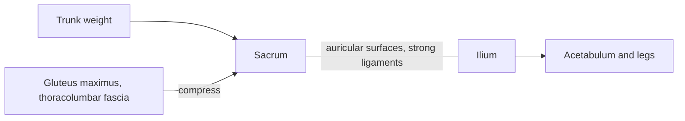

# Sacroiliac joint

## Summary

The sacroiliac joints connect the sacrum with the ilium on each side. They are plane synovial joints with irregular, interlocking surfaces held by some of the strongest ligaments in the body. They transfer the weight of the trunk to the legs and allow only a few degrees of movement.

## Prerequisites

- [Joints overview](joints-overview.md)

## Core concepts

### Definition

The *sacroiliac joint* is a paired, plane (gliding) synovial joint between the auricular surfaces of the sacrum and ilium, reinforced by the anterior, interosseous and posterior sacroiliac ligaments and by the sacrotuberous and sacrospinous ligaments. Latin: *articulatio sacroiliaca*.

### Analogy

The sacroiliac joint is like two puzzle pieces pressed together with glue: the irregular surfaces interlock and the ligaments hold them tight, so they barely move but absorb small shocks. The analogy breaks because the "glue" loosens in pregnancy.

### Mechanism

The main movement is *nutation*, a small forward tilt of the sacrum under load, typically 1 to 4 degrees, which tightens the ligaments (self-locking). The gluteus maximus and the thoracolumbar fascia add compression across the joint.

### Facts

| Feature | Description |
| --- | --- |
| Type | Synovial, plane, with strong ligaments |
| Bones | Sacrum, ilium |
| Movement | Nutation and counternutation, a few degrees |
| Function | Transfer load between spine and legs |

## Worked example

Pain over the dimples at the back of the pelvis (posterior superior iliac spines), sometimes spreading to the buttock, can come from the sacroiliac joint, especially in pregnancy or after a fall on the buttock. Several provocation tests together make the diagnosis more likely than any single test.

## Trade offs and when to use it

Very stable, little motion; this stability is relaxed in pregnancy to allow the pelvis to widen.

## Common mistakes

- **Blaming most low back pain on the sacroiliac joint.** It is one of several possible sources and is hard to confirm.

## Practice

1. What is nutation?
2. What type of joint is the sacroiliac joint?

### Answers

1. A small forward tilt of the sacrum relative to the ilium under load.
2. A plane synovial joint with strong ligaments.

## Further reading

- Standring, S. (Ed.) (2020). *Gray's Anatomy: The Anatomical Basis of Clinical Practice (42nd ed.)*. Elsevier. Reference text for attachments, innervation and relations.
- Betts, J. G., Young, K. A., Wise, J. A. et al. (2022). *Anatomy and Physiology 2e*. OpenStax, Rice University. [Link](https://openstax.org/details/books/anatomy-and-physiology-2e). Open textbook with illustrations of the skeletal and muscular systems.
