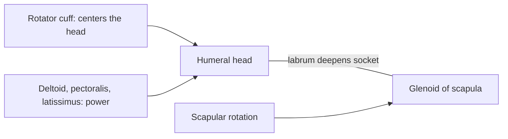

# Shoulder joint

## Summary

The shoulder (glenohumeral) joint is a ball and socket joint between the head of the humerus and the shallow glenoid cavity of the scapula. It has the largest range of motion of any joint, achieved by trading bony stability for mobility. The rotator cuff muscles keep the head centered in the socket, and the shoulder is the most frequently dislocated large joint.

## Prerequisites

- [Joints overview](joints-overview.md)

## Core concepts

### Definition

The *glenohumeral joint* is a free, multiaxial ball and socket synovial joint. A rim of fibrocartilage (the glenoid labrum) deepens the socket. The "shoulder complex" also includes the sternoclavicular and acromioclavicular joints and the scapulothoracic gliding plane. Latin: *articulatio humeri*.

### Analogy

The shoulder is like a golf ball resting on a tee: the ball (humeral head) is much larger than the tee (glenoid), so it can roll in any direction, but it falls off easily unless held. The rotator cuff acts like fingers holding the ball on the tee. The analogy breaks because the tee itself moves with the scapula to follow the ball.

### Mechanism

The rotator cuff (supraspinatus, infraspinatus, teres minor, subscapularis) compresses the head into the glenoid during all movements. The deltoid and pectoral muscles provide the large forces. During arm elevation, the scapula rotates upward about 1 degree for every 2 degrees of glenohumeral motion. The long head of the biceps runs through the joint over the humeral head.

### Facts

| Feature | Description |
| --- | --- |
| Type | Synovial, multiaxial, free ball and socket |
| Bones | Humerus, scapula |
| Movements | Flexion about 180 degrees, extension about 60, abduction about 180 (with scapula), adduction, internal and external rotation, circumduction |
| Main stabilizers | Rotator cuff, labrum, glenohumeral ligaments, capsule |

## Worked example

About 95 percent of shoulder dislocations are anterior, typically when the arm is abducted and externally rotated, as in blocking a shot overhead. The labrum can tear at the front of the socket (Bankart lesion), and young athletes have a high rate of repeat dislocation, which is why some undergo surgical repair.

## Trade offs and when to use it

The widest range of motion of any joint comes with the highest dislocation rate and frequent rotator cuff problems.

## Common mistakes

- **Training only the large shoulder muscles.** The rotator cuff and scapular muscles keep the joint centered and need training too.

## Practice

1. Name the four rotator cuff muscles.
2. In which direction do most shoulder dislocations occur?

### Answers

1. Supraspinatus, infraspinatus, teres minor and subscapularis.
2. Anteriorly.

## Further reading

- Standring, S. (Ed.) (2020). *Gray's Anatomy: The Anatomical Basis of Clinical Practice (42nd ed.)*. Elsevier. Reference text for attachments, innervation and relations.
- Betts, J. G., Young, K. A., Wise, J. A. et al. (2022). *Anatomy and Physiology 2e*. OpenStax, Rice University. [Link](https://openstax.org/details/books/anatomy-and-physiology-2e). Open textbook with illustrations of the skeletal and muscular systems.
