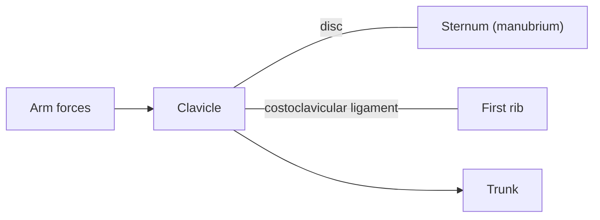

# Sternoclavicular joint

## Summary

The sternoclavicular joint between the clavicle and the sternum is the only bony joint connecting the upper limb to the trunk. It is classed as an irregular (saddle-like) joint with a disc and allows the clavicle to rise, fall, move forward and back and rotate. It is very strong and rarely dislocates.

## Prerequisites

- [Joints overview](joints-overview.md)

## Core concepts

### Definition

The *sternoclavicular joint* is a synovial joint between the sternal end of the clavicle, the clavicular notch of the manubrium and the first costal cartilage, divided by an articular disc. Latin: *articulatio sternoclavicularis*.

### Analogy

The joint is like the universal joint at the root of a crane boom: it lets the boom (clavicle) swing in many directions while firmly anchored to the base (sternum). The analogy breaks because strong ligaments, not bolts, hold it in place.

### Mechanism

With the arm raised overhead, the clavicle elevates about 30 to 35 degrees and rotates backward about 40 to 50 degrees at this joint, which lets the scapula rotate upward. The disc and the costoclavicular ligament absorb force transmitted from the arm.

### Facts

| Feature | Description |
| --- | --- |
| Type | Synovial, saddle-like (irregular), with disc |
| Bones | Clavicle, manubrium, first costal cartilage |
| Movements | Elevation, depression, protraction, retraction, rotation |

## Worked example

Because the ligaments are strong, a fall on the shoulder usually breaks the clavicle rather than dislocating this joint. A posterior dislocation, though rare, is an emergency, because the clavicle can press on the trachea or great vessels behind the sternum.

## Trade offs and when to use it

Strong and mobile, but its injuries are rare and therefore easily missed.

## Common mistakes

- **Ignoring this joint in shoulder movement.** Overhead reach needs clavicular rotation here.

## Practice

1. What is special about the sternoclavicular joint?
2. Why is a posterior dislocation dangerous?

### Answers

1. It is the only bony joint between the upper limb and the trunk.
2. The clavicle can press on the trachea and great vessels.

## Further reading

- Standring, S. (Ed.) (2020). *Gray's Anatomy: The Anatomical Basis of Clinical Practice (42nd ed.)*. Elsevier. Reference text for attachments, innervation and relations.
- Betts, J. G., Young, K. A., Wise, J. A. et al. (2022). *Anatomy and Physiology 2e*. OpenStax, Rice University. [Link](https://openstax.org/details/books/anatomy-and-physiology-2e). Open textbook with illustrations of the skeletal and muscular systems.
