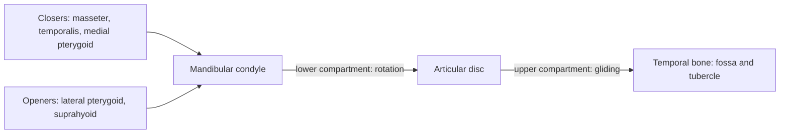

# Temporomandibular joint

## Summary

The temporomandibular joint (TMJ) connects the mandible to the temporal bone in front of each ear. An articular disc divides it into two compartments, so it can both hinge and glide. It is used in chewing, speaking and yawning, and disorders of the TMJ are a common cause of facial pain.

## Prerequisites

- [Joints overview](joints-overview.md)

## Core concepts

### Definition

The *temporomandibular joint* is a paired synovial joint between the condylar process of the mandible and the mandibular fossa and articular tubercle of the temporal bone, with a fibrocartilage disc inside. Latin: *articulatio temporomandibularis*.

### Analogy

The TMJ is like a hinged drawer: first the drawer front tilts (rotation of the condyle in the lower compartment), then the whole drawer slides forward on its rails (gliding of the disc and condyle in the upper compartment onto the articular tubercle). The analogy breaks because both sides of the jaw must move together, since the mandible is one bone.

### Mechanism

Opening the mouth begins with rotation of the condyles (about the first 20 to 25 mm) and continues with forward translation. Closing is done by the masseter, temporalis and medial pterygoid; opening by the lateral pterygoid, assisted by gravity and the suprahyoid muscles. Side-to-side grinding uses alternating action of the pterygoids.

### Facts

| Feature | Description |
| --- | --- |
| Type | Synovial, bicondylar, with disc (hinge and gliding) |
| Bones | Mandible, temporal bone |
| Movements | Opening, closing, protrusion, retrusion, side-to-side |
| Normal opening | About 40 to 55 mm between incisors in adults |

## Worked example

A clicking jaw on opening often means the disc slips forward when the mouth is closed and snaps back into place during opening. Clicking alone is common and usually harmless; pain or locking needs assessment. Most TMJ disorders improve with simple measures such as soft food, reducing clenching and jaw exercises.

## Trade offs and when to use it

Combining hinge and glide allows a wide opening for eating but makes the disc vulnerable to displacement.

## Common mistakes

- **Treating every jaw click as a disease.** Painless clicking is common and often needs no treatment.

## Practice

1. Which muscle opens the jaw by pulling the condyle forward?
2. What divides the TMJ into two compartments?

### Answers

1. The lateral pterygoid.
2. The articular disc.

## Further reading

- Standring, S. (Ed.) (2020). *Gray's Anatomy: The Anatomical Basis of Clinical Practice (42nd ed.)*. Elsevier. Reference text for attachments, innervation and relations.
- Betts, J. G., Young, K. A., Wise, J. A. et al. (2022). *Anatomy and Physiology 2e*. OpenStax, Rice University. [Link](https://openstax.org/details/books/anatomy-and-physiology-2e). Open textbook with illustrations of the skeletal and muscular systems.
