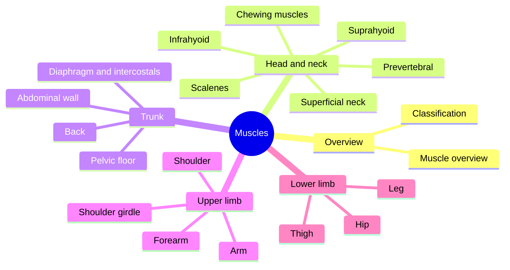

# Muscular system

Skeletal muscles move the skeleton, hold posture, produce heat and protect joints. This subfield explains what muscles are and how they are classified, then gives one note per muscle or muscle group, organized by region. Each muscle note lists origin, insertion, nerve supply and actions, and links the muscle to exercises and common problems.

## Map

## Reading order

1. [Muscular system overview](muscular-system-overview.md): what a muscle is, how many there are and how they are built.
2. [Muscle classification](muscle-classification.md): classification by tissue, joints crossed, function, shape, fiber arrangement and fiber type.
3. [Head and neck muscles](head-and-neck/README.md)
4. [Trunk muscles](trunk/README.md)
5. [Upper limb muscles](upper-limb/README.md)
6. [Lower limb muscles](lower-limb/README.md)

How muscles contract is explained in [Physiology](../../physiology/README.md), and how they work together in movement in [Functional muscle groups](../../exercise-and-fitness/biomechanics/functional-muscle-groups.md).
