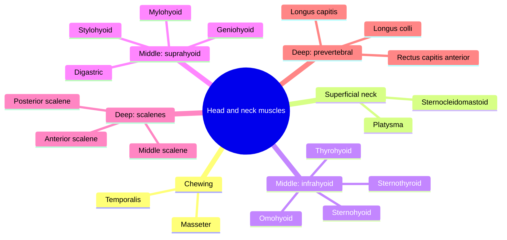

# Head and neck muscles

The neck holds and moves the head, protects the airway and the great vessels, and takes part in swallowing, speech and breathing. Its muscles are arranged in layers: superficial, middle (infrahyoid and suprahyoid groups around the hyoid bone) and deep (scalenes and prevertebral muscles). Two chewing muscles of the head are included because they work with the suprahyoid group.

## Map

## Reading order

Chewing muscles:

1. [Masseter](masseter.md)
2. [Temporalis](temporalis.md)

Superficial neck muscles:

3. [Platysma](platysma.md)
4. [Sternocleidomastoid](sternocleidomastoid.md)

Middle neck muscles, infrahyoid group:

5. [Sternohyoid](sternohyoid.md)
6. [Omohyoid](omohyoid.md)
7. [Sternothyroid](sternothyroid.md)
8. [Thyrohyoid](thyrohyoid.md)

Middle neck muscles, suprahyoid group:

9. [Digastric](digastric.md)
10. [Stylohyoid](stylohyoid.md)
11. [Mylohyoid](mylohyoid.md)
12. [Geniohyoid](geniohyoid.md)

Deep neck muscles, scalenes:

13. [Anterior scalene](anterior-scalene.md)
14. [Middle scalene](middle-scalene.md)
15. [Posterior scalene](posterior-scalene.md)

Deep neck muscles, prevertebral group:

16. [Rectus capitis anterior](rectus-capitis-anterior.md)
17. [Longus capitis](longus-capitis.md)
18. [Longus colli](longus-colli.md)

The surface anatomy of the neck as a whole is described in [Neck](../../regions/neck.md).
