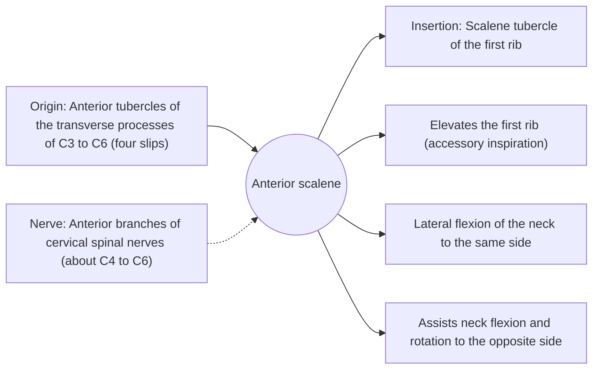

# Anterior scalene

## Summary

The anterior scalene is a deep neck muscle running from the cervical vertebrae down to the first rib. It bends the neck to the side, lifts the first rib in deep breathing and helps flex the neck. The subclavian artery and the brachial plexus pass between it and the middle scalene.

## Prerequisites

- [Muscular system overview](../muscular-system-overview.md)
- [Neck](../../regions/neck.md)

## Core concepts

### Definition

The *anterior scalene* begins with four slips on the anterior tubercles of the transverse processes of C3 to C6 and inserts on the first rib.

### Analogy

The scalenes are like guy wires that hold the neck mast to the first rib. Pulled from above, they lift the rib (breathing); pulled from below, they tilt the neck. The analogy breaks because nerves and the main artery to the arm pass through the gap between two of the wires.

### Mechanism

In quiet breathing the scalenes are active in many people, holding the upper ribs; in heavy breathing they lift them. The phrenic nerve runs down on the front of the anterior scalene, and the subclavian vein passes in front of it.

The diagram shows the attachments, the nerve and the actions.

### Attachments and innervation

| Feature | Description |
| --- | --- |
| Latin name | *musculus scalenus anterior* |
| Origin | Anterior tubercles of the transverse processes of C3 to C6 (four slips) |
| Insertion | Scalene tubercle of the first rib |
| Innervation | Anterior branches of cervical spinal nerves (about C4 to C6) |
| Actions | Elevates the first rib (accessory inspiration); Lateral flexion of the neck to the same side; Assists neck flexion and rotation to the opposite side |

### Scalene gap

The subclavian artery and the roots of the brachial plexus pass through the interscalene triangle between the anterior and middle scalenes and the first rib. Narrowing of this gap is one cause of thoracic outlet syndrome.

## Worked example

An anesthesiologist performing an interscalene block injects local anesthetic between the anterior and middle scalenes under ultrasound to numb the shoulder for surgery. Because the phrenic nerve runs on the anterior scalene, the block often temporarily paralyzes half of the diaphragm.

## Trade offs and when to use it

A breathing helper and neck stabilizer whose position near nerves and vessels makes it clinically important.

## Common mistakes

- **Placing the brachial plexus in front of the anterior scalene.** It passes behind it, between the anterior and middle scalenes.

## Practice

1. What passes between the anterior and middle scalenes?
2. Which nerve runs on the front of the anterior scalene?

### Answers

1. The subclavian artery and the brachial plexus.
2. The phrenic nerve.

## Further reading

- Standring, S. (Ed.) (2020). *Gray's Anatomy: The Anatomical Basis of Clinical Practice (42nd ed.)*. Elsevier. Reference text for attachments, innervation and relations.
- Betts, J. G., Young, K. A., Wise, J. A. et al. (2022). *Anatomy and Physiology 2e*. OpenStax, Rice University. [Link](https://openstax.org/details/books/anatomy-and-physiology-2e). Open textbook with illustrations of the skeletal and muscular systems.
