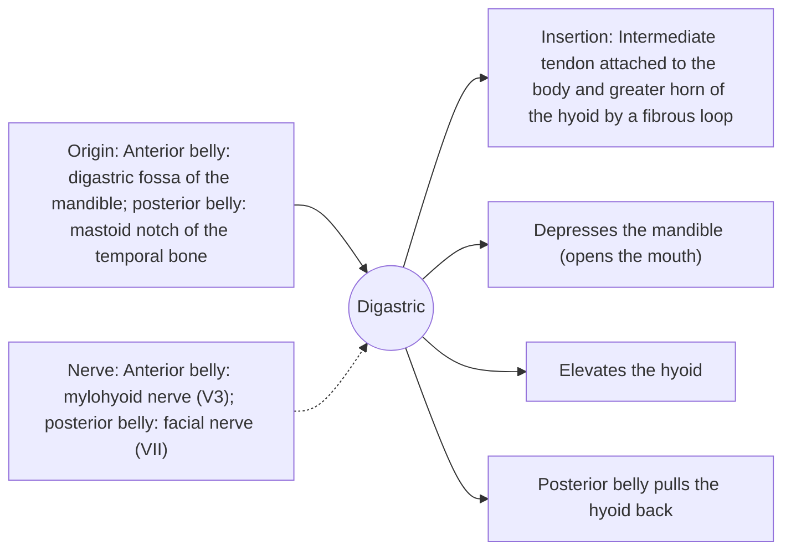

# Digastric

## Summary

The digastric is a suprahyoid muscle with two bellies, anterior and posterior, joined by an intermediate tendon that is held to the hyoid bone by a fibrous loop. It opens the mouth by pulling the mandible down and lifts the hyoid during swallowing.

## Prerequisites

- [Muscular system overview](../muscular-system-overview.md)
- [Neck](../../regions/neck.md)

## Core concepts

### Definition

The *digastric* ("two-bellied") lies below the mandible. The two bellies come from different embryonic arches and therefore have different nerves.

### Analogy

The digastric is like a rope passing through a pulley at the hyoid: pulling both ends lifts the hyoid, and if the hyoid is held down by the infrahyoid muscles, the front end pulls the chin down to open the mouth. The analogy breaks because the two "ends" are separate muscles with separate nerves.

### Mechanism

When the infrahyoid muscles fix the hyoid, the digastric opens the mouth, especially against resistance and in wide opening. When the mandible is fixed, it lifts the hyoid for swallowing.

The diagram shows the attachments, the nerve and the actions.

### Attachments and innervation

| Feature | Description |
| --- | --- |
| Latin name | *musculus digastricus* |
| Origin | Anterior belly: digastric fossa of the mandible; posterior belly: mastoid notch of the temporal bone |
| Insertion | Intermediate tendon attached to the body and greater horn of the hyoid by a fibrous loop |
| Innervation | Anterior belly: mylohyoid nerve (V3); posterior belly: facial nerve (VII) |
| Actions | Depresses the mandible (opens the mouth); Elevates the hyoid; Posterior belly pulls the hyoid back |

## Worked example

Opening the mouth against a hand placed under the chin makes the anterior bellies tense under the jaw. The double nerve supply is a classic example of how embryology explains adult anatomy.

## Trade offs and when to use it

One muscle, two functions, depending on which bone is fixed.

## Common mistakes

- **Assuming one nerve supplies both bellies.** The anterior belly gets the mylohyoid nerve (V3), the posterior belly the facial nerve (VII).

## Practice

1. Which two nerves supply the digastric?
2. Where does the posterior belly originate?

### Answers

1. The mylohyoid nerve (trigeminal) for the anterior belly and the facial nerve for the posterior belly.
2. The mastoid notch of the temporal bone.

## Further reading

- Standring, S. (Ed.) (2020). *Gray's Anatomy: The Anatomical Basis of Clinical Practice (42nd ed.)*. Elsevier. Reference text for attachments, innervation and relations.
- Betts, J. G., Young, K. A., Wise, J. A. et al. (2022). *Anatomy and Physiology 2e*. OpenStax, Rice University. [Link](https://openstax.org/details/books/anatomy-and-physiology-2e). Open textbook with illustrations of the skeletal and muscular systems.
