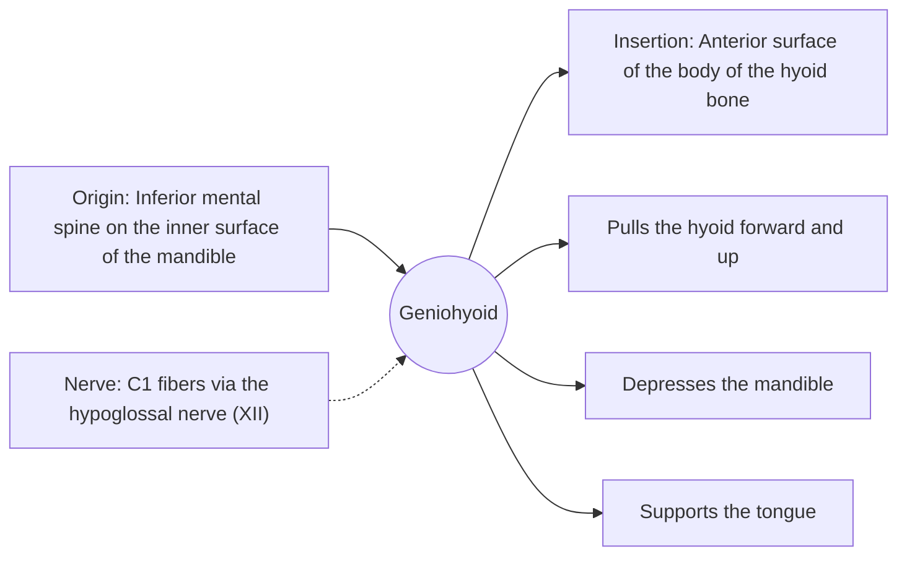

# Geniohyoid

## Summary

The geniohyoid is a narrow suprahyoid muscle above the mylohyoid, running from the chin to the hyoid bone. It pulls the hyoid forward and up, which widens the throat during swallowing, and depresses the mandible.

## Prerequisites

- [Muscular system overview](../muscular-system-overview.md)
- [Neck](../../regions/neck.md)

## Core concepts

### Definition

The *geniohyoid* ("chin-hyoid") is a short, narrow muscle lying next to its partner in the midline, above the mylohyoid and below the genioglossus.

### Analogy

The geniohyoid is like a short tow rope from the chin pulling the hyoid forward. Moving the hyoid forward opens the passage behind the tongue. The analogy breaks because the rope can also pull the chin down when the hyoid is anchored.

### Mechanism

Forward movement of the hyoid during swallowing widens the pharynx and helps open the upper esophageal sphincter. It also helps keep the airway open during sleep.

The diagram shows the attachments, the nerve and the actions.

### Attachments and innervation

| Feature | Description |
| --- | --- |
| Latin name | *musculus geniohyoideus* |
| Origin | Inferior mental spine on the inner surface of the mandible |
| Insertion | Anterior surface of the body of the hyoid bone |
| Innervation | C1 fibers via the hypoglossal nerve (XII) |
| Actions | Pulls the hyoid forward and up; Depresses the mandible; Supports the tongue |

## Worked example

Studies of swallowing after stroke focus on hyoid movement; reduced forward movement, partly from weak geniohyoid action, is linked to food entering the airway (aspiration). Swallowing therapy includes exercises such as head lifts to strengthen the suprahyoid muscles.

## Trade offs and when to use it

Small but important for safe swallowing.

## Common mistakes

- **Confusing geniohyoid with genioglossus.** The genioglossus is a tongue muscle above it.

## Practice

1. In which direction does the geniohyoid pull the hyoid?
2. Which nerve fibers supply it?

### Answers

1. Forward and up.
2. C1 fibers carried by the hypoglossal nerve.

## Further reading

- Standring, S. (Ed.) (2020). *Gray's Anatomy: The Anatomical Basis of Clinical Practice (42nd ed.)*. Elsevier. Reference text for attachments, innervation and relations.
- Betts, J. G., Young, K. A., Wise, J. A. et al. (2022). *Anatomy and Physiology 2e*. OpenStax, Rice University. [Link](https://openstax.org/details/books/anatomy-and-physiology-2e). Open textbook with illustrations of the skeletal and muscular systems.
