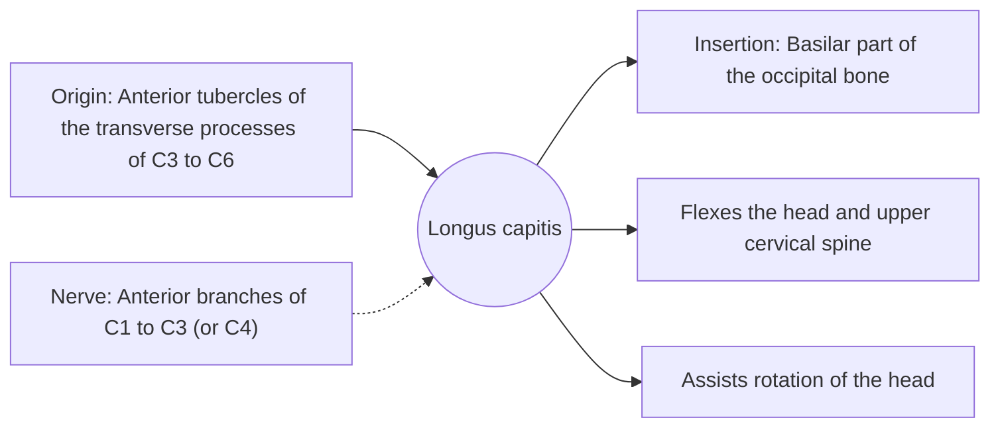

# Longus capitis

## Summary

The longus capitis is the most superficial of the prevertebral muscles. It runs from the cervical vertebrae C3 to C6 to the base of the skull and flexes the head and upper neck.

## Prerequisites

- [Muscular system overview](../muscular-system-overview.md)
- [Neck](../../regions/neck.md)

## Core concepts

### Definition

The *longus capitis* begins on the anterior tubercles of the transverse processes of C3 to C6 and ends on the basilar part of the occipital bone, just in front of the rectus capitis anterior.

### Analogy

The longus capitis is like the front cable of a crane jib, pulling the head forward and down on the neck. The analogy breaks because it acts mostly in fine control, not as a power cable.

### Mechanism

With the longus colli it forms the deep cervical flexors, which keep the cervical lordosis from collapsing into a forward head posture and stabilize the neck during movement.

The diagram shows the attachments, the nerve and the actions.

### Attachments and innervation

| Feature | Description |
| --- | --- |
| Latin name | *musculus longus capitis* |
| Origin | Anterior tubercles of the transverse processes of C3 to C6 |
| Insertion | Basilar part of the occipital bone |
| Innervation | Anterior branches of C1 to C3 (or C4) |
| Actions | Flexes the head and upper cervical spine; Assists rotation of the head |

## Worked example

In people with chronic neck pain, the deep cervical flexors often show reduced endurance. The cranio-cervical flexion test uses a pressure cuff behind the neck to measure how well a person can activate them with a gentle nod.

## Trade offs and when to use it

Important stabilizer whose weakness is linked to neck pain.

## Common mistakes

- **Training only the SCM for neck flexion.** The deep flexors need gentle, controlled nods.

## Practice

1. Where does the longus capitis insert?
2. Which test assesses the deep neck flexors?

### Answers

1. On the basilar part of the occipital bone.
2. The cranio-cervical flexion test.

## Further reading

- Standring, S. (Ed.) (2020). *Gray's Anatomy: The Anatomical Basis of Clinical Practice (42nd ed.)*. Elsevier. Reference text for attachments, innervation and relations.
- Betts, J. G., Young, K. A., Wise, J. A. et al. (2022). *Anatomy and Physiology 2e*. OpenStax, Rice University. [Link](https://openstax.org/details/books/anatomy-and-physiology-2e). Open textbook with illustrations of the skeletal and muscular systems.
