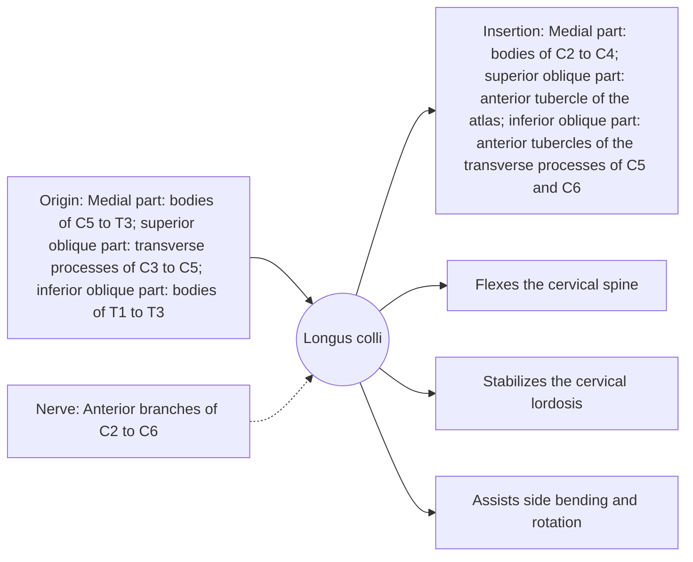

# Longus colli

## Summary

The longus colli is a deep prevertebral muscle lying directly on the front of the cervical and upper thoracic vertebrae. It has three parts and flexes the neck, stabilizes the cervical spine and supports its lordosis.

## Prerequisites

- [Muscular system overview](../muscular-system-overview.md)
- [Neck](../../regions/neck.md)

## Core concepts

### Definition

The *longus colli* consists of three parts: a medial (vertical) part, a superior oblique part and an inferior oblique part, spanning from T3 to C1.

### Analogy

The longus colli is like a set of short ties running along the front of a column of stacked blocks, holding them in a gentle curve and preventing them from bending backward too far. The analogy breaks because the ties also adjust the curve during movement.

### Mechanism

Together with the longus capitis, it counteracts the extension pull of the neck extensors and the forward pull of gravity on the head. Its endurance is often reduced after whiplash injuries.

The diagram shows the attachments, the nerve and the actions.

### Attachments and innervation

| Feature | Description |
| --- | --- |
| Latin name | *musculus longus colli* |
| Origin | Medial part: bodies of C5 to T3; superior oblique part: transverse processes of C3 to C5; inferior oblique part: bodies of T1 to T3 |
| Insertion | Medial part: bodies of C2 to C4; superior oblique part: anterior tubercle of the atlas; inferior oblique part: anterior tubercles of the transverse processes of C5 and C6 |
| Innervation | Anterior branches of C2 to C6 |
| Actions | Flexes the cervical spine; Stabilizes the cervical lordosis; Assists side bending and rotation |

## Worked example

After a whiplash injury in a car accident, the longus colli can be strained as the neck is thrown into extension. Retraining the deep neck flexors with low-load exercises is part of rehabilitation.

## Trade offs and when to use it

A key deep stabilizer of the neck; poor endurance is common in neck pain.

## Common mistakes

- **Thinking the longus colli moves the head.** It acts on the cervical spine; the longus capitis reaches the skull.

## Practice

1. Name the three parts of the longus colli.
2. Which injury often affects the longus colli?

### Answers

1. Medial (vertical), superior oblique and inferior oblique parts.
2. Whiplash.

## Further reading

- Standring, S. (Ed.) (2020). *Gray's Anatomy: The Anatomical Basis of Clinical Practice (42nd ed.)*. Elsevier. Reference text for attachments, innervation and relations.
- Betts, J. G., Young, K. A., Wise, J. A. et al. (2022). *Anatomy and Physiology 2e*. OpenStax, Rice University. [Link](https://openstax.org/details/books/anatomy-and-physiology-2e). Open textbook with illustrations of the skeletal and muscular systems.
