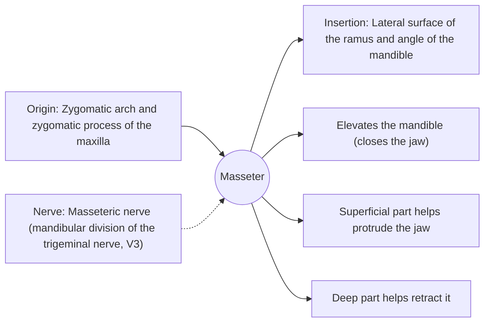

# Masseter

## Summary

The masseter is the thick, rectangular chewing muscle on the side of the jaw. It is one of the strongest muscles of the body relative to its size and closes the jaw with great force. It can be felt bulging when the teeth are clenched.

## Prerequisites

- [Muscular system overview](../muscular-system-overview.md)

## Core concepts

### Definition

The *masseter* is a muscle of mastication with a superficial and a deep part, running from the zygomatic arch to the outer surface of the ramus and angle of the mandible.

### Analogy

The masseter is like the short handle side of a nutcracker, close to the hinge, where a muscle can produce very high closing force on the teeth. The analogy breaks because the jaw hinge also glides forward.

### Mechanism

With the temporalis and medial pterygoid it forms the jaw-closing group. Bite forces at the molars typically reach several hundred newtons in adults. The muscle hypertrophies in people who clench or grind their teeth (bruxism), which can widen the lower face.

The diagram shows the attachments, the nerve and the actions.

### Attachments and innervation

| Feature | Description |
| --- | --- |
| Latin name | *musculus masseter* |
| Origin | Zygomatic arch and zygomatic process of the maxilla |
| Insertion | Lateral surface of the ramus and angle of the mandible |
| Innervation | Masseteric nerve (mandibular division of the trigeminal nerve, V3) |
| Actions | Elevates the mandible (closes the jaw); Superficial part helps protrude the jaw; Deep part helps retract it |

## Worked example

Clenching the teeth makes the masseter bulge at the angle of the jaw, which is the standard way to palpate it. In bruxism, chronic clenching, often at night, causes morning jaw pain and tooth wear; a night guard protects the teeth.

## Trade offs and when to use it

Strong closing force is useful for chewing but transmits large loads to the teeth and the temporomandibular joint.

## Common mistakes

- **Thinking the masseter opens the jaw.** It closes it; the lateral pterygoid and suprahyoid muscles open it.

## Practice

1. Which nerve supplies the masseter?
2. Name two other jaw-closing muscles.

### Answers

1. The masseteric nerve from the mandibular division of the trigeminal nerve.
2. Temporalis and medial pterygoid.

## Further reading

- Standring, S. (Ed.) (2020). *Gray's Anatomy: The Anatomical Basis of Clinical Practice (42nd ed.)*. Elsevier. Reference text for attachments, innervation and relations.
- Betts, J. G., Young, K. A., Wise, J. A. et al. (2022). *Anatomy and Physiology 2e*. OpenStax, Rice University. [Link](https://openstax.org/details/books/anatomy-and-physiology-2e). Open textbook with illustrations of the skeletal and muscular systems.
