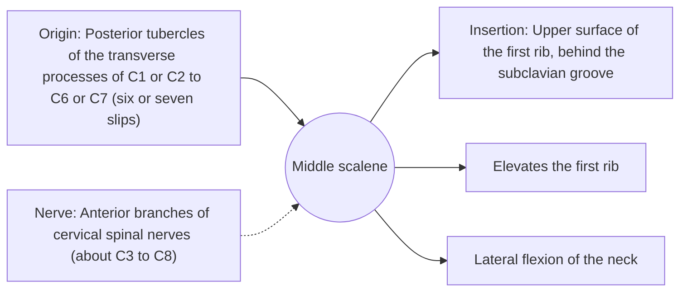

# Middle scalene

## Summary

The middle scalene is the largest and longest of the scalenes. It runs from the transverse processes of the upper six cervical vertebrae to the first rib, behind the anterior scalene. It bends the neck to the side and lifts the first rib.

## Prerequisites

- [Muscular system overview](../muscular-system-overview.md)
- [Neck](../../regions/neck.md)

## Core concepts

### Definition

The *middle scalene* begins with six or seven slips on the transverse processes of C1 (or C2) to C6 (C7) and inserts on the first rib, like the anterior scalene but behind the groove for the subclavian artery.

### Analogy

The middle scalene is the strongest of the guy wires on the side of the neck. The analogy breaks because nerves (the long thoracic and dorsal scapular nerves) pierce through it.

### Mechanism

It forms the back wall of the interscalene gap. The dorsal scapular nerve and the upper roots of the long thoracic nerve often pass through it, so tightness or injury here can affect the rhomboids and serratus anterior.

The diagram shows the attachments, the nerve and the actions.

### Attachments and innervation

| Feature | Description |
| --- | --- |
| Latin name | *musculus scalenus medius* |
| Origin | Posterior tubercles of the transverse processes of C1 or C2 to C6 or C7 (six or seven slips) |
| Insertion | Upper surface of the first rib, behind the subclavian groove |
| Innervation | Anterior branches of cervical spinal nerves (about C3 to C8) |
| Actions | Elevates the first rib; Lateral flexion of the neck |

## Worked example

In people with chronic obstructive pulmonary disease, the scalenes, including the middle scalene, become visibly active even at rest because they help lift the rib cage when the diaphragm is flattened.

## Trade offs and when to use it

Supports breathing and neck posture; its relation to nerves links neck problems with shoulder blade control.

## Common mistakes

- **Assuming the middle scalene attaches to the second rib.** The posterior scalene goes to the second rib.

## Practice

1. How many slips does the middle scalene usually have?
2. Which nerves often pierce the middle scalene?

### Answers

1. Six or seven.
2. The dorsal scapular nerve and the long thoracic nerve roots.

## Further reading

- Standring, S. (Ed.) (2020). *Gray's Anatomy: The Anatomical Basis of Clinical Practice (42nd ed.)*. Elsevier. Reference text for attachments, innervation and relations.
- Betts, J. G., Young, K. A., Wise, J. A. et al. (2022). *Anatomy and Physiology 2e*. OpenStax, Rice University. [Link](https://openstax.org/details/books/anatomy-and-physiology-2e). Open textbook with illustrations of the skeletal and muscular systems.
