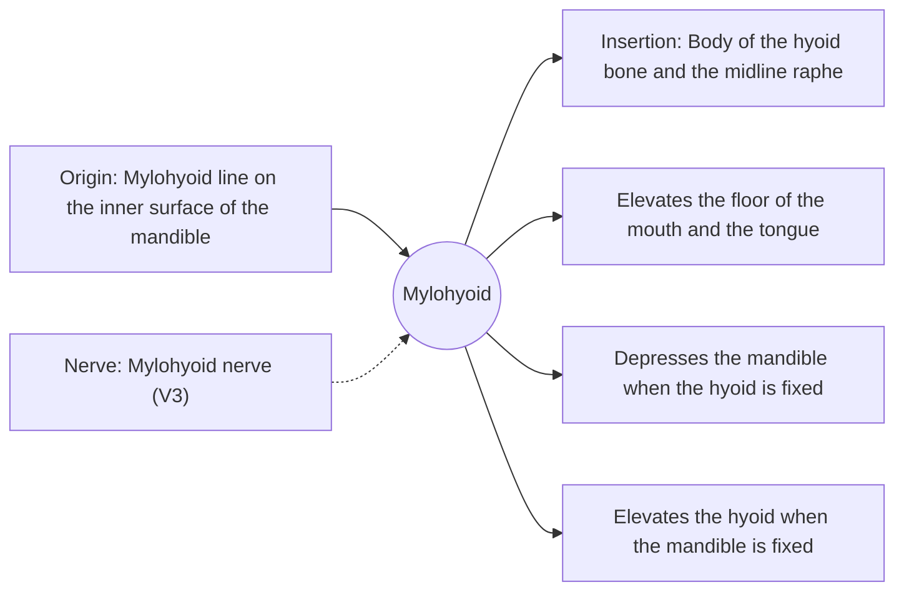

# Mylohyoid

## Summary

The mylohyoid forms the muscular floor of the mouth. It runs from the inner surface of the mandible to the hyoid bone and a midline seam. It lifts the floor of the mouth and the tongue, depresses the mandible and tenses the floor of the mouth during swallowing.

## Prerequisites

- [Muscular system overview](../muscular-system-overview.md)
- [Neck](../../regions/neck.md)

## Core concepts

### Definition

The *mylohyoid* is a flat, sheet-like suprahyoid muscle. The two sides meet at a midline raphe and form a hammock (the oral diaphragm).

### Analogy

The mylohyoid is like a hammock slung between the two sides of the lower jaw. Tightening it raises whatever lies in it, the tongue, pushing food up against the palate. The analogy breaks because the hammock is anchored at the back to a movable bone (the hyoid).

### Mechanism

In the first phase of swallowing, the mylohyoid tenses and lifts the floor of the mouth, pressing the tongue against the palate to push the food bolus back.

The diagram shows the attachments, the nerve and the actions.

### Attachments and innervation

| Feature | Description |
| --- | --- |
| Latin name | *musculus mylohyoideus* |
| Origin | Mylohyoid line on the inner surface of the mandible |
| Insertion | Body of the hyoid bone and the midline raphe |
| Innervation | Mylohyoid nerve (V3) |
| Actions | Elevates the floor of the mouth and the tongue; Depresses the mandible when the hyoid is fixed; Elevates the hyoid when the mandible is fixed |

## Worked example

Infections from lower molar roots can spread below the mylohyoid into the neck (Ludwig angina), causing swelling under the jaw that can threaten the airway. Whether an infection spreads above or below the muscle depends on whether the tooth root ends above or below the mylohyoid line.

## Trade offs and when to use it

A thin sheet with a key role in swallowing and in separating spaces of the neck.

## Common mistakes

- **Calling the mylohyoid a muscle of the tongue.** It is a suprahyoid muscle forming the floor of the mouth.

## Practice

1. What does the mylohyoid form?
2. Which nerve supplies it?

### Answers

1. The muscular floor of the mouth.
2. The mylohyoid nerve, from the mandibular division of the trigeminal nerve.

## Further reading

- Standring, S. (Ed.) (2020). *Gray's Anatomy: The Anatomical Basis of Clinical Practice (42nd ed.)*. Elsevier. Reference text for attachments, innervation and relations.
- Betts, J. G., Young, K. A., Wise, J. A. et al. (2022). *Anatomy and Physiology 2e*. OpenStax, Rice University. [Link](https://openstax.org/details/books/anatomy-and-physiology-2e). Open textbook with illustrations of the skeletal and muscular systems.
