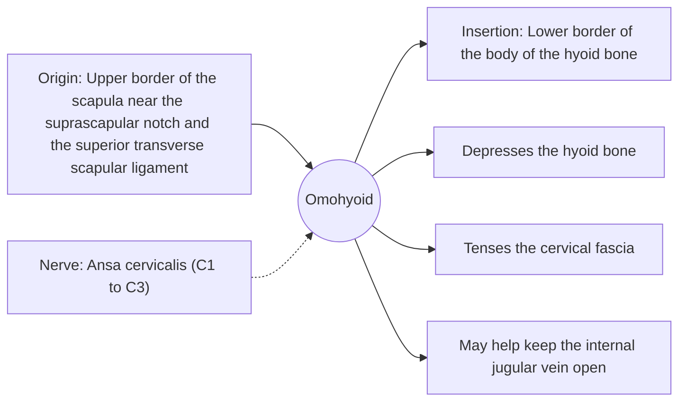

# Omohyoid

## Summary

The omohyoid is a long, thin infrahyoid muscle with two bellies joined by an intermediate tendon. It runs from the shoulder blade to the hyoid bone. Besides pulling the hyoid down, it tenses the deep neck fascia and is thought to keep the internal jugular vein open.

## Prerequisites

- [Muscular system overview](../muscular-system-overview.md)
- [Neck](../../regions/neck.md)

## Core concepts

### Definition

The *omohyoid* ("shoulder-hyoid") is a long, flat muscle with an inferior and a superior belly. A fascial sling holds the intermediate tendon to the clavicle, so the muscle bends at an angle.

### Analogy

The omohyoid is like a rope passed through a pulley: from the shoulder blade it runs forward, turns at a sling near the clavicle, and then runs up to the hyoid. The analogy breaks because the sling is soft fascia, not a fixed pulley.

### Mechanism

The intermediate tendon lies over the internal jugular vein. By tensing the fascia around the carotid sheath, the muscle is thought to widen the lumen of the internal jugular vein during deep inspiration, which aids venous return. The superior belly crosses the carotid sheath, a landmark in neck surgery.

The diagram shows the attachments, the nerve and the actions.

### Attachments and innervation

| Feature | Description |
| --- | --- |
| Latin name | *musculus omohyoideus* |
| Origin | Upper border of the scapula near the suprascapular notch and the superior transverse scapular ligament |
| Insertion | Lower border of the body of the hyoid bone |
| Innervation | Ansa cervicalis (C1 to C3) |
| Actions | Depresses the hyoid bone; Tenses the cervical fascia; May help keep the internal jugular vein open |

## Worked example

When a person takes a deep breath and swallows, the omohyoid can sometimes be seen in thin necks as a slanting cord in the lower lateral neck, dividing the lateral triangle into smaller triangles used by surgeons as landmarks.

## Trade offs and when to use it

A small muscle with a structural role in fascia tension rather than force production.

## Common mistakes

- **Placing the omohyoid origin on the coracoid process.** It arises from the upper border of the scapula near the suprascapular notch, at the base of the coracoid process.

## Practice

1. What connects the two bellies of the omohyoid?
2. Which vein may the omohyoid help keep open?

### Answers

1. An intermediate tendon held by a fascial sling to the clavicle.
2. The internal jugular vein.

## Further reading

- Standring, S. (Ed.) (2020). *Gray's Anatomy: The Anatomical Basis of Clinical Practice (42nd ed.)*. Elsevier. Reference text for attachments, innervation and relations.
- Betts, J. G., Young, K. A., Wise, J. A. et al. (2022). *Anatomy and Physiology 2e*. OpenStax, Rice University. [Link](https://openstax.org/details/books/anatomy-and-physiology-2e). Open textbook with illustrations of the skeletal and muscular systems.
