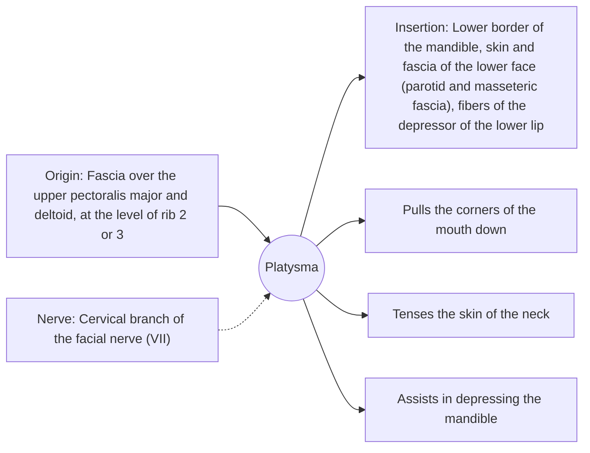

# Platysma

## Summary

The platysma is a broad, thin, flat muscle lying just under the skin of the neck. It pulls the corners of the mouth down and tenses the skin of the neck, giving the face a threatening, frightened or angry expression. It is a muscle of facial expression, supplied by the facial nerve.

## Prerequisites

- [Muscular system overview](../muscular-system-overview.md)
- [Neck](../../regions/neck.md)

## Core concepts

### Definition

The *platysma* is a superficial neck muscle, a thin sheet within the subcutaneous tissue, extending from the upper chest to the lower face.

### Analogy

The platysma is like a thin elastic sheet glued under the skin of the neck. Pulling it tightens the skin and drags the mouth down, as when grimacing. The analogy breaks because the sheet loses tone with age and forms vertical bands in the neck.

### Mechanism

As a muscle of facial expression, it attaches to skin rather than moving bones. It is active in grimacing, in sudden effort and in expressions of fear or anger.

The diagram shows the attachments, the nerve and the actions.

### Attachments and innervation

| Feature | Description |
| --- | --- |
| Latin name | *platysma* |
| Origin | Fascia over the upper pectoralis major and deltoid, at the level of rib 2 or 3 |
| Insertion | Lower border of the mandible, skin and fascia of the lower face (parotid and masseteric fascia), fibers of the depressor of the lower lip |
| Innervation | Cervical branch of the facial nerve (VII) |
| Actions | Pulls the corners of the mouth down; Tenses the skin of the neck; Assists in depressing the mandible |

## Worked example

Grimacing by pulling the corners of the mouth down and clenching the teeth makes the platysma stand out as sheets of muscle on the front of the neck. Age-related "platysmal bands" are a cosmetic concern treated with botulinum toxin or surgery.

## Trade offs and when to use it

Expressive but weak; it has no role in moving the head.

## Common mistakes

- **Thinking the platysma is supplied by a cervical spinal nerve.** It is supplied by the facial nerve, like other muscles of facial expression.

## Practice

1. Which nerve supplies the platysma?
2. What expression does the platysma produce?

### Answers

1. The cervical branch of the facial nerve.
2. Pulling the mouth corners down, as in fright or anger, and tensing the neck skin.

## Further reading

- Standring, S. (Ed.) (2020). *Gray's Anatomy: The Anatomical Basis of Clinical Practice (42nd ed.)*. Elsevier. Reference text for attachments, innervation and relations.
- Betts, J. G., Young, K. A., Wise, J. A. et al. (2022). *Anatomy and Physiology 2e*. OpenStax, Rice University. [Link](https://openstax.org/details/books/anatomy-and-physiology-2e). Open textbook with illustrations of the skeletal and muscular systems.
