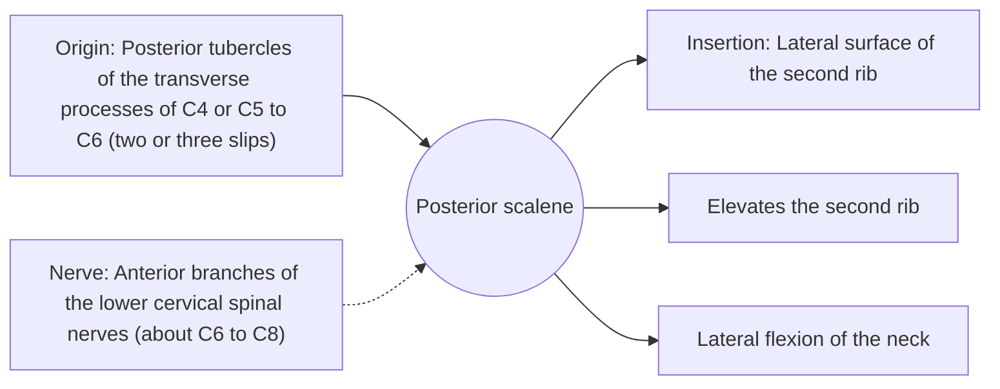

# Posterior scalene

## Summary

The posterior scalene is the smallest and deepest scalene. It runs from the lower cervical vertebrae to the outer surface of the second rib. It lifts the second rib and bends the neck to the side.

## Prerequisites

- [Muscular system overview](../muscular-system-overview.md)
- [Neck](../../regions/neck.md)

## Core concepts

### Definition

The *posterior scalene* begins with two or three slips on the transverse processes of C4 or C5 to C6 and inserts on the lateral surface of the second rib.

### Analogy

The posterior scalene is the back guy wire, reaching one rib lower than the others. The analogy breaks because in many people it is partly fused with the middle scalene.

### Mechanism

It works with the other scalenes in deep breathing and in stabilizing the neck in the frontal plane.

The diagram shows the attachments, the nerve and the actions.

### Attachments and innervation

| Feature | Description |
| --- | --- |
| Latin name | *musculus scalenus posterior* |
| Origin | Posterior tubercles of the transverse processes of C4 or C5 to C6 (two or three slips) |
| Insertion | Lateral surface of the second rib |
| Innervation | Anterior branches of the lower cervical spinal nerves (about C6 to C8) |
| Actions | Elevates the second rib; Lateral flexion of the neck |

## Worked example

Stretching the scalenes involves tilting the head away from the side being stretched while keeping the shoulder down; adding slight rotation and extension emphasizes the anterior and posterior parts.

## Trade offs and when to use it

Small, with a role mainly in breathing and side bending.

## Common mistakes

- **Saying all three scalenes insert on the first rib.** The posterior scalene inserts on the second rib.

## Practice

1. Where does the posterior scalene insert?
2. Which scalene is the smallest?

### Answers

1. On the lateral surface of the second rib.
2. The posterior scalene.

## Further reading

- Standring, S. (Ed.) (2020). *Gray's Anatomy: The Anatomical Basis of Clinical Practice (42nd ed.)*. Elsevier. Reference text for attachments, innervation and relations.
- Betts, J. G., Young, K. A., Wise, J. A. et al. (2022). *Anatomy and Physiology 2e*. OpenStax, Rice University. [Link](https://openstax.org/details/books/anatomy-and-physiology-2e). Open textbook with illustrations of the skeletal and muscular systems.
